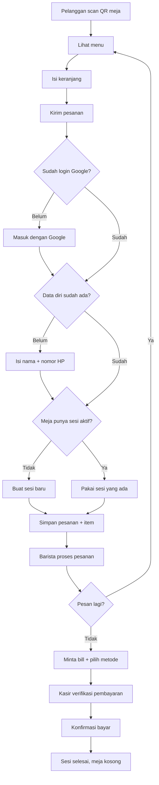
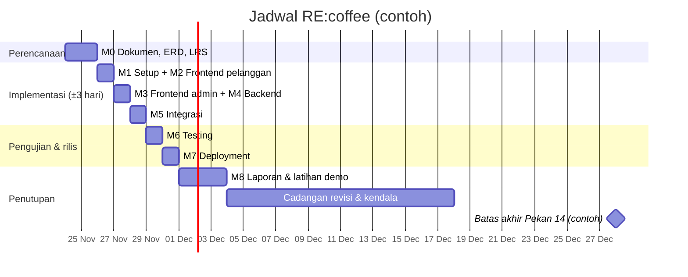

# RE:coffee — Product Requirements Document (PRD)

> Sistem pemesanan kopi berbasis meja (open bill) untuk proyek UAS Manajemen Proyek Perangkat Lunak (MPPL).
> Dokumen ini adalah **satu-satunya sumber kebenaran** untuk scope, desain, arsitektur, dan urutan pengerjaan.
> AI agent dan pelaksana proyek wajib membaca bagian **0. Aturan Kerja** sebelum menyentuh kode.

| Item | Nilai |
|---|---|
| Nama produk | RE:coffee (kafe fiktif) |
| Jenis | Web app (mobile-first untuk pelanggan, desktop-first untuk admin) |
| Mata kuliah | Manajemen Proyek Perangkat Lunak (MPPL), Projek UAS |
| Deadline | Pekan 14, akhir Desember 2026 (semua deliverable) — tanggal pasti: `[ISI TANGGAL]` |
| Jenis proyek | **Individu** |
| Pelaksana | **Khairunisa Yulia Cahyani** (NIM 241011701074) — merangkap Project Manager, Developer, dan QA |
| Versi dokumen | 1.2 — 21 November 2026 (revisi: pelanggan login Google + data diri, entitas PELANGGAN, data pelaksana, QRIS, rencana Supabase) |

---

## Daftar Isi

0. Aturan Kerja (wajib dibaca AI agent)
1. Overview Produk
2. Latar Belakang, Masalah, dan Tujuan
3. Ruang Lingkup (In-Scope dan Out-of-Scope)
4. Aktor dan Hak Akses
5. Alur Bisnis Utama (Open Bill per Meja)
6. Kebutuhan Fungsional
7. Kebutuhan Non-Fungsional
8. Analisis Data (Kebutuhan Data)
9. Use Case
10. ERD dan LRS
11. Tech Stack dan Alasannya
12. Arsitektur Sistem
13. Desain Database (DDL, RLS, Function)
14. Kontrak Data dan Error Handling (Frontend)
15. Design System RE:coffee
16. Spesifikasi Halaman (Screen by Screen)
17. Struktur Folder Project
18. Milestone Pengerjaan (M0 sampai M8)
19. Strategi dan Metode Pengujian
20. Deployment
21. Estimasi Pengerjaan dan Jadwal
22. Estimasi Biaya
23. Manajemen Risiko
24. Deliverable MPPL (Checklist)
25. Skenario Demo ke Dosen
26. Pengembangan Lanjutan (bahan KP)
27. Glosarium

---

## 0. Aturan Kerja (wajib dibaca AI agent)

Proyek ini **sengaja kecil**. Kualitas datang dari eksekusi yang rapi, bukan dari jumlah fitur.

1. **Kerjakan satu milestone per sesi.** Jangan loncat ke milestone berikutnya sebelum acceptance criteria milestone saat ini terpenuhi dan dicentang di `docs/PROGRESS.md`.
2. **Dilarang menambah fitur di luar bagian 3 (In-Scope).** Kalau menurutmu ada fitur penting yang kurang, tulis usulan di `docs/PROGRESS.md` bagian "Usulan", jangan langsung dikerjakan.
3. **Dilarang menambah library di luar daftar bagian 11** tanpa persetujuan. Tidak boleh ada UI kit (shadcn, MUI, Chakra, DaisyUI, dll.), tidak boleh ada state manager global (Redux, Zustand), tidak boleh Next.js.
4. **Dilarang membuat atau memakai gambar hasil AI generator.** Semua visual adalah SVG yang ditulis tangan (kode) atau ikon open-source berlisensi MIT (Phosphor Icons).
5. **TypeScript strict.** Tidak boleh `any`, tidak boleh `@ts-ignore`. Kalau tipe sulit, pakai `unknown` lalu narrow.
6. **Harga selalu integer Rupiah.** Tidak ada float untuk uang. Format tampilan hanya lewat `formatRupiah()`.
7. **Harga tidak pernah dikirim dari frontend.** Frontend hanya mengirim `menu_id` dan `qty`; harga diambil database.
8. **Kunci rahasia tidak boleh masuk repo.** Hanya `VITE_SUPABASE_URL` dan `VITE_SUPABASE_ANON_KEY` (publishable) yang boleh di frontend. `service_role` key **tidak pernah** dipakai di project ini.
9. **Setiap selesai milestone:** update `docs/PROGRESS.md` (apa yang selesai, keputusan, catatan), lalu commit dengan format Conventional Commits, contoh: `feat(menu): tampilkan papan menu dari data mock`.
10. **Kalau ragu, tanya.** Lebih baik satu pertanyaan daripada 300 baris kode yang salah arah.
11. Bahasa UI: **Bahasa Indonesia, sentence case**. Nama variabel/fungsi kode: Bahasa Inggris, kecuali nama tabel/kolom database yang mengikuti dokumen ini (Bahasa Indonesia).

---

## 1. Overview Produk

**RE:coffee** adalah web app pemesanan untuk sebuah coffee shop dengan **28 meja**. Pelanggan duduk, scan QR code yang ditempel di meja, lalu memesan langsung dari HP **tanpa install aplikasi**. Menu bisa dilihat siapa saja, tetapi untuk **mengirim pesanan** pelanggan wajib **masuk dengan akun Google** dan **mengisi nama serta nomor HP** sekali di awal. Tujuannya mencegah pesanan iseng (troll): setiap pesanan tercatat atas nama orang yang jelas. Selama masih duduk, pelanggan bisa memesan berkali-kali; semua pesanan masuk ke **satu tagihan meja (open bill)**. Saat selesai, pelanggan menekan **Minta bill** dan memilih metode bayar: **QRIS** atau **bayar di kasir**. Kasir mengonfirmasi pembayaran, sesi meja ditutup, dan meja otomatis kembali **kosong**.

Di sisi lain, **admin/kasir** login dengan **akun Google** untuk:
- memantau 28 meja secara visual (kosong, terisi, minta bill),
- melihat antrian pesanan untuk barista dan mengubah statusnya,
- mengonfirmasi pembayaran dan menutup meja,
- mengelola menu (tambah, ubah, tandai habis, arsipkan).

Satu kalimat untuk dosen:
> "RE:coffee memindahkan proses pesan dan tagih dari kertas ke sistem: pelanggan pesan dari mejanya, barista melihat antrian, kasir melihat tagihan setiap meja, dan status meja selalu sinkron dengan data transaksi."

---

## 2. Latar Belakang, Masalah, dan Tujuan

### 2.1 Latar belakang
Di coffee shop skala kecil-menengah, proses pemesanan umumnya masih manual: pelanggan antre di kasir, pesanan tambahan dicatat di kertas, dan tagihan per meja dihitung ulang saat pelanggan mau pulang. Ketika ramai, proses ini rawan salah catat, salah hitung, dan pelanggan menunggu lama.

### 2.2 Masalah yang diselesaikan
| # | Masalah | Dampak |
|---|---|---|
| P1 | Pelanggan harus antre ke kasir setiap kali menambah pesanan | Waktu tunggu lama, antrean menumpuk |
| P2 | Pesanan tambahan dicatat manual | Pesanan terlewat atau salah meja |
| P3 | Tagihan per meja dihitung manual di akhir | Salah hitung, selisih kas |
| P4 | Kasir tidak tahu meja mana yang kosong atau belum bayar | Meja tidak terkelola, potensi pelanggan pergi tanpa bayar |

### 2.3 Tujuan proyek (SMART)
1. Pelanggan dapat memesan dari meja melalui browser HP dengan alur ≤ 4 langkah setelah login pertama (scan, pilih menu, review, kirim); login Google + isi data diri hanya dilakukan sekali per perangkat.
2. Seluruh pesanan dalam satu kunjungan tercatat dalam satu sesi meja dengan total tagihan terhitung otomatis oleh database.
3. Admin dapat melihat status ke-28 meja dalam satu layar, diperbarui otomatis maksimal setiap 5 detik.
4. Sistem selesai, teruji (black box), dan ter-deploy di Vercel sebelum Pekan 14.

### 2.4 Indikator keberhasilan
- 100% skenario uji black box prioritas tinggi lulus.
- Demo end-to-end (pesan → minta bill → konfirmasi → meja kosong) berjalan tanpa error di URL produksi.
- Dokumen MPPL lengkap sesuai checklist bagian 24.

---

## 3. Ruang Lingkup

### 3.1 In-Scope (yang dikerjakan)
**Pelanggan (login Google untuk memesan)**
- Membuka halaman meja lewat QR (`/meja/:nomor`, nomor 1–28).
- Melihat menu per kategori, termasuk penanda menu habis (tanpa login).
- Masuk dengan Google, lalu mengisi **nama** dan **nomor HP** sekali (data diri pelanggan); bisa diubah dan bisa keluar (logout).
- Keranjang: tambah, kurangi, hapus item, catatan pesanan (opsional, maks 140 karakter).
- Mengirim pesanan (berulang kali selama sesi aktif).
- Melihat tagihan meja: daftar pesanan, status tiap pesanan, total.
- Minta bill dengan memilih metode: QRIS atau bayar di kasir.
- Melihat gambar QRIS statis bila memilih QRIS.

**Admin/Kasir (login Google, email terdaftar)**
- Login dan logout dengan Google.
- Denah 28 meja dengan status: kosong, terisi, minta bill.
- Detail meja: daftar pesanan, total, metode bayar, tombol **Konfirmasi bayar**, tombol **Batalkan sesi**.
- Antrian pesanan: status `baru → diproses → diantar`.
- Kelola menu: tambah, ubah, tandai habis/tersedia, arsipkan.
- Ringkasan kecil di dashboard: jumlah meja terisi, meja minta bill, pesanan belum diantar (hanya `COUNT`, bukan laporan omzet).

**Teknis**
- Database relasional PostgreSQL (Supabase) dengan RLS.
- Logika kritis di database function (buat pesanan, minta bill, konfirmasi bayar).
- Deploy ke Vercel.
- QR code 28 meja (file SVG siap cetak).

### 3.2 Out-of-Scope (tidak dikerjakan, ditulis di laporan sebagai batasan)
| Fitur | Alasan |
|---|---|
| Payment gateway QRIS dinamis + webhook | Butuh akun merchant, biaya, dan risiko keamanan; QRIS statis + konfirmasi manual cukup untuk validasi alur |
| Login selain Google (email/password, nomor HP) | Google cukup; satu provider mengurangi pekerjaan dan risiko |
| Verifikasi nomor HP (OTP SMS/WhatsApp) | Butuh layanan berbayar; nomor HP cukup divalidasi formatnya |
| Takeaway / delivery | Fokus dine-in berbasis meja |
| Split bill per orang | Satu meja satu tagihan |
| Laporan omzet, grafik penjualan, export PDF/Excel | Di luar kebutuhan inti; jadi pengembangan lanjutan |
| Manajemen stok bahan baku | Kompleksitas tinggi |
| Voucher, promo, loyalty, member | Di luar kebutuhan inti |
| Multi-cabang, multi-role (owner/kasir/barista terpisah) | Satu role admin cukup |
| Notifikasi push / WhatsApp | Polling cukup |
| Realtime websocket | Polling 5 detik cukup; Supabase Realtime menjadi opsi lanjutan |
| Pencegahan pesanan dari luar kafe (geofencing, PIN meja) | Login Google + data diri sudah menekan pesanan iseng; sisanya mitigasi operasional |

### 3.3 Asumsi
- Satu meja = satu tagihan, siapa pun yang scan QR meja tersebut masuk ke tagihan yang sama.
- Pelanggan memiliki HP dengan kamera, koneksi internet, dan akun Google.
- QRIS yang dipakai adalah QRIS statis (gambar). Untuk keperluan tugas, dipakai **QRIS milik pelaksana** sebagai simulasi QRIS kafe; saat di-scan, nama merchant yang muncul adalah nama pelaksana. Verifikasi pembayaran dilakukan kasir lewat aplikasi bank/e-wallet.
- Admin memiliki akun Google.

### 3.4 Batasan
- Free tier Vercel (Hobby) dan Supabase (Free) dengan batas kuota masing-masing.
- Waktu pengerjaan sampai Pekan 14.
- Dikerjakan **individu**: satu orang merangkap Project Manager, Developer, dan QA/Dokumentasi.
- Implementasi dibantu AI coding assistant (Claude Code), sehingga fase coding dipadatkan menjadi ±3 hari; waktu sisanya untuk dokumen, pengujian, dan laporan.

---

## 4. Aktor dan Hak Akses

| Aktor | Autentikasi | Boleh | Tidak boleh |
|---|---|---|---|
| **Pelanggan** | Google OAuth + data diri (nama, nomor HP). Melihat menu tidak perlu login | Lihat menu, kirim pesanan ke meja, lihat tagihan meja aktif, minta bill (hanya bila sudah memesan di sesi tersebut), mengubah data dirinya | Mengubah harga, mengubah status pesanan, menutup sesi, melihat data diri pelanggan lain, mengakses halaman admin |
| **Admin/Kasir** | Google OAuth + email terdaftar di tabel `admin` | Semua fitur admin di bagian 3.1 | Menghapus data transaksi (sesi/pesanan tidak bisa dihapus, hanya dibatalkan) |

Catatan: barista memakai akun admin yang sama (satu role). Pemisahan role adalah pengembangan lanjutan. Pelanggan dan admin sama-sama login dengan Google; yang membedakan adalah **email admin terdaftar di tabel `admin`**. Akun Google biasa otomatis diperlakukan sebagai pelanggan.

---

## 5. Alur Bisnis Utama (Open Bill per Meja)

### 5.1 Narasi
1. Pelanggan duduk di meja 18 dan scan QR. Browser membuka `/meja/18` dan menu langsung tampil.
2. Pelanggan memilih menu, lalu menekan **Kirim pesanan**. Bila belum login, sistem meminta **Masuk dengan Google**; keranjang tetap tersimpan selama proses login.
3. Login pertama kali: pelanggan mengisi **nama** dan **nomor HP**. Login berikutnya langsung lanjut.
4. Pesanan dikirim atas nama pelanggan tersebut.
5. Database memeriksa: apakah meja 18 punya sesi aktif?
   - Belum ada: sesi baru dibuat, meja 18 menjadi **terisi**.
   - Sudah ada: pesanan ditempelkan ke sesi tersebut.
6. Barista melihat pesanan di **Antrian** (beserta nama pemesan), mengubah status menjadi `diproses`, lalu `diantar`.
7. Pelanggan (atau teman satu meja yang juga login) boleh memesan lagi kapan pun selama sesi masih `aktif`. Semua pesanan masuk ke tagihan meja yang sama.
8. Saat selesai, pelanggan yang **sudah memesan di sesi itu** menekan **Minta bill**, memilih QRIS atau bayar di kasir. Sesi menjadi `minta_bill`, meja tampil kuning di denah admin. Pesanan baru diblokir.
9. Kasir memverifikasi pembayaran (cek notifikasi QRIS di aplikasi bank, atau terima uang tunai), lalu menekan **Konfirmasi bayar**.
10. Sesi menjadi `selesai`, total dibekukan (`total_bayar`), meja 18 kembali **kosong**. Data pesanan **tetap tersimpan** sebagai riwayat.

### 5.2 Diagram alur (activity)


### 5.3 State machine
**Sesi meja**
```
            (pesanan pertama)
 [tidak ada] ───────────────▶ aktif ──(minta bill)──▶ minta_bill
                                │                        │
                                │(konfirmasi bayar)      │(konfirmasi bayar)
                                ▼                        ▼
                             selesai ◀──────────────── selesai
   aktif / minta_bill ──(batalkan sesi, admin)──▶ batal
```
- `aktif` dan `minta_bill` = meja **terisi**.
- `selesai` dan `batal` = sesi tertutup, meja **kosong**.
- Konfirmasi bayar boleh dari `aktif` (pelanggan langsung ke kasir tanpa menekan minta bill) atau dari `minta_bill`.
- `batal` dipakai untuk kasus pelanggan pergi tanpa bayar atau salah input saat demo; tercatat siapa dan kapan.

**Pesanan**
```
 baru ──▶ diproses ──▶ diantar
```
Hanya bisa maju satu langkah. UI admin hanya menampilkan tombol langkah berikutnya.

### 5.4 Aturan bisnis
| Kode | Aturan |
|---|---|
| BR-01 | Satu meja hanya boleh punya satu sesi berstatus `aktif` atau `minta_bill` pada satu waktu (dijaga unique index). |
| BR-02 | Sesi dibuat otomatis saat pesanan pertama dikirim, bukan saat QR dibuka (tidak ada sesi kosong). |
| BR-03 | Harga item disalin dari tabel menu saat pesanan dibuat (`harga_satuan`), sehingga perubahan harga tidak mengubah tagihan lama. |
| BR-04 | Qty per item 1–20; maksimal 30 baris item per pesanan. |
| BR-05 | Menu yang `tersedia = false` atau diarsipkan tidak bisa dipesan. |
| BR-06 | Sesi `minta_bill` tidak menerima pesanan baru. |
| BR-07 | Total tagihan dihitung database: Σ(qty × harga_satuan) seluruh item di sesi. |
| BR-08 | Sesi dan pesanan tidak pernah dihapus; penutupan hanya lewat status `selesai` atau `batal`. |
| BR-09 | Menu yang pernah dipesan tidak bisa dihapus permanen, hanya diarsipkan. |
| BR-10 | Hanya admin yang bisa mengonfirmasi bayar, membatalkan sesi, mengubah status pesanan, dan mengelola menu. |
| BR-11 | Mengirim pesanan wajib login Google **dan** memiliki data diri (nama 2–50 karakter, nomor HP Indonesia valid). |
| BR-12 | Setiap pesanan menyimpan siapa pemesannya (`pelanggan_id`). |
| BR-13 | Minta bill hanya bisa dilakukan pelanggan yang memiliki minimal satu pesanan di sesi meja tersebut. |
| BR-14 | Pelanggan hanya bisa melihat dan mengubah data dirinya sendiri; admin bisa melihat data diri semua pelanggan. |

---

## 6. Kebutuhan Fungsional

| ID | Aktor | Kebutuhan | Prioritas |
|---|---|---|---|
| FR-01 | Pelanggan | Membuka halaman meja melalui URL `/meja/:nomor`; nomor di luar 1–28 menampilkan pesan meja tidak ditemukan | Tinggi |
| FR-02 | Pelanggan | Melihat daftar menu dikelompokkan per kategori (Kopi, Non-kopi, Makanan, Camilan) | Tinggi |
| FR-03 | Pelanggan | Menu habis tetap tampil dengan label "Habis" dan tidak bisa ditambahkan | Sedang |
| FR-04 | Pelanggan | Menambah, mengurangi, dan menghapus item di keranjang; keranjang tersimpan di perangkat per meja | Tinggi |
| FR-05 | Pelanggan | Menambahkan catatan pesanan (maks 140 karakter) | Rendah |
| FR-06 | Pelanggan | Mengirim pesanan; sistem membuat atau memakai sesi meja aktif | Tinggi |
| FR-07 | Pelanggan | Melihat tagihan meja: semua pesanan dalam sesi, status, subtotal, total | Tinggi |
| FR-08 | Pelanggan | Minta bill dengan memilih QRIS atau bayar di kasir | Tinggi |
| FR-09 | Pelanggan | Melihat gambar QRIS dan nominal yang harus dibayar bila memilih QRIS | Tinggi |
| FR-10 | Pelanggan | Setelah sesi ditutup kasir, halaman tagihan menampilkan "Terima kasih, pembayaran sudah dikonfirmasi" | Sedang |
| FR-23 | Pelanggan | Masuk dengan Google sebelum mengirim pesanan; keranjang tidak hilang setelah kembali dari halaman login | Tinggi |
| FR-24 | Pelanggan | Mengisi data diri saat login pertama: nama (2–50 karakter) dan nomor HP (format Indonesia); bisa diubah kemudian | Tinggi |
| FR-25 | Pelanggan | Keluar (logout) dari perangkat | Sedang |
| FR-11 | Admin | Login dengan Google; email yang tidak terdaftar sebagai admin ditolak di halaman admin dan otomatis logout | Tinggi |
| FR-12 | Admin | Melihat denah 28 meja dengan status kosong / terisi / minta bill dan total berjalan | Tinggi |
| FR-13 | Admin | Membuka detail meja: pesanan, item, total, metode bayar, serta nama dan nomor HP pemesan tiap pesanan | Tinggi |
| FR-14 | Admin | Konfirmasi bayar (dengan memilih/menimpa metode bayar) → sesi selesai, meja kosong | Tinggi |
| FR-15 | Admin | Batalkan sesi dengan konfirmasi dialog | Sedang |
| FR-16 | Admin | Melihat antrian pesanan berstatus `baru` dan `diproses`, urut dari yang terlama | Tinggi |
| FR-17 | Admin | Memajukan status pesanan satu langkah | Tinggi |
| FR-18 | Admin | Menambah dan mengubah menu (nama, deskripsi, kategori, harga, urutan) | Tinggi |
| FR-19 | Admin | Menandai menu habis/tersedia | Tinggi |
| FR-20 | Admin | Mengarsipkan menu | Sedang |
| FR-21 | Admin | Melihat ringkasan: meja terisi, meja minta bill, pesanan belum diantar | Rendah |
| FR-22 | Sistem | Data denah meja, antrian, dan tagihan diperbarui otomatis (polling) | Tinggi |

---

## 7. Kebutuhan Non-Fungsional

| ID | Kategori | Kebutuhan |
|---|---|---|
| NFR-01 | Performa | Halaman pelanggan siap dipakai < 3 detik di koneksi 4G; bundle JS awal < 250 KB gzip |
| NFR-02 | Responsif | Halaman pelanggan optimal di lebar 360–480 px; admin optimal di ≥ 1024 px dan tetap bisa dipakai di tablet |
| NFR-03 | Keamanan | RLS aktif di semua tabel; operasi tulis pelanggan hanya lewat database function; tidak ada secret di frontend |
| NFR-04 | Keamanan | Admin divalidasi di database (`is_admin()`), bukan hanya di UI |
| NFR-05 | Integritas data | Harga integer, total dihitung server, satu sesi aktif per meja dijamin unique index |
| NFR-06 | Aksesibilitas | Kontras teks minimal WCAG AA (4.5:1), target sentuh ≥ 44 px, fokus keyboard terlihat, status tidak hanya dibedakan warna |
| NFR-07 | Usability | Alur pesan maksimal 4 langkah; semua teks Bahasa Indonesia yang jelas |
| NFR-08 | Ketersediaan | Ter-deploy di Vercel dengan HTTPS |
| NFR-09 | Maintainability | TypeScript strict, struktur per fitur, migrasi SQL versi berurutan, dokumentasi progres per milestone |
| NFR-10 | Portabilitas | Berjalan di Chrome, Safari iOS, dan Firefox versi terbaru |
| NFR-11 | Privasi | Nomor HP pelanggan hanya terlihat oleh pemiliknya dan admin; tidak pernah tampil di halaman tagihan yang dilihat pelanggan lain (yang tampil hanya nama) |

---

## 8. Analisis Data (Kebutuhan Data)

Bagian ini mengisi poin **"data analisis"** pada requirement MPPL: data apa yang dibutuhkan sistem, dari mana asalnya, siapa yang memakai, dan bagaimana data mengalir.

### 8.1 Identifikasi data
| Data | Sumber / Penginput | Pemakai | Sifat | Contoh |
|---|---|---|---|---|
| Meja | Seed awal (28 baris) | Sistem, admin | Master, jarang berubah | Meja 18, kapasitas 4 |
| Menu | Admin | Pelanggan, admin | Master, berubah sesekali | Kopi Susu Gula Aren, Rp22.000 |
| Sesi meja | Sistem (otomatis saat pesanan pertama), ditutup admin | Pelanggan, admin | Transaksi | Sesi meja 18, aktif, dibuka 14.05 |
| Pesanan | Pelanggan | Admin/barista | Transaksi | Pesanan #3 meja 18 oleh Rina, status diproses |
| Item pesanan | Pelanggan (menu + qty), harga dari sistem | Admin, perhitungan total | Transaksi (detail) | 2 × Es Kopi Susu @ Rp20.000 |
| Pelanggan | Pelanggan sendiri (sekali, saat login pertama) | Admin (identitas pemesan), sistem | Master | Rina, 081234567890 |
| Admin | Seed / pengelola sistem | Sistem (otorisasi) | Master | morrispes5@gmail.com |
| Akun login | Google OAuth (dikelola Supabase Auth) | Sistem | Autentikasi | email dan id akun Google |

### 8.2 Data turunan (dihitung, tidak disimpan ganda)
| Data turunan | Rumus | Alasan tidak disimpan |
|---|---|---|
| Status meja | Kosong jika tidak ada sesi `aktif/minta_bill`; terisi jika `aktif`; minta bill jika `minta_bill` | Menghindari data tidak sinkron (meja "kosong" padahal ada tagihan) |
| Total berjalan sesi | Σ(qty × harga_satuan) | Selalu akurat |
| Jumlah pesanan belum diantar | COUNT pesanan status ≠ `diantar` | Selalu akurat |
| `total_bayar` | **Disimpan** saat konfirmasi bayar | Snapshot final untuk audit, tidak boleh berubah lagi |

### 8.3 Alur data (DFD level 0, ringkas)
```
               menu, status pesanan, tagihan
   Pelanggan ◀───────────────────────────────┐
      │ menu_id + qty, minta bill            │
      ▼                                      │
 ┌────────────────────────────────────────────┐
 │           Sistem RE:coffee                   │
 │  (validasi, hitung harga, kelola sesi)     │
 └────────────────────────────────────────────┘
      ▲                                      │
      │ data menu, konfirmasi bayar,         │ denah meja, antrian,
      │ status pesanan                       ▼ detail tagihan
   Admin/Kasir ◀─────────────────────────────┘
```

### 8.4 Volume data (estimasi untuk satu kafe)
- Menu: ±20–40 baris.
- Sesi: ±60–120 per hari (28 meja × 2–4 putaran).
- Pesanan: ±1,5 per sesi → ±90–180 per hari.
- Item: ±2–3 per pesanan → ±300–500 per hari.
Volume ini sangat kecil untuk PostgreSQL; free tier lebih dari cukup untuk demo dan uji coba.

### 8.5 Kualitas dan validasi data
- Validasi di dua lapis: form (UX) dan constraint/function database (kebenaran).
- Constraint: `CHECK` qty 1–20, harga > 0, panjang teks dibatasi, enum untuk status, foreign key untuk relasi.

---

## 9. Use Case

### 9.1 Daftar use case
| ID | Use case | Aktor |
|---|---|---|
| UC-01 | Melihat menu | Pelanggan |
| UC-02 | Mengelola keranjang | Pelanggan |
| UC-03 | Mengirim pesanan | Pelanggan |
| UC-04 | Melihat tagihan meja | Pelanggan |
| UC-05 | Minta bill dan memilih metode bayar | Pelanggan |
| UC-12 | Masuk dengan Google dan melengkapi data diri | Pelanggan |
| UC-06 | Login dengan Google | Admin |
| UC-07 | Memantau denah meja | Admin |
| UC-08 | Mengonfirmasi pembayaran | Admin |
| UC-09 | Membatalkan sesi meja | Admin |
| UC-10 | Mengelola antrian pesanan | Admin |
| UC-11 | Mengelola menu | Admin |

### 9.2 Diagram use case (ringkas)
```
 Pelanggan ──┬── UC-01 Melihat menu
             ├── UC-02 Mengelola keranjang
             ├── UC-03 Mengirim pesanan ──<<include>>── Membuat/memakai sesi meja
             │                          └─<<include>>── UC-12 Masuk Google + data diri
             ├── UC-04 Melihat tagihan meja ──<<include>>── UC-12
             ├── UC-05 Minta bill ──<<include>>── UC-12
             └── UC-12 Masuk dengan Google dan melengkapi data diri

 Admin ──────┬── UC-06 Login Google
             ├── UC-07 Memantau denah meja
             ├── UC-08 Konfirmasi pembayaran ──<<extend>>── Mengganti metode bayar
             ├── UC-09 Batalkan sesi
             ├── UC-10 Kelola antrian pesanan
             └── UC-11 Kelola menu
   (UC-07 s.d. UC-11 <<include>> UC-06)
```

### 9.3 Skenario use case utama

**UC-03 Mengirim pesanan**
- Prasyarat: keranjang berisi minimal 1 item; pelanggan sudah login dan punya data diri (UC-12); sesi meja tidak berstatus `minta_bill`.
- Alur utama:
  1. Pelanggan membuka ringkasan keranjang.
  2. Pelanggan menekan **Kirim pesanan**.
  3. Sistem memvalidasi meja, item, qty, dan ketersediaan menu.
  4. Sistem membuat sesi bila belum ada, lalu menyimpan pesanan dan item dengan harga dari database.
  5. Sistem mengosongkan keranjang dan menampilkan "Pesanan terkirim ke barista".
- Alur alternatif:
  - 3a. Menu habis saat dikirim → tampil "Ada menu yang baru saja habis. Hapus dari keranjang lalu kirim lagi."
  - 3b. Sesi `minta_bill` → tampil "Bill sudah diminta. Tambah pesanan lewat kasir."
  - 3c. Jaringan gagal → keranjang tidak dihapus, tampil "Pesanan belum terkirim. Cek koneksi lalu coba lagi."
- Pascakondisi: pesanan berstatus `baru` muncul di antrian admin.

**UC-05 Minta bill**
- Prasyarat: sesi meja `aktif`; pelanggan login dan sudah punya minimal satu pesanan di sesi ini.
- Alur utama: pelanggan membuka tagihan → **Minta bill** → pilih QRIS atau Bayar di kasir → sistem mengubah sesi ke `minta_bill` → bila QRIS, tampil gambar QRIS + nominal.
- Pascakondisi: meja tampil kuning "Minta bill" di denah admin.

**UC-12 Masuk dengan Google dan melengkapi data diri**
- Pemicu: pelanggan menekan Kirim pesanan, membuka tagihan, atau Minta bill dalam keadaan belum login.
- Alur utama: sistem menampilkan **Masuk dengan Google** → pelanggan memilih akun Google → kembali ke halaman meja yang sama → bila data diri belum ada, tampil form nama + nomor HP → **Simpan** → aksi semula dilanjutkan.
- Alur alternatif: nomor HP tidak valid → pesan "Nomor HP belum benar. Contoh: 081234567890."; pelanggan batal login → keranjang tetap ada.
- Pascakondisi: data diri tersimpan; login berikutnya tidak meminta data lagi.

**UC-08 Konfirmasi pembayaran**
- Prasyarat: admin login; sesi `aktif` atau `minta_bill`.
- Alur utama: admin membuka detail meja → cek total dan metode → (opsional ubah metode) → **Konfirmasi bayar** → dialog konfirmasi → sistem menyimpan `total_bayar`, `ditutup_at`, `dikonfirmasi_oleh`, status `selesai`.
- Pascakondisi: meja kembali kosong; halaman tagihan pelanggan menampilkan terima kasih.

---

## 10. ERD dan LRS

Urutan perancangan data: **ERD konseptual (notasi Chen) → transformasi → LRS → tabel fisik (bagian 13) → kamus data**. ERD menjawab "apa saja yang ada dan bagaimana hubungannya", LRS menjawab "bagaimana itu disusun menjadi record dan kunci".

### 10.1 Simbol notasi Chen yang dipakai
| Simbol | Bentuk | Arti di diagram RE:coffee |
|---|---|---|
| Entitas | Persegi panjang | PELANGGAN, MEJA, SESI_MEJA, PESANAN, MENU, ADMIN |
| Relasi | **Belah ketupat** | Diberi nama kata kerja: Membuat, Memiliki, Mencakup, Berisi, Mengonfirmasi |
| Atribut | Oval | Properti entitas atau relasi |
| Atribut kunci | Oval dengan teks digarisbawahi | id, nomor, email |
| Atribut turunan | Oval garis putus-putus | status_meja, total_tagihan (dihitung, tidak disimpan) |
| Kardinalitas | Angka di garis: `1`, `M`, `N` | 1:M dan M:N |
| Partisipasi total | Garis ganda | Entitas **wajib** ikut relasi |
| Partisipasi parsial | Garis tunggal | Entitas **boleh tidak** ikut relasi |

Catatan: bentuk relasi di notasi Chen adalah **belah ketupat**, bukan segitiga. Segitiga dipakai di EER (Enhanced ERD) untuk generalisasi/spesialisasi (relasi ISA, misalnya PEGAWAI dipecah jadi KASIR dan BARISTA). RE:coffee hanya punya satu jenis admin, jadi segitiga **tidak diperlukan**. Kalau dosen memakai notasi lain (misalnya Crow's Foot), isi entitas, relasi, dan kardinalitas di bawah tetap sama, hanya simbolnya yang diganti.

### 10.2 Entitas dan alasan keberadaannya
| Entitas | Mewakili | Kenapa perlu |
|---|---|---|
| PELANGGAN | Orang yang memesan (login Google + data diri) | Mencegah pesanan iseng; setiap pesanan punya pemesan yang jelas |
| MEJA | 28 meja fisik di kafe | Titik identitas tagihan; QR code menunjuk ke meja |
| SESI_MEJA | Satu kunjungan di satu meja, dari pesanan pertama sampai dibayar | Mengikat banyak pesanan menjadi satu tagihan; membedakan kunjungan jam 10.00 dan jam 14.00 di meja yang sama |
| PESANAN | Satu kali pengiriman keranjang | Pelanggan bisa memesan berkali-kali; barista memproses per pesanan |
| MENU | Daftar minuman dan makanan | Data master yang dipesan |
| ADMIN | Kasir yang boleh mengelola sistem | Otorisasi dan jejak siapa yang mengonfirmasi pembayaran |

Dua keputusan yang perlu bisa dijelaskan:
1. **PELANGGAN berelasi ke PESANAN, bukan ke SESI_MEJA.** Tagihan tetap milik meja (open bill), karena satu meja bisa diisi beberapa teman yang masing-masing login. Yang dicatat per pelanggan adalah *siapa memesan apa*. Jadi relasinya PELANGGAN 1:M PESANAN, sedangkan tagihan dihitung dari SESI_MEJA.
2. **ITEM_PESANAN bukan entitas di ERD konseptual.** Hubungan PESANAN dengan MENU adalah **M:N** (satu pesanan berisi banyak menu, satu menu muncul di banyak pesanan), dan hubungan itu punya atribut sendiri (qty, harga saat dipesan). Di ERD ia digambar sebagai **relasi "Berisi" yang memiliki atribut**. Baru saat transformasi ke LRS ia berubah menjadi record ITEM_PESANAN.

### 10.3 Atribut per entitas dan relasi
| Pemilik | Atribut kunci | Atribut lain | Atribut turunan |
|---|---|---|---|
| PELANGGAN | <u>id</u> | email, nama, no_hp, created_at, updated_at | – |
| MEJA | <u>nomor</u> | kapasitas | status_meja (kosong/terisi/minta bill, dari sesi terbuka) |
| SESI_MEJA | <u>id</u> | status, metode_bayar, total_bayar, dibuka_at, minta_bill_at, ditutup_at | total_tagihan (Σ qty × harga_satuan) |
| PESANAN | <u>id</u> | status, catatan, created_at, updated_at | subtotal_pesanan |
| MENU | <u>id</u> | nama, deskripsi, kategori, harga, tersedia, diarsipkan, urutan, created_at, updated_at | – |
| ADMIN | <u>email</u> | nama, created_at | – |
| Relasi **Berisi** | – | qty, harga_satuan, nama_menu | subtotal_item (qty × harga_satuan) |

`total_bayar` disimpan (bukan turunan) karena merupakan **snapshot final** saat sesi ditutup dan tidak boleh berubah lagi.

### 10.4 Relasi, kardinalitas, dan partisipasi
| Relasi | Entitas | Kardinalitas | Partisipasi | Cara membaca |
|---|---|---|---|---|
| **Membuat** | PELANGGAN – PESANAN | 1 : M | PELANGGAN parsial, PESANAN total | Satu pelanggan membuat nol atau banyak pesanan (baru daftar = nol). Setiap pesanan pasti dibuat tepat satu pelanggan. |
| **Memiliki** | MEJA – SESI_MEJA | 1 : M | MEJA parsial, SESI_MEJA total | Satu meja memiliki nol atau banyak sesi sepanjang waktu. Setiap sesi pasti milik tepat satu meja. |
| **Mencakup** | SESI_MEJA – PESANAN | 1 : M | Keduanya total | Satu sesi mencakup minimal satu pesanan (sesi baru dibuat bersamaan dengan pesanan pertama, BR-02). Setiap pesanan pasti berada di satu sesi. |
| **Berisi** | PESANAN – MENU | M : N | PESANAN total, MENU parsial | Satu pesanan berisi satu atau lebih menu. Satu menu bisa ada di nol atau banyak pesanan. |
| **Mengonfirmasi** | ADMIN – SESI_MEJA | 1 : M | Keduanya parsial | Satu admin mengonfirmasi nol atau banyak sesi. Sesi yang masih berjalan belum dikonfirmasi siapa pun. |

Aturan yang **tidak bisa** digambarkan lewat kardinalitas: "satu meja hanya boleh punya **satu** sesi terbuka pada satu waktu". Secara ERD hubungannya tetap 1:M (sepanjang waktu banyak sesi); batasan waktu ini dijaga di level fisik oleh *partial unique index* `sesi_meja_satu_terbuka_idx` (bagian 13.1). Ini poin bagus untuk dijelaskan ke dosen: ERD menangkap struktur, aturan bisnis tertentu dijaga oleh constraint.

### 10.5 Diagram ERD (notasi Chen)
Tata letak acuan untuk digambar ulang di draw.io (`═` = partisipasi total / garis ganda, `─` = parsial / garis tunggal, `◇` = belah ketupat):
```
          (nomor)   (kapasitas)   (status_meja)┄┄ turunan
               \        |        ⁄
              ┌───────────────────┐
              │       MEJA        │
              └───────────────────┘
                        │ 1
                  ◇ Memiliki ◇
                        ║ M
              ┌───────────────────┐  M                        1  ┌──────────────┐
  (id)────────│     SESI_MEJA     │──────◇ Mengonfirmasi ◇───────│    ADMIN     │──(email)
 (status)─────│                   │                              └──────────────┘
 (metode_bayar)│                  │                                 │        │
 (total_bayar)─│                  │                              (nama) (created_at)
 (dibuka_at, minta_bill_at, ditutup_at)
              └───────────────────┘
                        ║ 1
                  ◇ Mencakup ◇
                        ║ M
 ┌──────────────┐  1        M   ┌───────────────────┐  M                        N  ┌──────────────┐
 │  PELANGGAN   │───◇ Membuat ◇══│      PESANAN      │══════◇ Berisi ◇──────────────│     MENU     │──(id)
 └──────────────┘                └───────────────────┘        /   |   \             └──────────────┘
  (id)(email)(nama)               (id)(status)(catatan)   (qty) (harga_  (nama_       (nama)(deskripsi)(kategori)
  (no_hp)(created_at)             (created_at)                   satuan)  menu)       (harga)(tersedia)(diarsipkan)(urutan)
```
Checklist saat menggambar di draw.io:
- [ ] 6 persegi panjang (entitas), 5 belah ketupat (relasi), tidak ada entitas yang melayang tanpa relasi.
- [ ] Nama relasi kata kerja dan dibaca dari entitas sisi 1 ke sisi M.
- [ ] Atribut kunci digarisbawahi; atribut turunan garis putus-putus.
- [ ] Atribut milik relasi Berisi (qty, harga_satuan, nama_menu) menempel ke belah ketupat, bukan ke entitas.
- [ ] Angka kardinalitas di kedua ujung setiap relasi; garis ganda pada sisi partisipasi total.
- [ ] Keterangan simbol (legenda) di pojok diagram.

### 10.6 Transformasi ERD ke LRS
Aturan yang dipakai:
1. Setiap entitas menjadi satu record; atribut kunci menjadi primary key.
2. **Relasi 1:M**: primary key entitas sisi 1 disalin menjadi foreign key di record sisi M.
3. **Relasi M:N**: dibuat record baru yang berisi primary key kedua entitas (sebagai foreign key) ditambah atribut milik relasi.
4. **Atribut turunan tidak dijadikan field** (dihitung saat dibutuhkan).

Penerapan:
| Relasi | Aturan | Hasil di LRS |
|---|---|---|
| Membuat (1:M) | Aturan 2 | `pelanggan_id` (FK → PELANGGAN.id) di PESANAN, wajib diisi |
| Memiliki (1:M) | Aturan 2 | `nomor_meja` (FK → MEJA.nomor) di SESI_MEJA, wajib diisi |
| Mencakup (1:M) | Aturan 2 | `sesi_id` (FK → SESI_MEJA.id) di PESANAN, wajib diisi |
| Mengonfirmasi (1:M) | Aturan 2 | `dikonfirmasi_oleh` (FK → ADMIN.email) di SESI_MEJA, **boleh kosong** karena partisipasi parsial |
| Berisi (M:N) | Aturan 3 | Record baru **ITEM_PESANAN**: `pesanan_id` (FK), `menu_id` (FK), `qty`, `harga_satuan`, `nama_menu` |
| status_meja, total_tagihan, subtotal | Aturan 4 | Tidak menjadi field; dihitung oleh view/query |

Primary key ITEM_PESANAN: menurut aturan 3, kunci alaminya adalah gabungan **(pesanan_id, menu_id)**, karena satu menu hanya muncul sekali per pesanan (qty yang bertambah, bukan barisnya). Di implementasi dipakai **surrogate key `id`** agar konsisten dengan tabel lain (semua UUID), sementara (pesanan_id, menu_id) tetap dijaga sebagai **UNIQUE** (alternate key). Jadi kunci versi teori dan versi implementasi sama-sama terpenuhi.

### 10.7 LRS (Logical Record Structure)
Konvensi: `*` = primary key, `**` = foreign key, angka di ujung garis = kardinalitas.
```
 ┌──────────────────────┐                 ┌──────────────────────────┐                 ┌──────────────────────┐
 │ MEJA                 │                 │ SESI_MEJA                │                 │ ADMIN                │
 ├──────────────────────┤ 1             M ├──────────────────────────┤ M             1 ├──────────────────────┤
 │ nomor *              │─────────────────│ id *                     │─────────────────│ email *              │
 │ kapasitas            │                 │ nomor_meja **            │                 │ nama                 │
 └──────────────────────┘                 │ dikonfirmasi_oleh **     │                 │ created_at           │
                                          │ status                   │                 └──────────────────────┘
                                          │ metode_bayar             │
                                          │ total_bayar              │
                                          │ dibuka_at                │
                                          │ minta_bill_at            │
                                          │ ditutup_at               │
                                          └──────────────────────────┘
                                                       │ 1
                                                       │
                                                       │ M
                                          ┌──────────────────────────┐
 ┌──────────────────────┐                 │ PESANAN                  │
 │ PELANGGAN            │ 1             M ├──────────────────────────┤
 ├──────────────────────┤─────────────────│ id *                     │
 │ id *                 │                 │ sesi_id **               │
 │ email                │                 │ pelanggan_id **          │
 │ nama                 │                 │ status                   │
 │ no_hp                │                 │ catatan                  │
 │ created_at           │                 │ created_at               │
 │ updated_at           │                 │ updated_at               │
 └──────────────────────┘                 └──────────────────────────┘
                                                       │ 1
                                                       │
                                                       │ M
 ┌──────────────────────┐                 ┌──────────────────────────┐
 │ MENU                 │                 │ ITEM_PESANAN             │
 ├──────────────────────┤ 1             M ├──────────────────────────┤
 │ id *                 │─────────────────│ id *                     │
 │ nama                 │                 │ pesanan_id **            │
 │ deskripsi            │                 │ menu_id **               │
 │ kategori             │                 │ nama_menu                │
 │ harga                │                 │ qty                      │
 │ tersedia             │                 │ harga_satuan             │
 │ diarsipkan           │                 └──────────────────────────┘
 │ urutan               │                  UNIQUE (pesanan_id, menu_id)
 │ created_at           │
 │ updated_at           │
 └──────────────────────┘
```
Perhatikan perubahan dari ERD ke LRS yang wajib terlihat di gambar:
- Relasi M:N **Berisi** sudah hilang dan digantikan record **ITEM_PESANAN** dengan dua relasi 1:M (PESANAN 1–M ITEM_PESANAN, MENU 1–M ITEM_PESANAN).
- Setiap garis 1:M sekarang punya foreign key yang jelas di sisi M.
- Tidak ada atribut turunan.
- Jumlah record: 7 (6 entitas + 1 hasil transformasi M:N).
- PELANGGAN.id sama dengan id akun di Supabase Auth (`auth.users.id`), sehingga satu akun Google = satu data pelanggan.

### 10.8 Kamus data
**PELANGGAN**
| Field | Tipe | Kunci | Keterangan |
|---|---|---|---|
| id | uuid | PK (sama dengan id akun Supabase Auth) | Pengenal pelanggan |
| email | text | – | Email akun Google, diisi otomatis dari login |
| nama | text (2–50) | – | Nama yang diisi pelanggan |
| no_hp | text | – | Nomor HP Indonesia (08…, 628…, atau +628…) |
| created_at, updated_at | timestamptz | – | Waktu daftar dan diubah |

**MEJA**
| Field | Tipe | Kunci | Keterangan |
|---|---|---|---|
| nomor | smallint | PK | Nomor meja 1–28 |
| kapasitas | smallint | – | Jumlah kursi, default 4 |

**SESI_MEJA**
| Field | Tipe | Kunci | Keterangan |
|---|---|---|---|
| id | uuid | PK | Pengenal sesi |
| nomor_meja | smallint | FK → MEJA | Meja tempat sesi berlangsung |
| dikonfirmasi_oleh | text | FK → ADMIN | Email admin yang menutup sesi; kosong selama sesi berjalan |
| status | enum | – | aktif, minta_bill, selesai, batal |
| metode_bayar | enum | – | qris atau kasir; kosong sebelum minta bill |
| total_bayar | integer | – | Snapshot total saat sesi ditutup (Rupiah) |
| dibuka_at | timestamptz | – | Waktu pesanan pertama |
| minta_bill_at | timestamptz | – | Waktu pelanggan meminta bill |
| ditutup_at | timestamptz | – | Waktu sesi selesai/batal |

**PESANAN**
| Field | Tipe | Kunci | Keterangan |
|---|---|---|---|
| id | uuid | PK | Pengenal pesanan |
| sesi_id | uuid | FK → SESI_MEJA | Sesi pemilik pesanan |
| pelanggan_id | uuid | FK → PELANGGAN | Pelanggan yang membuat pesanan |
| status | enum | – | baru, diproses, diantar |
| catatan | text (≤140) | – | Catatan pelanggan, opsional |
| created_at, updated_at | timestamptz | – | Waktu dibuat dan diubah |

**ITEM_PESANAN**
| Field | Tipe | Kunci | Keterangan |
|---|---|---|---|
| id | uuid | PK | Pengenal item |
| pesanan_id | uuid | FK → PESANAN, UNIQUE bersama menu_id | Pesanan pemilik item |
| menu_id | uuid | FK → MENU | Menu yang dipesan |
| nama_menu | text | – | Snapshot nama menu saat dipesan |
| qty | smallint | – | Jumlah 1–20 |
| harga_satuan | integer | – | Snapshot harga saat dipesan (Rupiah) |

**MENU**
| Field | Tipe | Kunci | Keterangan |
|---|---|---|---|
| id | uuid | PK | Pengenal menu |
| nama | text (2–60) | – | Nama menu |
| deskripsi | text (≤160) | – | Keterangan singkat |
| kategori | enum | – | kopi, non_kopi, makanan, camilan |
| harga | integer | – | Harga saat ini (Rupiah) |
| tersedia | boolean | – | false = habis |
| diarsipkan | boolean | – | true = disembunyikan permanen |
| urutan | smallint | – | Urutan tampil dalam kategori |
| created_at, updated_at | timestamptz | – | Waktu dibuat dan diubah |

**ADMIN**
| Field | Tipe | Kunci | Keterangan |
|---|---|---|---|
| email | text | PK | Email Google admin (huruf kecil) |
| nama | text | – | Nama tampilan |
| created_at | timestamptz | – | Waktu didaftarkan |

### 10.9 Catatan normalisasi (bahan penjelasan ke dosen)
- Semua record memenuhi **3NF**: setiap field non-kunci hanya bergantung pada primary key record-nya.
- `item_pesanan.nama_menu` dan `item_pesanan.harga_satuan` adalah **denormalisasi yang disengaja (snapshot)**: tagihan dan riwayat harus mencerminkan nama dan harga saat transaksi terjadi, bukan saat ini. Tanpa snapshot, mengubah harga menu akan mengubah tagihan yang sudah dibayar.
- `sesi_meja.total_bayar` juga snapshot final saat sesi ditutup.
- Status meja **tidak disimpan** karena merupakan atribut turunan dari sesi terbuka; menyimpannya akan membuka peluang data tidak sinkron (meja "kosong" padahal ada tagihan).

### 10.10 Pertanyaan ERD/LRS yang mungkin muncul saat presentasi
| Pertanyaan | Inti jawaban |
|---|---|
| Kenapa PELANGGAN terhubung ke PESANAN, bukan ke SESI_MEJA? | Satu meja bisa diisi beberapa orang yang masing-masing login. Tagihan milik meja (open bill), sedangkan pelanggan dicatat per pesanan untuk akuntabilitas. |
| Kenapa pelanggan wajib login dan isi data diri? | Mencegah pesanan iseng; setiap pesanan bisa ditelusuri ke orang yang jelas. |
| Kenapa ITEM_PESANAN ada di LRS tapi tidak di ERD? | Di ERD ia relasi M:N "Berisi" yang punya atribut; aturan transformasi M:N mengubahnya menjadi record sendiri di LRS. |
| Kenapa perlu SESI_MEJA, tidak langsung MEJA ke PESANAN? | Satu meja dipakai banyak pengunjung bergantian. Tanpa sesi, pesanan pengunjung jam 10 dan jam 14 tercampur dalam satu tagihan. |
| Kalau satu meja hanya boleh satu sesi aktif, kenapa relasinya 1:M? | Kardinalitas menggambarkan sepanjang waktu (banyak sesi). Batasan "satu yang aktif" dijaga constraint partial unique index. |
| Kenapa harga disimpan dua kali (MENU dan ITEM_PESANAN)? | Yang di MENU adalah harga sekarang, yang di ITEM_PESANAN harga saat transaksi. Snapshot disengaja. |
| Kenapa ADMIN dihubungkan ke SESI_MEJA? | Untuk jejak audit: siapa yang mengonfirmasi pembayaran atau membatalkan sesi. |

---

## 11. Tech Stack dan Alasannya

| Lapisan | Pilihan | Alasan |
|---|---|---|
| Bahasa | **TypeScript** (strict) | Tipe data jelas, error ketahuan sebelum runtime, cocok dengan tipe hasil generate Supabase |
| Build tool | **Vite** | Dev server cepat, build ringan, tanpa overhead framework server |
| UI library | **React** | Ekosistem dan dokumentasi paling luas |
| Routing | **React Router** (mode library, SPA) | Standar, cukup untuk 8 halaman |
| Data fetching | **TanStack Query** | Cache, loading/error state, dan polling (`refetchInterval`) tanpa menulis ulang logika |
| Styling | **Tailwind CSS v4** dengan token di `@theme` | Cepat, konsisten dengan design token, tanpa UI kit |
| Ikon UI | **Phosphor Icons** (`@phosphor-icons/react`, MIT) | Ikon UI umum (plus, minus, check, sign out) |
| Ikon brand | **SVG kustom** di `src/components/brand/icons` | Elemen warung kopi (gelas blirik, kaleng kerupuk, dll.), bukan gambar AI |
| Font | **Gloock** (display) + **Plus Jakarta Sans** (teks), self-host via `@fontsource` | Lihat bagian 15.3 |
| Validasi form | **Zod** (hanya form menu admin dan env) | Validasi deklaratif yang ringan |
| Backend | **Supabase**: PostgreSQL + Auth (Google) | Database relasional, auth Google tanpa menulis OAuth, function SQL untuk logika kritis, tanpa server terpisah |
| QR code | **qrcode** (npm, dipakai di script Node) | Generate 28 file SVG QR sekali jalan |
| Testing | **Vitest** + **React Testing Library** | Unit test util dan komponen kecil; native dengan Vite |
| Lint/format | ESLint + Prettier | Konsistensi kode |
| Hosting | **Vercel** (Hobby) | Deploy statis gratis, HTTPS otomatis, preview per push |
| Repo | GitHub | Version control dan integrasi Vercel |

Versi: gunakan versi stabil terbaru saat instalasi, lalu catat versi yang terpasang di `docs/PROGRESS.md`. Node.js versi LTS terbaru.

**Kenapa bukan Next.js / backend terpisah?** Aplikasi ini tidak butuh SSR atau SEO, dan semua logika server cukup di database function. Tanpa server terpisah, permukaan serangan dan biaya pemeliharaan lebih kecil, dan proses deploy hanya file statis.

**Konsekuensi yang harus dipahami:** karena frontend berbicara langsung ke database, **keamanan sepenuhnya bergantung pada RLS dan function**. Itulah alasan bagian 13 sangat detail.

---

## 12. Arsitektur Sistem

### 12.1 Diagram arsitektur
```
 ┌───────────────────────┐        ┌───────────────────────┐
 │ HP Pelanggan          │        │ Laptop Admin/Kasir    │
 │ scan QR → /meja/18    │        │ /admin (login Google) │
 └──────────┬────────────┘        └──────────┬────────────┘
            │ HTTPS                          │ HTTPS
            ▼                                ▼
 ┌──────────────────────────────────────────────────────┐
 │ Vercel — SPA statis (Vite build: HTML, JS, CSS, SVG) │
 └──────────────────────────┬───────────────────────────┘
                            │ supabase-js (REST/RPC, anon key + JWT admin)
                            ▼
 ┌──────────────────────────────────────────────────────┐
 │ Supabase                                             │
 │  ├─ Auth: Google OAuth → JWT (email)                 │
 │  ├─ PostgreSQL                                       │
 │  │   ├─ Tabel + constraint + index                   │
 │  │   ├─ RLS policy (is_admin)                        │
 │  │   ├─ Function: buat_pesanan, get_tagihan_meja,    │
 │  │   │   minta_bill, konfirmasi_bayar, batalkan_sesi │
 │  │   └─ View: v_status_meja                          │
 │  └─ (Storage tidak dipakai; QRIS = file statis)      │
 └──────────────────────────────────────────────────────┘
```

### 12.2 Pola akses data
| Operasi | Siapa | Cara |
|---|---|---|
| Baca meja, baca menu | Publik (tanpa login) | `select` langsung (RLS izinkan baca) |
| Simpan / ubah data diri | Pelanggan login | RPC `simpan_profil` |
| Baca data diri sendiri | Pelanggan login | `select` tabel `pelanggan` (RLS: hanya baris sendiri) |
| Kirim pesanan | Pelanggan login + data diri | RPC `buat_pesanan` |
| Baca tagihan meja | Pelanggan login | RPC `get_tagihan_meja` |
| Minta bill | Pelanggan login yang sudah memesan di sesi itu | RPC `minta_bill` |
| Denah meja | Admin | `select` view `v_status_meja` |
| Detail meja, antrian | Admin | `select` tabel dengan relasi (RLS admin) |
| Ubah status pesanan | Admin | `update` langsung (RLS admin) |
| Konfirmasi bayar, batalkan sesi | Admin | RPC `konfirmasi_bayar`, `batalkan_sesi` |
| Kelola menu | Admin | `insert/update` langsung (RLS admin) |

Prinsip: **pelanggan tidak punya akses tulis langsung ke tabel apa pun**. Semua tulis pelanggan lewat function yang memvalidasi input dan memakai identitas dari token login (`auth.uid()`), bukan dari data yang dikirim browser.

### 12.3 Pembaruan data (polling)
| Halaman | Interval |
|---|---|
| Denah meja admin | 5 detik |
| Antrian pesanan | 5 detik |
| Detail meja admin | 5 detik |
| Tagihan pelanggan | 10 detik |
Polling berhenti otomatis saat tab tidak aktif (default TanStack Query `refetchIntervalInBackground: false`) dan refetch saat tab kembali fokus.

### 12.4 Autentikasi (pelanggan dan admin)
Keduanya memakai **Google OAuth lewat Supabase Auth**. Bedanya hanya di otorisasi.

**Pelanggan**
1. Menu tampil tanpa login. Saat menekan **Kirim pesanan**, membuka tagihan, atau **Minta bill** dalam keadaan belum login, tampil tombol **Masuk dengan Google**.
2. `supabase.auth.signInWithOAuth({ provider: 'google', options: { redirectTo: window.location.href } })` → kembali ke halaman meja yang sama. Keranjang aman karena tersimpan di `localStorage`.
3. Frontend membaca baris `pelanggan` milik user (`select ... where id = auth.uid()`).
4. Tidak ada → tampil form **Lengkapi data diri** (nama, nomor HP) → RPC `simpan_profil`.
5. Ada → aksi semula dilanjutkan. Header menampilkan nama dan link **Keluar**.

**Admin**
1. Di `/admin/masuk`, klik **Masuk dengan Google** → `redirectTo: <origin>/admin`.
2. Frontend memanggil RPC `is_admin()`.
3. `false` → `signOut()` dan tampil "Akun ini belum terdaftar sebagai admin RE:coffee."
4. `true` → masuk dashboard. Komponen `RequireAdmin` menjaga semua route `/admin/*`.
5. Walaupun UI dibobol, database tetap menolak karena RLS dan function memanggil `is_admin()`.

Satu akun Google bisa sekaligus admin dan pelanggan (berguna saat demo): ia perlu mengisi data diri bila ingin memesan dari halaman meja.

---

## 13. Desain Database (DDL, RLS, Function)

Semua SQL disimpan sebagai file migrasi berurutan di `supabase/migrations/` dan dijalankan berurutan (SQL Editor Supabase atau Supabase CLI). Jangan mengubah migrasi yang sudah dijalankan; buat file baru untuk perubahan.

**Status verifikasi:** seluruh SQL di bagian 13 dan skrip 19.4 sudah dijalankan tanpa error di PostgreSQL 16 dengan stub `auth.uid()`/`auth.jwt()` ala Supabase. Yang sudah lolos: migrasi + seed, uji RLS anon (semua OK), simpan profil (nama/nomor HP tidak valid ditolak), qty 21 ditolak, dua pelanggan berbeda masuk ke satu sesi meja, nama pemesan tampil di tagihan tanpa nomor HP, pelanggan yang belum memesan ditolak minta bill, pesanan baru ditolak saat `minta_bill`, non-admin ditolak konfirmasi, transisi status pesanan yang meloncat ditolak, konfirmasi bayar oleh admin menutup sesi dan meja kembali kosong. Supabase memakai PostgreSQL versi lebih baru; bila muncul error kecil saat M4, perbaiki tanpa mengubah desain tabel, relasi, dan aturan.

### 13.1 `0001_schema.sql`
```sql
-- Enum
create type kategori_menu as enum ('kopi', 'non_kopi', 'makanan', 'camilan');
create type status_sesi as enum ('aktif', 'minta_bill', 'selesai', 'batal');
create type status_pesanan as enum ('baru', 'diproses', 'diantar');
create type metode_bayar as enum ('qris', 'kasir');

-- Meja
create table meja (
  nomor smallint primary key check (nomor between 1 and 28),
  kapasitas smallint not null default 4 check (kapasitas between 1 and 12)
);

-- Menu
create table menu (
  id uuid primary key default gen_random_uuid(),
  nama text not null check (char_length(nama) between 2 and 60),
  deskripsi text check (deskripsi is null or char_length(deskripsi) <= 160),
  kategori kategori_menu not null,
  harga integer not null check (harga > 0 and harga <= 1000000),
  tersedia boolean not null default true,
  diarsipkan boolean not null default false,
  urutan smallint not null default 0,
  created_at timestamptz not null default now(),
  updated_at timestamptz not null default now()
);
create index menu_kategori_urutan_idx on menu (kategori, urutan) where not diarsipkan;

-- Sesi meja
create table sesi_meja (
  id uuid primary key default gen_random_uuid(),
  nomor_meja smallint not null references meja (nomor),
  status status_sesi not null default 'aktif',
  metode_bayar metode_bayar,
  total_bayar integer check (total_bayar is null or total_bayar >= 0),
  dibuka_at timestamptz not null default now(),
  minta_bill_at timestamptz,
  ditutup_at timestamptz,
  dikonfirmasi_oleh text,
  constraint sesi_tutup_konsisten check (
    (status in ('aktif', 'minta_bill') and ditutup_at is null)
    or (status in ('selesai', 'batal') and ditutup_at is not null)
  )
);
-- BR-01: satu sesi terbuka per meja
create unique index sesi_meja_satu_terbuka_idx
  on sesi_meja (nomor_meja)
  where status in ('aktif', 'minta_bill');
create index sesi_meja_status_idx on sesi_meja (status);

-- Pelanggan (data diri; id = id akun Supabase Auth)
create table pelanggan (
  id uuid primary key references auth.users (id) on delete restrict,
  email text not null,
  nama text not null check (char_length(btrim(nama)) between 2 and 50),
  no_hp text not null check (no_hp ~ '^(\+62|62|0)8[0-9]{7,12}$'),
  created_at timestamptz not null default now(),
  updated_at timestamptz not null default now()
);

-- Pesanan
create table pesanan (
  id uuid primary key default gen_random_uuid(),
  sesi_id uuid not null references sesi_meja (id) on delete restrict,
  pelanggan_id uuid not null references pelanggan (id) on delete restrict,
  status status_pesanan not null default 'baru',
  catatan text check (catatan is null or char_length(catatan) <= 140),
  created_at timestamptz not null default now(),
  updated_at timestamptz not null default now()
);
create index pesanan_sesi_idx on pesanan (sesi_id);
create index pesanan_pelanggan_idx on pesanan (pelanggan_id);
create index pesanan_antrian_idx on pesanan (created_at) where status in ('baru', 'diproses');

-- Item pesanan
create table item_pesanan (
  id uuid primary key default gen_random_uuid(),
  pesanan_id uuid not null references pesanan (id) on delete restrict,
  menu_id uuid not null references menu (id) on delete restrict,
  nama_menu text not null,
  qty smallint not null check (qty between 1 and 20),
  harga_satuan integer not null check (harga_satuan > 0),
  -- Alternate key: satu menu hanya sekali per pesanan (hasil transformasi M:N, bagian 10.6)
  constraint item_pesanan_unik unique (pesanan_id, menu_id)
);
create index item_pesanan_menu_idx on item_pesanan (menu_id);

-- Admin
create table admin (
  email text primary key check (email = lower(email)),
  nama text,
  created_at timestamptz not null default now()
);

-- Relasi Mengonfirmasi (ADMIN 1 : M SESI_MEJA), boleh kosong selama sesi berjalan
alter table sesi_meja
  add constraint sesi_meja_dikonfirmasi_oleh_fk
  foreign key (dikonfirmasi_oleh) references admin (email) on update cascade;

-- updated_at otomatis
create or replace function set_updated_at() returns trigger
language plpgsql as $$
begin
  new.updated_at := now();
  return new;
end;
$$;

create trigger menu_updated_at before update on menu
  for each row execute function set_updated_at();
create trigger pesanan_updated_at before update on pesanan
  for each row execute function set_updated_at();
create trigger pelanggan_updated_at before update on pelanggan
  for each row execute function set_updated_at();

-- Status pesanan hanya boleh maju satu langkah
create or replace function cek_transisi_pesanan() returns trigger
language plpgsql as $$
begin
  if new.status <> old.status and not (
    (old.status = 'baru' and new.status = 'diproses') or
    (old.status = 'diproses' and new.status = 'diantar')
  ) then
    raise exception 'TRANSISI_STATUS_TIDAK_VALID';
  end if;
  return new;
end;
$$;

create trigger pesanan_transisi before update of status on pesanan
  for each row execute function cek_transisi_pesanan();
```

### 13.2 `0002_auth_rls.sql`
```sql
-- Helper: apakah user saat ini admin?
create or replace function is_admin() returns boolean
language sql stable security definer set search_path = public as $$
  select exists (
    select 1 from admin
    where email = lower(coalesce(auth.jwt() ->> 'email', ''))
  );
$$;

alter table meja enable row level security;
alter table menu enable row level security;
alter table sesi_meja enable row level security;
alter table pesanan enable row level security;
alter table item_pesanan enable row level security;
alter table pelanggan enable row level security;
alter table admin enable row level security;

-- Meja: publik baca
create policy meja_baca_publik on meja for select using (true);

-- Menu: publik baca yang tidak diarsipkan; admin baca semua dan kelola
create policy menu_baca_publik on menu for select using (not diarsipkan);
create policy menu_baca_admin on menu for select using (is_admin());
create policy menu_tambah_admin on menu for insert with check (is_admin());
create policy menu_ubah_admin on menu for update using (is_admin()) with check (is_admin());
-- Tidak ada policy delete: menu diarsipkan, bukan dihapus.

-- Sesi: hanya admin baca; tulis hanya lewat function
create policy sesi_baca_admin on sesi_meja for select using (is_admin());

-- Pesanan: admin baca dan ubah status
create policy pesanan_baca_admin on pesanan for select using (is_admin());
create policy pesanan_ubah_admin on pesanan for update using (is_admin()) with check (is_admin());

-- Item: admin baca
create policy item_baca_admin on item_pesanan for select using (is_admin());

-- Pelanggan: baca data sendiri; admin baca semua. Tulis hanya lewat simpan_profil()
create policy pelanggan_baca_sendiri on pelanggan for select using (id = auth.uid());
create policy pelanggan_baca_admin on pelanggan for select using (is_admin());

-- Admin: admin baca daftar admin
create policy admin_baca_admin on admin for select using (is_admin());
```

### 13.3 `0003_functions.sql`
```sql
-- Simpan / ubah data diri pelanggan (dipanggil setelah login Google)
create or replace function simpan_profil(p_nama text, p_no_hp text) returns void
language plpgsql security definer set search_path = public as $$
declare
  v_uid uuid := auth.uid();
  v_email text := lower(coalesce(auth.jwt() ->> 'email', ''));
  v_nama text := btrim(coalesce(p_nama, ''));
  v_hp text := regexp_replace(coalesce(p_no_hp, ''), '[\s-]', '', 'g');
begin
  if v_uid is null then
    raise exception 'BELUM_LOGIN';
  end if;
  if char_length(v_nama) not between 2 and 50
     or v_hp !~ '^(\+62|62|0)8[0-9]{7,12}$' then
    raise exception 'PROFIL_TIDAK_VALID';
  end if;

  insert into pelanggan (id, email, nama, no_hp)
  values (v_uid, v_email, v_nama, v_hp)
  on conflict (id) do update
    set nama = excluded.nama, no_hp = excluded.no_hp, email = excluded.email;
end;
$$;

-- Kirim pesanan (pelanggan login + data diri). p_items: [{"menu_id": "uuid", "qty": 2}, ...]
create or replace function buat_pesanan(
  p_nomor_meja smallint,
  p_items jsonb,
  p_catatan text default null
) returns uuid
language plpgsql security definer set search_path = public as $$
declare
  v_sesi_id uuid;
  v_status status_sesi;
  v_pesanan_id uuid;
  v_item jsonb;
  v_menu menu%rowtype;
  v_qty integer;
  v_uid uuid := auth.uid();
begin
  if v_uid is null then
    raise exception 'BELUM_LOGIN';
  end if;
  if not exists (select 1 from pelanggan where id = v_uid) then
    raise exception 'PROFIL_BELUM_LENGKAP';
  end if;

  if p_items is null or jsonb_typeof(p_items) <> 'array'
     or jsonb_array_length(p_items) = 0 or jsonb_array_length(p_items) > 30 then
    raise exception 'ITEM_TIDAK_VALID';
  end if;

  -- Menu yang sama harus digabung di keranjang (qty), bukan dikirim dua baris
  if (select count(distinct value ->> 'menu_id') from jsonb_array_elements(p_items))
     <> jsonb_array_length(p_items) then
    raise exception 'ITEM_TIDAK_VALID';
  end if;

  -- Kunci baris meja: dua HP di meja yang sama mengirim bersamaan tidak membuat dua sesi
  perform 1 from meja where nomor = p_nomor_meja for update;
  if not found then
    raise exception 'MEJA_TIDAK_DITEMUKAN';
  end if;

  select id, status into v_sesi_id, v_status
  from sesi_meja
  where nomor_meja = p_nomor_meja and status in ('aktif', 'minta_bill');

  if v_sesi_id is null then
    insert into sesi_meja (nomor_meja) values (p_nomor_meja) returning id into v_sesi_id;
  elsif v_status = 'minta_bill' then
    raise exception 'TAGIHAN_SEDANG_DIPROSES';
  end if;

  insert into pesanan (sesi_id, pelanggan_id, catatan)
  values (v_sesi_id, v_uid, nullif(btrim(p_catatan), ''))
  returning id into v_pesanan_id;

  for v_item in select value from jsonb_array_elements(p_items) loop
    begin
      v_qty := (v_item ->> 'qty')::integer;
    exception when others then
      raise exception 'QTY_TIDAK_VALID';
    end;
    if v_qty is null or v_qty < 1 or v_qty > 20 then
      raise exception 'QTY_TIDAK_VALID';
    end if;

    select * into v_menu
    from menu
    where id = (v_item ->> 'menu_id')::uuid and tersedia and not diarsipkan;
    if not found then
      raise exception 'MENU_TIDAK_TERSEDIA';
    end if;

    insert into item_pesanan (pesanan_id, menu_id, nama_menu, qty, harga_satuan)
    values (v_pesanan_id, v_menu.id, v_menu.nama, v_qty, v_menu.harga);
  end loop;

  return v_pesanan_id;
end;
$$;

-- Tagihan meja aktif (pelanggan login). Mengembalikan null jika meja kosong.
-- Nama pemesan ditampilkan, nomor HP tidak (NFR-11).
create or replace function get_tagihan_meja(p_nomor_meja smallint) returns jsonb
language sql stable security definer set search_path = public as $$
  select jsonb_build_object(
    'sesi_id', s.id,
    'nomor_meja', s.nomor_meja,
    'status', s.status,
    'metode_bayar', s.metode_bayar,
    'dibuka_at', s.dibuka_at,
    'total', coalesce((
      select sum(i.qty * i.harga_satuan)
      from pesanan p join item_pesanan i on i.pesanan_id = p.id
      where p.sesi_id = s.id
    ), 0),
    'pesanan', coalesce((
      select jsonb_agg(jsonb_build_object(
        'id', p.id,
        'status', p.status,
        'catatan', p.catatan,
        'dipesan_oleh', (select pl.nama from pelanggan pl where pl.id = p.pelanggan_id),
        'milik_saya', p.pelanggan_id = auth.uid(),
        'created_at', p.created_at,
        'items', (
          select jsonb_agg(jsonb_build_object(
            'nama_menu', i.nama_menu,
            'qty', i.qty,
            'harga_satuan', i.harga_satuan
          ))
          from item_pesanan i where i.pesanan_id = p.id
        )
      ) order by p.created_at)
      from pesanan p where p.sesi_id = s.id
    ), '[]'::jsonb)
  )
  from sesi_meja s
  where s.nomor_meja = p_nomor_meja and s.status in ('aktif', 'minta_bill');
$$;

-- Status sesi terakhir meja (untuk layar "terima kasih" setelah ditutup)
create or replace function get_status_terakhir_meja(p_nomor_meja smallint, p_sesi_id uuid)
returns status_sesi
language sql stable security definer set search_path = public as $$
  select status from sesi_meja where id = p_sesi_id and nomor_meja = p_nomor_meja;
$$;

-- Minta bill (pelanggan). Boleh dipanggil ulang untuk mengganti metode.
create or replace function minta_bill(p_nomor_meja smallint, p_metode metode_bayar) returns void
language plpgsql security definer set search_path = public as $$
begin
  if auth.uid() is null then
    raise exception 'BELUM_LOGIN';
  end if;
  if p_metode is null then
    raise exception 'METODE_TIDAK_VALID';
  end if;

  -- BR-13: hanya yang sudah memesan di sesi terbuka meja ini
  if not exists (
    select 1
    from pesanan p join sesi_meja s on s.id = p.sesi_id
    where s.nomor_meja = p_nomor_meja
      and s.status in ('aktif', 'minta_bill')
      and p.pelanggan_id = auth.uid()
  ) then
    raise exception 'BUKAN_PEMESAN_MEJA';
  end if;

  update sesi_meja
  set status = 'minta_bill',
      metode_bayar = p_metode,
      minta_bill_at = coalesce(minta_bill_at, now())
  where nomor_meja = p_nomor_meja and status in ('aktif', 'minta_bill');

  if not found then
    raise exception 'SESI_TIDAK_AKTIF';
  end if;
end;
$$;

-- Konfirmasi bayar (admin)
create or replace function konfirmasi_bayar(p_sesi_id uuid, p_metode metode_bayar default null)
returns void
language plpgsql security definer set search_path = public as $$
declare
  v_total integer;
begin
  if not is_admin() then
    raise exception 'BUKAN_ADMIN';
  end if;

  select coalesce(sum(i.qty * i.harga_satuan), 0) into v_total
  from pesanan p join item_pesanan i on i.pesanan_id = p.id
  where p.sesi_id = p_sesi_id;

  update sesi_meja
  set status = 'selesai',
      metode_bayar = coalesce(p_metode, metode_bayar, 'kasir'),
      total_bayar = v_total,
      ditutup_at = now(),
      dikonfirmasi_oleh = lower(auth.jwt() ->> 'email')
  where id = p_sesi_id and status in ('aktif', 'minta_bill');

  if not found then
    raise exception 'SESI_TIDAK_AKTIF';
  end if;
end;
$$;

-- Batalkan sesi (admin)
create or replace function batalkan_sesi(p_sesi_id uuid) returns void
language plpgsql security definer set search_path = public as $$
begin
  if not is_admin() then
    raise exception 'BUKAN_ADMIN';
  end if;

  update sesi_meja
  set status = 'batal',
      ditutup_at = now(),
      dikonfirmasi_oleh = lower(auth.jwt() ->> 'email')
  where id = p_sesi_id and status in ('aktif', 'minta_bill');

  if not found then
    raise exception 'SESI_TIDAK_AKTIF';
  end if;
end;
$$;

-- View denah meja (RLS tabel dasar tetap berlaku)
create or replace view v_status_meja with (security_invoker = true) as
select
  m.nomor,
  m.kapasitas,
  s.id as sesi_id,
  coalesce(s.status::text, 'kosong') as status,
  s.metode_bayar,
  s.dibuka_at,
  s.minta_bill_at,
  coalesce((
    select sum(i.qty * i.harga_satuan)
    from pesanan p join item_pesanan i on i.pesanan_id = p.id
    where p.sesi_id = s.id
  ), 0) as total,
  coalesce((
    select count(*) from pesanan p
    where p.sesi_id = s.id and p.status <> 'diantar'
  ), 0) as pesanan_belum_diantar
from meja m
left join sesi_meja s
  on s.nomor_meja = m.nomor and s.status in ('aktif', 'minta_bill');

-- Hak eksekusi: cabut default, beri seperlunya.
-- Supabase memberi grant default langsung ke anon & authenticated (bukan hanya lewat public),
-- jadi ketiganya harus dicabut dulu.
revoke execute on function simpan_profil(text, text) from public, anon, authenticated;
revoke execute on function buat_pesanan(smallint, jsonb, text) from public, anon, authenticated;
revoke execute on function get_tagihan_meja(smallint) from public, anon, authenticated;
revoke execute on function get_status_terakhir_meja(smallint, uuid) from public, anon, authenticated;
revoke execute on function minta_bill(smallint, metode_bayar) from public, anon, authenticated;
revoke execute on function konfirmasi_bayar(uuid, metode_bayar) from public, anon, authenticated;
revoke execute on function batalkan_sesi(uuid) from public, anon, authenticated;
revoke execute on function is_admin() from public, anon, authenticated;

-- Fungsi pelanggan: hanya untuk yang sudah login (role authenticated)
grant execute on function simpan_profil(text, text) to authenticated;
grant execute on function buat_pesanan(smallint, jsonb, text) to authenticated;
grant execute on function get_tagihan_meja(smallint) to authenticated;
grant execute on function get_status_terakhir_meja(smallint, uuid) to authenticated;
grant execute on function minta_bill(smallint, metode_bayar) to authenticated;
grant execute on function is_admin() to anon, authenticated;
grant execute on function konfirmasi_bayar(uuid, metode_bayar) to authenticated;
grant execute on function batalkan_sesi(uuid) to authenticated;
```
Catatan untuk agent: setelah migrasi dijalankan, cek di dashboard Supabase bahwa role `anon` tidak bisa `insert` langsung ke `pesanan` (lihat uji RLS di bagian 19.4). Fungsi trigger (`set_updated_at`, `cek_transisi_pesanan`) tidak perlu di-grant karena dipanggil oleh trigger, bukan oleh client.

### 13.4 `supabase/seed.sql`
```sql
insert into meja (nomor) select generate_series(1, 28);

insert into menu (nama, deskripsi, kategori, harga, urutan) values
  ('Kopi Tubruk', 'Kopi hitam diseduh langsung, ampasnya ikut menemani.', 'kopi', 15000, 1),
  ('Kopi Susu Gula Aren', 'Espresso, susu segar, gula aren cair.', 'kopi', 22000, 2),
  ('Es Kopi Susu', 'Versi dingin yang paling sering dipesan.', 'kopi', 20000, 3),
  ('Americano', 'Espresso dan air panas.', 'kopi', 18000, 4),
  ('Kopi Jahe', 'Kopi hitam dengan jahe bakar.', 'kopi', 17000, 5),
  ('Teh Tarik', 'Teh susu yang ditarik sampai berbusa.', 'non_kopi', 16000, 1),
  ('Es Teh Manis', 'Teh tubruk, gula batu, es.', 'non_kopi', 8000, 2),
  ('Cokelat Panas', 'Cokelat bubuk dan susu.', 'non_kopi', 20000, 3),
  ('Roti Bakar Srikaya', 'Roti tawar tebal, srikaya, mentega.', 'makanan', 18000, 1),
  ('Indomie Telur', 'Mi rebus atau goreng dengan telur.', 'makanan', 15000, 2),
  ('Pisang Goreng', 'Lima potong, taburan gula halus.', 'camilan', 14000, 1),
  ('Kerupuk Kaleng', 'Ambil sendiri dari kaleng, bayar per bungkus.', 'camilan', 3000, 2);

-- Admin (email Google, huruf kecil)
insert into admin (email, nama) values
  ('morrispes5@gmail.com', 'Kasir 1');
```

### 13.5 Kode error database → pesan UI
| Kode | Pesan untuk pengguna |
|---|---|
| `ITEM_TIDAK_VALID` | Keranjang kosong atau terlalu banyak item. |
| `MEJA_TIDAK_DITEMUKAN` | Nomor meja tidak dikenal. Scan ulang QR di meja kamu. |
| `TAGIHAN_SEDANG_DIPROSES` | Bill sudah diminta. Tambah pesanan lewat kasir. |
| `QTY_TIDAK_VALID` | Jumlah tiap menu harus 1 sampai 20. |
| `MENU_TIDAK_TERSEDIA` | Ada menu yang baru saja habis. Hapus dari keranjang lalu kirim lagi. |
| `METODE_TIDAK_VALID` | Pilih metode bayar dulu. |
| `SESI_TIDAK_AKTIF` | Meja ini tidak punya tagihan aktif. |
| `BUKAN_ADMIN` | Akun ini tidak punya akses admin. |
| `BELUM_LOGIN` | Masuk dengan Google dulu untuk melanjutkan. |
| `PROFIL_BELUM_LENGKAP` | Lengkapi nama dan nomor HP dulu. |
| `PROFIL_TIDAK_VALID` | Nama 2–50 huruf dan nomor HP harus benar. Contoh: 081234567890. |
| `BUKAN_PEMESAN_MEJA` | Bill hanya bisa diminta oleh yang sudah memesan di meja ini. |
| `TRANSISI_STATUS_TIDAK_VALID` | Status pesanan sudah berubah. Muat ulang antrian. |
| (lainnya / jaringan) | Gagal terhubung. Cek koneksi lalu coba lagi. |

---

## 14. Kontrak Data dan Error Handling (Frontend)

### 14.1 Tipe utama (`src/types/domain.ts`)
```ts
export type KategoriMenu = 'kopi' | 'non_kopi' | 'makanan' | 'camilan';
export type StatusSesi = 'aktif' | 'minta_bill' | 'selesai' | 'batal';
export type StatusMeja = 'kosong' | 'aktif' | 'minta_bill';
export type StatusPesanan = 'baru' | 'diproses' | 'diantar';
export type MetodeBayar = 'qris' | 'kasir';

export interface Menu {
  id: string;
  nama: string;
  deskripsi: string | null;
  kategori: KategoriMenu;
  harga: number; // integer rupiah
  tersedia: boolean;
  diarsipkan: boolean;
  urutan: number;
}

export interface CartItem {
  menuId: string;
  nama: string;      // hanya untuk tampilan
  hargaTampil: number; // hanya untuk tampilan, bukan dikirim
  qty: number;
}

export interface ItemTagihan { nama_menu: string; qty: number; harga_satuan: number }
export interface PesananTagihan {
  id: string;
  status: StatusPesanan;
  catatan: string | null;
  dipesan_oleh: string;   // nama pelanggan, tanpa nomor HP
  milik_saya: boolean;    // true jika pesanan dibuat user yang sedang login
  created_at: string;
  items: ItemTagihan[];
}

export interface Profil { nama: string; no_hp: string; email: string }
export interface Tagihan {
  sesi_id: string;
  nomor_meja: number;
  status: Extract<StatusSesi, 'aktif' | 'minta_bill'>;
  metode_bayar: MetodeBayar | null;
  dibuka_at: string;
  total: number;
  pesanan: PesananTagihan[];
}

export interface StatusMejaRow {
  nomor: number;
  kapasitas: number;
  sesi_id: string | null;
  status: StatusMeja;
  metode_bayar: MetodeBayar | null;
  dibuka_at: string | null;
  minta_bill_at: string | null;
  total: number;
  pesanan_belum_diantar: number;
}
```
Tipe tabel mentah di-generate ke `src/types/database.types.ts` (Supabase CLI `supabase gen types typescript` atau MCP Supabase) dan dipakai saat membuat client: `createClient<Database>(...)`.

### 14.2 Lapisan API
- Setiap fitur punya `api.ts` berisi fungsi murni, contoh `fetchMenu()`, `kirimPesanan(nomorMeja, items, catatan)`.
- Di M2–M3, `api.ts` membaca data mock dari `src/mocks/`. Di M5, isi fungsi diganti ke Supabase **tanpa mengubah signature**, sehingga komponen tidak perlu diubah.
- Validasi form data diri memakai Zod dengan aturan yang sama dengan database: nama 2–50 karakter (setelah trim), nomor HP `^(\+62|62|0)8[0-9]{7,12}$` setelah spasi dan tanda hubung dibuang.
- Komponen tidak pernah memanggil `supabase` langsung; selalu lewat hook (`useMenu`, `useTagihan`, dll.) yang membungkus `api.ts` dengan TanStack Query.

### 14.3 Error
- `src/lib/errors.ts` berisi `toUserMessage(error: unknown): string` yang memetakan kode di tabel 13.5.
- Error tampil sebagai pesan inline di dekat aksi yang gagal (bukan `alert()`).
- Mutasi gagal tidak menghapus state lokal (keranjang tetap ada).

### 14.4 Keranjang
- `useReducer` + Context per halaman meja, disimpan ke `localStorage` dengan key `recoffee:cart:<nomor>`.
- Aksi: `tambah`, `kurangi`, `hapus`, `setCatatan`, `kosongkan`.
- Qty dibatasi 1–20 di reducer (sama dengan aturan database).
- Data dari `localStorage` divalidasi saat dibaca; bila rusak, abaikan dan mulai keranjang kosong.

### 14.5 Utilitas wajib
- `formatRupiah(n: number): string` → `Intl.NumberFormat('id-ID', { style: 'currency', currency: 'IDR', maximumFractionDigits: 0 })`.
- `formatJam(iso: string): string` → jam:menit zona `Asia/Jakarta`.
- `parseNomorMeja(param: string | undefined): number | null` → hanya integer 1–28.

---

## 15. Design System RE:coffee

Referensi metode: skill frontend-design (token dulu, satu elemen berani, sisanya tenang) dan pola "satu file design system sebagai sumber kebenaran". Di M1, bagian ini disalin ke `docs/design-system.md` dan semua komponen wajib mengikutinya.

### 15.1 Konsep
**"Warung kopi, diseduh ulang."** Nama RE:coffee dibaca sebagai *re-* (kembali): kenangan warung kopi lama dihadirkan dengan cara yang bersih dan modern.
- **Nostalgia** datang dari *bahasa visual warung*: gelas blirik (enamel hijau berbintik), kopi tubruk dengan ampas, kaleng kerupuk, teko, papan harga yang ditulis rapi.
- **Modern** datang dari *disiplin*: latar putih, banyak ruang kosong, grid yang tenang, tipografi yang tegas.
- Elemen warung **hanya muncul sebagai ikon garis SVG**, tidak sebagai tekstur, foto, atau ilustrasi penuh.

### 15.2 Warna
| Token | Hex | Pemakaian |
|---|---|---|
| `putih` | `#FFFFFF` | Latar utama semua halaman |
| `tegel` | `#F4F4F2` | Latar sekunder (area keranjang, baris hover tabel admin), sangat hemat |
| `garis` | `#E4E2DE` | Border 1 px, pemisah, leader titik di papan menu |
| `tubruk` | `#2B201B` | Teks utama, ikon, logo |
| `ampas` | `#76695F` | Teks sekunder (deskripsi menu, jam, keterangan); kontras ±5:1 di putih |
| `blirik` | `#2F6B57` | Aksen utama: tombol primer, fokus ring, meja terisi; kontras ±6:1 di putih |
| `lampu` | `#F0B840` | Status minta bill (sebagai **latar** dengan teks `tubruk`, tidak pernah sebagai warna teks) |
| `kaleng` | `#B23A2E` | Error dan aksi destruktif (batalkan sesi) |

Aturan: maksimal satu warna aksen per layar selain status. Tidak ada gradien. Tidak ada shadow; pemisah memakai border `garis` atau ruang kosong.

### 15.3 Tipografi
| Peran | Font | Alasan |
|---|---|---|
| Display (logo, nomor meja, judul kategori) | **Gloock** (Google Fonts, via `@fontsource/gloock`) | Serif kontras tinggi dengan rasa papan nama toko lama; dipakai hemat, hanya ukuran besar |
| Teks, UI, angka harga | **Plus Jakarta Sans** (via `@fontsource-variable/plus-jakarta-sans`) | Sans modern buatan desainer Indonesia untuk identitas kota Jakarta; angka jelas untuk harga |

Skala (rem, rasio ±1.25):
| Token | Ukuran / line-height | Pemakaian |
|---|---|---|
| `display-xl` | 4rem / 1 | Nomor meja di halaman pelanggan |
| `display-l` | 2.5rem / 1.1 | Judul halaman admin, total tagihan |
| `display-m` | 1.75rem / 1.2 | Judul kategori menu |
| `body-l` | 1.125rem / 1.5 | Nama menu |
| `body` | 1rem / 1.55 | Teks umum |
| `body-s` | 0.875rem / 1.5 | Deskripsi, keterangan |

Aturan tipografi:
- Sentence case di semua teks. **Tidak ada label ALL CAPS**, tidak ada eyebrow label di atas judul.
- Harga memakai `font-variant-numeric: tabular-nums` agar sejajar.
- Tidak menonjolkan satu kata dengan warna/italic di judul.
- Panjang baris teks maksimal ±65 karakter.

### 15.4 Spasi, grid, bentuk
- Skala spasi (px): 4, 8, 12, 16, 24, 32, 48, 64, 96. Antar-section minimal 48 px di mobile, 64–96 px di desktop.
- Pelanggan: satu kolom, lebar konten maks 480 px, padding samping 20 px, rata kiri.
- Admin: lebar konten maks 1120 px, rata kiri, navigasi atas sederhana.
- Radius: 6 px untuk tombol/input/dialog; `9999px` hanya untuk meja (lingkaran) dan badge status. Tidak ada radius lain.
- Target sentuh minimal 44 × 44 px.

### 15.5 Elemen signature: papan menu warung
Satu-satunya elemen "berani" di desain. Menu **tidak** ditampilkan sebagai grid kartu, melainkan sebagai **daftar harga ala papan warung**:
```
Kopi                                        [ikon gelas blirik]

Kopi Tubruk ·························· Rp15.000   [ + ]
Kopi hitam diseduh langsung, ampasnya ikut menemani.

Kopi Susu Gula Aren ·················· Rp22.000   [ + ]
Espresso, susu segar, gula aren cair.
```
- Leader titik memakai `border-bottom: 1px dotted var(--color-garis)` pada elemen flex pengisi, bukan karakter titik.
- Judul kategori memakai Gloock `display-m` dengan ikon SVG kategori di kanan.
- Menu habis: nama dan harga berwarna `ampas`, harga dicoret, tombol diganti teks "Habis".

### 15.6 Ikon SVG kustom (tulis tangan, tanpa AI)
Spesifikasi: viewBox 24 × 24, stroke 1.5 px, `stroke-linecap: round`, `stroke-linejoin: round`, `fill: none`, warna `currentColor`. Setiap ikon adalah komponen React di `src/components/brand/icons/`.
| Ikon | Dipakai untuk |
|---|---|
| `GelasBlirik` | Kategori kopi (gelas enamel dengan 3–4 titik bintik) |
| `CangkirTubruk` | Kopi tubruk, empty state tagihan |
| `Teko` | Kategori non-kopi |
| `PiringRoti` | Kategori makanan |
| `KalengKerupuk` | Kategori camilan |
| `BijiKopi` | Logo mark, favicon, pemisah dekoratif tunggal |
| `KursiPlastik` | Empty state denah (semua meja kosong) |
| `Uap` | Animasi kecil saat pesanan terkirim |
Ikon UI umum (plus, minus, check, x, sign out, arrow kiri) memakai Phosphor Icons gaya `regular`.

### 15.7 Logo
- Wordmark: **RE:coffee** dengan Gloock, warna `tubruk`.
- Tanda titik dua ":" diganti **dua biji kopi kecil** bertumpuk (SVG `BijiKopi` versi isi `blirik`).
- Logo mark (favicon): satu biji kopi `blirik` di lingkaran putih, file `public/favicon.svg`.
- Komponen: `<Logo size="sm|md|lg" />`.

### 15.8 Komponen dasar (`src/components/ui/`)
| Komponen | Varian / state wajib |
|---|---|
| `Button` | `primary` (latar blirik, teks putih), `secondary` (border garis, teks tubruk), `ghost`, `danger` (teks kaleng); state default, hover, focus-visible, disabled, loading |
| `IconButton` | Untuk + / − di menu dan keranjang, 44 px |
| `Badge` | Status pesanan dan meja, selalu berisi teks (tidak hanya warna) |
| `Dialog` | Konfirmasi bayar, batalkan sesi; memakai elemen `<dialog>` native |
| `Sheet` | Panel keranjang dari bawah (mobile) |
| `TextField`, `TextArea`, `Select`, `Switch` | Untuk form menu admin; label di atas, pesan error di bawah |
| `InlineMessage` | Info, sukses, error |
| `Spinner` / `Skeleton` | Loading; skeleton berupa garis abu `tegel`, bukan kotak kartu |

Fokus: `outline: 2px solid var(--color-blirik); outline-offset: 2px` pada `:focus-visible`.

### 15.9 Motion
- Satu momen saja: saat pesanan terkirim, ikon `Uap` di atas `CangkirTubruk` naik dan memudar (±600 ms).
- Transisi sheet/dialog 150–200 ms, hanya opacity + translate.
- Tidak ada animasi masuk per section, tidak ada hover lift.
- Hormati `prefers-reduced-motion: reduce` → semua animasi dimatikan.

### 15.10 Penulisan (copy)
- Bahasa Indonesia santai-sopan, sentence case, kalimat pendek.
- Tombol menyebut aksinya, dan nama aksi konsisten sepanjang alur:
  - **Tambah** → **Lihat pesanan** → **Kirim pesanan** → pesan "Pesanan terkirim ke barista."
  - **Minta bill** → pesan "Bill diminta. Kasir akan segera memproses."
  - **Konfirmasi bayar** → pesan "Pembayaran meja 18 dikonfirmasi. Meja kosong lagi."
- Error menjelaskan apa yang terjadi dan apa yang harus dilakukan, tanpa minta maaf berlebihan.
- Empty state mengajak bertindak: "Belum ada pesanan. Pilih menu di atas untuk mulai."

### 15.11 Larangan desain
- Grid kartu menu dengan foto, shadow, dan radius besar.
- Gradien, glassmorphism, blob dekoratif.
- Latar krem/beige; latar wajib putih.
- Label ALL CAPS, eyebrow, penomoran 01/02/03 yang bukan urutan.
- Gambar AI, foto stok yang di-generate, ilustrasi orang.
- Emoji sebagai ikon.

---

## 16. Spesifikasi Halaman

### 16.1 Peta route
| Route | Halaman | Akses |
|---|---|---|
| `/` | Beranda singkat | Publik |
| `/meja/:nomor` | Menu + keranjang | Publik |
| `/meja/:nomor/tagihan` | Tagihan meja + minta bill + QRIS | Publik |
| `/admin/masuk` | Login Google | Publik |
| `/admin` | Denah meja + ringkasan | Admin |
| `/admin/meja/:nomor` | Detail tagihan meja | Admin |
| `/admin/antrian` | Antrian pesanan | Admin |
| `/admin/menu` | Kelola menu | Admin |
| `*` | Tidak ditemukan | Publik |

### 16.2 `/` Beranda
```
RE:coffee (logo md)

Scan QR di meja kamu untuk mulai pesan.
Bayar kalau sudah selesai, pakai QRIS atau di kasir.

[biji kopi kecil]

Masuk sebagai kasir   (link teks kecil ke /admin/masuk)
```
Tidak ada hero gambar. Konten rata kiri, banyak ruang putih.

### 16.3 `/meja/:nomor` Menu
```
RE:coffee                       Tagihan meja    Masuk / Halo, Rina · Keluar

Meja                       ← body-s, ampas
18                         ← display-xl Gloock
Pesan dari sini, bayar kalau sudah selesai.

Kopi ·  ·  ·  ·  ·  ·  ·  ·  ·  ·  ·  [GelasBlirik]
(papan menu, lihat 15.5)

Non-kopi ...
Makanan ...
Camilan ...

────────── sticky bawah (muncul jika keranjang tidak kosong) ──────────
3 item, Rp57.000                              [ Lihat pesanan ]
```
- Nomor tidak valid → halaman "Meja tidak ditemukan. Scan ulang QR di meja kamu."
- Bila sesi meja `minta_bill`: tombol tambah dinonaktifkan dan tampil pesan "Bill sudah diminta. Tambah pesanan lewat kasir."
- **Sheet keranjang**: daftar item (− qty +), catatan opsional, total, tombol **Kirim pesanan**. Setelah sukses: sheet tertutup, animasi uap, pesan sukses, link "Lihat tagihan".
- **Belum login**: tombol di sheet berubah menjadi **Masuk dengan Google untuk pesan**, dengan satu kalimat di atasnya: "Biar pesanan tercatat atas namamu." Setelah kembali dari Google, sheet terbuka lagi dengan isi keranjang yang sama.
- **Dialog Lengkapi data diri** (muncul sekali setelah login pertama): field **Nama** dan **Nomor HP** (placeholder `081234567890`), keterangan kecil "Nomor HP hanya dilihat kasir.", tombol **Simpan**. Setelah tersimpan, aksi yang tadi tertunda (kirim pesanan) dilanjutkan otomatis.
- Header: belum login tampil link **Masuk**; sudah login tampil nama + link **Keluar** + link kecil **Ubah data diri**. (Middle dot di wireframe hanya ilustrasi.)

### 16.4 `/meja/:nomor/tagihan`
```
‹ Kembali ke menu

Tagihan meja 18
Dibuka 14.05

Pesanan 1 · 14.06 · Rina (kamu)    Diantar
  2 × Es Kopi Susu                 Rp40.000
  1 × Pisang Goreng                Rp14.000
Pesanan 2 · 14.40 · Dimas          Diproses
  1 × Americano                    Rp18.000

Total                              Rp72.000   ← display-l

[ Minta bill ]
```
Catatan: pemisah "·" di contoh hanya ilustrasi; implementasi menampilkan jam di baris terpisah atau dengan spasi, bukan middle dot.
- Halaman ini butuh login; bila belum, tampil penjelasan singkat + **Masuk dengan Google**.
- Tombol **Minta bill** hanya aktif untuk yang punya pesanan di sesi ini; yang lain melihat teks "Minta bill bisa dilakukan oleh yang sudah memesan di meja ini."
- **Minta bill** → dialog pilih metode: "Bayar pakai QRIS" / "Bayar di kasir".
- QRIS dipilih → tampil gambar `public/qris.png` (maks 280 px, sudah dipotong tanpa nama/alamat/NMID), nominal besar, instruksi: "Scan QRIS, masukkan nominal sesuai total, lalu tunjukkan bukti ke kasir." (QRIS statis: nominal diisi pembayar.)
- Kasir dipilih → "Silakan ke kasir dan sebut meja 18."
- Bila sesi sudah ditutup (polling mendeteksi tagihan null dan sesi terakhir `selesai`): "Pembayaran sudah dikonfirmasi. Terima kasih sudah mampir." + link kembali ke menu.
- Bila meja kosong sejak awal: empty state `CangkirTubruk` + "Belum ada pesanan di meja ini."

### 16.5 `/admin/masuk`
Logo, satu kalimat "Masuk untuk mengelola meja dan pesanan.", tombol **Masuk dengan Google**. Bila ditolak: pesan error akun tidak terdaftar.

### 16.6 `/admin` Denah meja
```
RE:coffee    Denah   Antrian   Menu                   kasir@gmail.com  Keluar

Denah meja
12 terisi   3 minta bill   5 pesanan belum diantar      ← teks biasa, bukan kartu statistik

 (1)   (2)   (3)   (4)   (5)   (6)   (7)
 (8)   (9)  (10)  (11)  (12)  (13)  (14)
(15)  (16)  (17)  (18)  (19)  (20)  (21)
(22)  (23)  (24)  (25)  (26)  (27)  (28)

Keterangan: ○ kosong   ● terisi   ◉ minta bill
```
- Tiap meja = lingkaran 72–88 px berisi nomor (Gloock) dan satu baris kecil di bawahnya:
  - kosong: border `garis`, teks "Kosong" `ampas`;
  - terisi: latar `blirik`, nomor putih, di bawahnya total (mis. "Rp72.000");
  - minta bill: latar `lampu`, nomor `tubruk`, di bawahnya "Minta bill · QRIS" (tanpa middle dot di implementasi: "Minta bill, QRIS").
- Klik meja terisi/minta bill → `/admin/meja/:nomor`. Meja kosong tidak bisa diklik.
- Grid 7 kolom di desktop, 4 kolom di tablet.

### 16.7 `/admin/meja/:nomor`
Sama dengan isi tagihan pelanggan, ditambah:
- Nama dan nomor HP pemesan di setiap pesanan (nomor HP bisa diklik `tel:`).
- Metode bayar yang dipilih pelanggan + `Select` untuk mengganti.
- **Konfirmasi bayar** (primary) → dialog "Konfirmasi pembayaran meja 18 sebesar Rp72.000?" → sukses kembali ke denah dengan pesan.
- **Batalkan sesi** (danger, posisi terpisah) → dialog "Batalkan sesi meja 18? Pesanan tetap tercatat, meja dikosongkan tanpa pembayaran."
- Peringatan non-blocking bila masih ada pesanan belum diantar.

### 16.8 `/admin/antrian`
Daftar baris (bukan kartu), urut dari yang terlama:
```
14.06   Meja 18   Rina    2 × Es Kopi Susu, 1 × Pisang Goreng   "less sugar"   Baru      [ Proses ]
14.09   Meja 4    Dimas   1 × Kopi Tubruk                                       Diproses  [ Antar ]
```
- Filter: Semua / Baru / Diproses.
- Tombol aksi menampilkan langkah berikutnya saja.
- Pesanan yang sudah `diantar` hilang dari antrian.

### 16.9 `/admin/menu`
- Tabel per kategori: nama, harga, tersedia (Switch), urutan, aksi Ubah / Arsipkan.
- Tombol **Tambah menu** → form di panel samping/dialog: nama, deskripsi, kategori, harga (input angka, tanpa titik), urutan.
- Validasi Zod sama dengan constraint database (nama 2–60, deskripsi ≤160, harga 1–1.000.000).
- Toggle tampilkan menu diarsipkan + aksi "Pulihkan".

---

## 17. Struktur Folder Project

```
recoffee/
├─ docs/
│  ├─ REcoffeePrd.md                 # dokumen ini
│  ├─ PROGRESS.md                  # log per milestone (wajib diupdate)
│  ├─ design-system.md             # salinan bagian 15, dibuat di M1
│  └─ mppl/
│     ├─ 01-project-charter.md
│     ├─ 02-ruang-lingkup-wbs.md
│     ├─ 03-kebutuhan-dan-analisis-data.md
│     ├─ 04-use-case.md
│     ├─ 05-erd-lrs.md
│     ├─ 06-desain-ui.md
│     ├─ 07-estimasi-jadwal.md
│     ├─ 08-biaya.md
│     ├─ 09-risiko.md
│     ├─ 10-pengujian.md
│     └─ diagram/                  # file .drawio dan export .png (ERD, LRS, use case)
├─ public/
│  ├─ favicon.svg
│  ├─ qris.png                     # QRIS statis dari pemilik (bukan hasil AI)
│  └─ qr-meja/                     # hasil script: meja-01.svg ... meja-28.svg
├─ scripts/
│  └─ generate-qr.mjs              # node scripts/generate-qr.mjs https://<domain>
├─ src/
│  ├─ main.tsx
│  ├─ app/
│  │  ├─ router.tsx
│  │  ├─ providers.tsx             # QueryClientProvider, AuthProvider
│  │  └─ RequireAdmin.tsx
│  ├─ components/
│  │  ├─ ui/                       # Button, Badge, Dialog, Sheet, TextField, dst.
│  │  ├─ brand/
│  │  │  ├─ Logo.tsx
│  │  │  └─ icons/                 # GelasBlirik.tsx, Teko.tsx, dst.
│  │  └─ layout/
│  │     ├─ CustomerLayout.tsx
│  │     └─ AdminLayout.tsx
│  ├─ features/
│  │  ├─ menu/                     # api.ts, hooks.ts, MenuBoard.tsx, MenuRow.tsx
│  │  ├─ cart/                     # cartReducer.ts, CartContext.tsx, CartSheet.tsx, CartBar.tsx
│  │  ├─ tagihan/                  # api.ts, hooks.ts, TagihanView.tsx, MintaBillDialog.tsx, QrisPanel.tsx
│  │  ├─ auth/                     # api.ts, AuthProvider.tsx, useAuth.ts, RequireLogin.tsx
│  │  ├─ profil/                   # api.ts, hooks.ts, ProfilDialog.tsx, schema.ts
│  │  ├─ admin-meja/               # api.ts, hooks.ts, DenahMeja.tsx, MejaBulat.tsx, DetailMeja.tsx
│  │  ├─ admin-antrian/            # api.ts, hooks.ts, AntrianList.tsx
│  │  └─ admin-menu/               # api.ts, hooks.ts, MenuTable.tsx, MenuForm.tsx, schema.ts
│  ├─ pages/                       # komponen route tipis yang merangkai fitur
│  │  ├─ HomePage.tsx
│  │  ├─ MejaPage.tsx
│  │  ├─ TagihanPage.tsx
│  │  ├─ AdminLoginPage.tsx
│  │  ├─ AdminDenahPage.tsx
│  │  ├─ AdminDetailMejaPage.tsx
│  │  ├─ AdminAntrianPage.tsx
│  │  ├─ AdminMenuPage.tsx
│  │  └─ NotFoundPage.tsx
│  ├─ lib/
│  │  ├─ supabase.ts               # createClient<Database>
│  │  ├─ env.ts                    # validasi env dengan Zod
│  │  ├─ queryClient.ts
│  │  ├─ format.ts                 # formatRupiah, formatJam
│  │  ├─ meja.ts                   # parseNomorMeja, TOTAL_MEJA = 28
│  │  └─ errors.ts                 # toUserMessage
│  ├─ mocks/                       # data mock M2–M3 (dihapus/diabaikan setelah M5)
│  ├─ styles/
│  │  └─ index.css                 # @import tailwind, @theme token, font-face
│  └─ types/
│     ├─ domain.ts
│     └─ database.types.ts         # hasil generate
├─ supabase/
│  ├─ migrations/
│  │  ├─ 0001_schema.sql
│  │  ├─ 0002_auth_rls.sql
│  │  └─ 0003_functions.sql
│  ├─ seed.sql
│  └─ tests/
│     └─ rls_check.sql
├─ tests/                          # atau co-located *.test.ts(x)
├─ .env.example
├─ .gitignore                      # .env, .env.local, node_modules, dist
├─ vercel.json
├─ index.html
├─ package.json
├─ tsconfig.json
├─ vite.config.ts
├─ eslint.config.js
├─ .prettierrc
└─ README.md
```

`.env.example`
```
VITE_SUPABASE_URL=https://xxxx.supabase.co
VITE_SUPABASE_ANON_KEY=isi-dengan-anon-atau-publishable-key
```

`vercel.json`
```json
{
  "rewrites": [{ "source": "/(.*)", "destination": "/index.html" }]
}
```

---

## 18. Milestone Pengerjaan

Urutan: **dokumen perencanaan → frontend (data mock) → backend → integrasi → testing → deployment → laporan & demo.** Setiap milestone punya Definition of Done (DoD). Milestone berikutnya tidak dimulai sebelum DoD tercentang.

### M0 — Perencanaan dan dokumen MPPL awal
**Tujuan:** scope terkunci dan dokumen dasar MPPL siap sebelum ngoding.
**Tugas:**
1. Isi `docs/mppl/01-project-charter.md` (template di bagian 24.1).
2. Isi `02-ruang-lingkup-wbs.md` dari bagian 3 + WBS (bagian 21.1).
3. Isi `03-kebutuhan-dan-analisis-data.md` dari bagian 6, 7, 8.
4. Isi `04-use-case.md` dari bagian 9; gambar diagram use case di draw.io.
5. Isi `05-erd-lrs.md` dari bagian 10: gambar ERD notasi Chen (ikuti checklist 10.5), tabel transformasi (10.6), LRS (10.7), dan kamus data (10.8) di draw.io; simpan `.drawio` dan `.png` di `diagram/`.
6. Isi `07-estimasi-jadwal.md`, `08-biaya.md`, `09-risiko.md` dari bagian 21–23.
7. Konfirmasi ke dosen/teman: tafsiran "data analisis" = bab analisis kebutuhan data.

**DoD:**
- [ ] Charter berisi nama pelaksana, tujuan, scope, jadwal, biaya, risiko.
- [ ] ERD memakai belah ketupat untuk relasi, kardinalitas dan partisipasi lengkap, tidak ada entitas terisolasi.
- [ ] LRS menunjukkan ITEM_PESANAN sebagai hasil transformasi M:N, semua FK ditandai `**`.
- [ ] ERD, LRS, kamus data, dan SQL bagian 13 saling konsisten (nama field sama persis).
- [ ] Scope dikunci dan dicatat di PROGRESS.md (perubahan setelah ini masuk daftar "Usulan").

### M1 — Setup project dan design system
**Tugas:**
1. `npm create vite@latest recoffee -- --template react-ts`.
2. Pasang dependensi bagian 11; set TypeScript `strict`, ESLint, Prettier.
3. Tailwind v4 + token warna, font, spasi di `src/styles/index.css` (`@theme`).
4. Pasang font via `@fontsource`.
5. Buat `Logo`, 8 ikon SVG kustom (15.6), `favicon.svg`.
6. Buat komponen `ui/` (15.8) dengan semua state.
7. Buat router dengan semua route (halaman kosong berisi judul).
8. Buat halaman sementara `/dev/ui` (hanya di mode dev) untuk melihat semua komponen dan ikon.
9. Salin bagian 15 ke `docs/design-system.md`.
10. Buat repo GitHub, commit awal, hubungkan ke Vercel agar preview otomatis dari awal.

**DoD:**
- [ ] `npm run dev`, `npm run build`, `npm run lint` lolos tanpa error.
- [ ] Semua komponen UI tampil di `/dev/ui` dengan state hover, focus, disabled.
- [ ] Ikon dan logo tampil tajam di 16 px dan 48 px.
- [ ] Tidak ada library di luar daftar.

### M2 — Frontend pelanggan (data mock)
**Tugas:**
1. `src/mocks/menu.ts` (isi sama dengan seed) dan `src/mocks/tagihan.ts`.
2. `features/menu`: `MenuBoard`, `MenuRow` sesuai papan menu 15.5.
3. `features/cart`: reducer + context + localStorage, `CartBar`, `CartSheet`.
4. `MejaPage` dan `TagihanPage` sesuai 16.3–16.4, termasuk dialog minta bill, panel QRIS, layar terima kasih, empty state, meja tidak valid.
5. `features/profil`: `ProfilDialog` + skema Zod; state login dimock (toggle "pura-pura login" hanya di mode dev) agar alur belum login → login → isi data diri → kirim bisa dicoba.
6. `api.ts` mengembalikan mock dengan delay buatan 300 ms agar state loading teruji.

**DoD:**
- [ ] Alur pesan → (login mock) → isi data diri → tagihan → minta bill dapat diklik penuh dengan data mock.
- [ ] Validasi nama dan nomor HP menampilkan pesan error yang jelas.
- [ ] Tampilan rapi di 360 px dan 480 px.
- [ ] Keranjang bertahan setelah refresh, terpisah per meja.
- [ ] Unit test `cartReducer` dan `format.ts` lulus.

### M3 — Frontend admin (data mock)
**Tugas:**
1. `AdminLayout` dengan navigasi Denah, Antrian, Menu, dan email + Keluar.
2. `AdminLoginPage` (tombol belum terhubung).
3. `DenahMeja` + `MejaBulat` (28 meja, 3 status, keterangan).
4. `DetailMeja` + dialog konfirmasi bayar dan batalkan sesi.
5. `AntrianList` dengan filter dan tombol langkah berikutnya.
6. `MenuTable` + `MenuForm` (Zod) + arsip/pulihkan.

**DoD:**
- [ ] Semua halaman admin bisa dinavigasi dengan data mock.
- [ ] Status meja terbaca tanpa warna (ada teks).
- [ ] Form menu menampilkan error validasi yang jelas.

### M4 — Backend Supabase
**Tugas:**
1. **Siapkan slot project Supabase** (akun pengembang, organisasi `morrispes5`). Free plan dibatasi **2 project aktif**, dan saat ini slot terisi `padelized-court-bintaro` dan `final project hactiv8` (dua project lain sudah berstatus paused).
   - Pilihan utama: **Pause `final project hactiv8`** dari dashboard bila sudah tidak dipakai, lalu buat project baru **`recoffee`**, region Southeast Asia (Singapore). Project yang di-pause bisa di-restore lagi dari dashboard (cek batas waktu restore yang tertera di dashboard).
   - **Jangan** menumpang di project `padelized-court-bintaro`: project itu punya user asli, dan auth/Google provider-nya akan tercampur.
   - Alternatif bila tidak ada project yang bisa di-pause: buat project di akun Supabase atas nama pelaksana.
   - Langkah ini dilakukan manual oleh pemilik akun; agent tidak boleh mem-pause atau menghapus project apa pun.
2. Jalankan `0001`, `0002`, `0003`, lalu `seed.sql` (email admin sudah diisi `morrispes5@gmail.com`).
3. Aktifkan Google provider memakai **OAuth Client yang sudah ada** di Google Cloud Console:
   - Buka OAuth Client tersebut → **Authorized redirect URIs** → tambahkan `https://<ref-project-recoffee>.supabase.co/auth/v1/callback`. URI lama jangan dihapus (masih dipakai project lain).
   - Salin Client ID dan Client Secret yang sama ke Supabase project `recoffee` → Authentication → Providers → Google.
   - **Cek OAuth consent screen**: harus berstatus **In production**. Bila masih **Testing**, hanya email yang terdaftar sebagai *test user* yang bisa login, sehingga pelanggan saat demo akan gagal masuk. Scope yang dipakai hanya email dan profil dasar.
   - Nama aplikasi yang tampil di layar login Google mengikuti consent screen yang sudah ada; dicatat sebagai batasan.
   - Supabase → Authentication → URL Configuration: Site URL = URL Vercel; Redirect URLs tambahkan `http://localhost:5173/**` dan `https://<domain-vercel>/**`.
4. Generate `src/types/database.types.ts`.
5. Jalankan `supabase/tests/rls_check.sql` (bagian 19.4) dan catat hasilnya.

**DoD:**
- [ ] Semua tabel, index, trigger, function, view ada.
- [ ] Uji RLS: anon gagal insert langsung ke `pesanan`, gagal panggil `konfirmasi_bayar`, gagal baca `sesi_meja`.
- [ ] Anon tidak bisa memanggil `buat_pesanan`, `get_tagihan_meja`, `minta_bill`, `simpan_profil`.
- [ ] Login Google admin dan login Google akun lain (sebagai pelanggan) berhasil di localhost.

### M5 — Integrasi frontend ↔ Supabase
**Tugas:**
1. `lib/env.ts`, `lib/supabase.ts`.
2. Ganti isi semua `api.ts` dari mock ke Supabase (signature tetap):
   - menu: `from('menu').select(...).order('kategori').order('urutan')`
   - kirim pesanan: `rpc('buat_pesanan', { p_nomor_meja, p_items, p_catatan })`
   - tagihan: `rpc('get_tagihan_meja', { p_nomor_meja })`
   - minta bill: `rpc('minta_bill', { p_nomor_meja, p_metode })`
   - denah: `from('v_status_meja').select('*').order('nomor')`
   - detail meja: `from('sesi_meja').select('*, pesanan(*, item_pesanan(*))')` untuk sesi terbuka meja tersebut
   - antrian: `from('pesanan').select('id, status, catatan, created_at, sesi_meja(nomor_meja), item_pesanan(nama_menu, qty)').in('status', ['baru','diproses']).order('created_at')`
   - ubah status pesanan: `from('pesanan').update({ status }).eq('id', id)`
   - konfirmasi/batal: `rpc('konfirmasi_bayar', ...)`, `rpc('batalkan_sesi', ...)`
   - menu admin: `insert`, `update`
3. `AuthProvider` (sesi Supabase), `RequireAdmin` + cek `is_admin()`, `RequireLogin` untuk aksi pelanggan, baca/simpan profil (`from('pelanggan').select().eq('id', user.id)`, `rpc('simpan_profil', { p_nama, p_no_hp })`).
   - detail meja dan antrian admin menyertakan pemesan: `pesanan(*, pelanggan(nama, no_hp), item_pesanan(*))`.
4. Polling sesuai 12.3; invalidate query terkait setelah mutasi sukses.
5. Pemetaan error lewat `toUserMessage`.
6. Simpan `sesi_id` terakhir per meja di `sessionStorage` untuk mendeteksi layar terima kasih (`get_status_terakhir_meja`).
7. Hapus import `src/mocks` dari kode produksi.

**DoD:**
- [ ] Alur end-to-end berjalan dengan data asli di dua browser (HP + laptop).
- [ ] Perubahan di admin terlihat di pelanggan ≤ 10 detik, dan sebaliknya ≤ 5 detik.
- [ ] Email non-admin ditolak di halaman admin, tetapi tetap bisa memesan sebagai pelanggan.
- [ ] Dua akun Google berbeda di meja yang sama masuk ke satu tagihan, dan nama masing-masing tampil per pesanan.
- [ ] Tidak ada `console.error` saat alur normal.

### M6 — Testing
**Tugas:**
1. Unit test (Vitest): `format.ts`, `meja.ts`, `cartReducer`, `errors.ts`, skema Zod menu.
2. Uji database: `rls_check.sql` + uji batas qty (0, 1, 20, 21).
3. Eksekusi tabel black box (bagian 19.3), isi kolom hasil, simpan di `docs/mppl/10-pengujian.md` beserta screenshot.
4. UAT singkat dengan 3–5 orang (teman) memakai skenario demo; catat kendala.
5. Cek aksesibilitas dasar: navigasi keyboard di admin, kontras, label form.
6. Perbaiki bug; catat di PROGRESS.md.

**DoD:**
- [ ] `npm run test` lulus.
- [ ] 100% kasus black box prioritas tinggi lulus.
- [ ] Hasil UAT terdokumentasi.

### M7 — Deployment
**Tugas:** ikuti checklist bagian 20. Opsional: pasang *keep-alive* (bagian 20.3) agar database tidak di-pause saat jeda sebelum demo.
**DoD:**
- [ ] URL produksi bisa diakses via HTTPS.
- [ ] Refresh di `/meja/18` dan `/admin/antrian` tidak 404.
- [ ] Login Google berjalan di domain produksi.
- [ ] 28 QR code tergenerate mengarah ke domain produksi; minimal 3 dicetak untuk demo.

### M8 — Laporan akhir dan persiapan demo
**Tugas:**
1. Susun laporan dari `docs/mppl/*` + screenshot aplikasi (format sesuai ketentuan dosen).
2. Siapkan skenario demo (bagian 25) dan latihan minimal sekali.
3. Siapkan jawaban pertanyaan umum dosen (bagian 25.3).
4. (Terpisah dari build) jurnal — lihat catatan bagian 24.

**DoD:**
- [ ] Laporan lengkap sesuai checklist bagian 24.
- [ ] Demo berhasil dijalankan ulang dari awal di URL produksi.

---

## 19. Strategi dan Metode Pengujian

### 19.1 Metode
| Level | Metode | Alat | Fokus |
|---|---|---|---|
| Unit | White box ringan | Vitest + React Testing Library | Fungsi murni: format, reducer keranjang, validasi |
| Database | Uji constraint & RLS | SQL Editor Supabase | Hak akses, aturan bisnis (BR-01 s.d. BR-14) |
| Sistem | **Black box** (Equivalence Partitioning + Boundary Value Analysis) | Manual, tabel uji | Fungsi sesuai kebutuhan FR |
| Penerimaan | UAT | Kuesioner singkat / catatan | Kemudahan pakai oleh calon pengguna |

Metode utama yang dilaporkan ke dosen: **Black Box Testing**, dengan contoh BVA pada qty (0, 1, 20, 21), nomor meja (0, 1, 28, 29), dan panjang nama (1, 2, 50, 51 karakter).

### 19.2 Unit test minimal
| File | Kasus |
|---|---|
| `format.test.ts` | `formatRupiah(15000)` → "Rp15.000" (atau "Rp 15.000" sesuai locale; uji dengan regex); `formatRupiah(0)` |
| `meja.test.ts` | `parseNomorMeja('18')` → 18; `'0'`, `'29'`, `'abc'`, `'1.5'`, `undefined` → null |
| `cartReducer.test.ts` | tambah item baru; tambah item sama → qty+1; qty tidak melebihi 20; kurangi ke 0 → item terhapus; kosongkan |
| `errors.test.ts` | kode dikenal → pesan sesuai tabel; error tidak dikenal → pesan default |
| `menuSchema.test.ts` | nama 1 karakter ditolak; harga 0 ditolak; harga 1.000.001 ditolak |
| `profilSchema.test.ts` | nama 1 dan 51 karakter ditolak, 2 dan 50 diterima; `081234567890`, `6281234567890`, `+6281234567890`, `0812-3456-7890` diterima; `0712345678`, `08123`, `abc` ditolak |

### 19.3 Tabel uji black box
| ID | Skenario | Input / Langkah | Hasil yang diharapkan | Prioritas | Hasil |
|---|---|---|---|---|---|
| TC-01 | Buka meja valid | `/meja/18` | Menu tampil, judul "Meja 18" | Tinggi | |
| TC-02 | Buka meja tidak valid (batas bawah) | `/meja/0` | Pesan meja tidak ditemukan | Tinggi | |
| TC-03 | Buka meja tidak valid (batas atas) | `/meja/29` | Pesan meja tidak ditemukan | Tinggi | |
| TC-04 | Tambah menu ke keranjang | Tambah Kopi Tubruk | Bar keranjang "1 item, Rp15.000" | Tinggi | |
| TC-05 | Qty batas atas | Tambah item sampai 20, tekan + lagi | Qty tetap 20, tombol + nonaktif | Sedang | |
| TC-06 | Menu habis | Admin set Kopi Tubruk habis, pelanggan refresh | Label "Habis", tidak bisa ditambah | Tinggi | |
| TC-07 | Menu habis saat kirim | Item di keranjang, admin set habis, pelanggan kirim | Pesan menu baru saja habis, keranjang tetap | Sedang | |
| TC-08 | Kirim pesanan pertama | Login + data diri lengkap, keranjang berisi, kirim | Sukses, meja 18 terisi di denah admin, nama pemesan tampil di antrian | Tinggi | |
| TC-09 | Kirim pesanan kedua | Kirim lagi di meja 18 | Masuk sesi yang sama, total bertambah | Tinggi | |
| TC-10 | Dua perangkat satu meja | Akun Google A dan B kirim di meja 18 | Satu sesi, kedua pesanan tercatat dengan nama masing-masing | Tinggi | |
| TC-11 | Minta bill QRIS | Tagihan → Minta bill → QRIS | Gambar QRIS + total tampil; meja kuning di admin | Tinggi | |
| TC-12 | Pesan setelah minta bill | Coba tambah pesanan | Tombol nonaktif / pesan bill sudah diminta | Tinggi | |
| TC-13 | Login admin terdaftar | Login Google email terdaftar | Masuk denah meja | Tinggi | |
| TC-14 | Login admin tidak terdaftar | Login Google email lain | Ditolak dan logout otomatis | Tinggi | |
| TC-15 | Akses admin tanpa login | Buka `/admin` langsung | Diarahkan ke `/admin/masuk` | Tinggi | |
| TC-16 | Proses antrian | Baru → Proses → Antar | Status berubah, hilang dari antrian setelah diantar; pelanggan melihat status baru | Tinggi | |
| TC-17 | Konfirmasi bayar | Detail meja 18 → Konfirmasi | Meja 18 kosong; pelanggan melihat layar terima kasih | Tinggi | |
| TC-18 | Konfirmasi bayar tanpa minta bill | Sesi aktif → Konfirmasi dengan metode kasir | Berhasil, metode tersimpan "kasir" | Sedang | |
| TC-19 | Batalkan sesi | Detail meja → Batalkan → konfirmasi | Meja kosong, sesi status batal | Sedang | |
| TC-20 | Tambah menu valid | Nama, kategori, harga 18000 | Menu muncul di halaman pelanggan | Tinggi | |
| TC-21 | Tambah menu harga tidak valid | Harga 0 | Error validasi, data tidak tersimpan | Sedang | |
| TC-22 | Arsipkan menu | Arsipkan Kopi Jahe | Hilang dari halaman pelanggan, riwayat tagihan lama tetap menampilkan namanya | Sedang | |
| TC-23 | Ubah harga tidak mengubah tagihan lama | Ubah harga Es Kopi Susu setelah dipesan | Tagihan sesi tersebut tetap harga lama | Tinggi | |
| TC-24 | Refresh di route dalam | Refresh `/meja/18/tagihan` di produksi | Halaman tampil, bukan 404 | Tinggi | |
| TC-25 | Koneksi terputus | Matikan internet, kirim pesanan | Pesan gagal terhubung, keranjang tetap | Sedang | |
| TC-26 | Kirim pesanan tanpa login | Belum login, isi keranjang, tekan kirim | Diminta Masuk dengan Google; setelah login keranjang masih utuh | Tinggi | |
| TC-27 | Login pertama tanpa data diri | Login akun Google baru | Dialog Lengkapi data diri muncul sebelum pesanan dikirim | Tinggi | |
| TC-28 | Nomor HP tidak valid | Isi `0712345678` | Pesan nomor HP belum benar, data tidak tersimpan | Tinggi | |
| TC-29 | Batas panjang nama | Nama 1 karakter dan 51 karakter | Ditolak; 2 dan 50 karakter diterima | Sedang | |
| TC-30 | Minta bill oleh yang belum memesan | Akun C login di meja 18 tanpa pesanan, tekan Minta bill | Tombol nonaktif / pesan hanya pemesan yang bisa minta bill | Tinggi | |
| TC-31 | Privasi nomor HP | Akun B membuka tagihan meja 18 | Nama pemesan lain tampil, nomor HP tidak tampil | Tinggi | |
| TC-32 | Ubah data diri | Ubah nama dari menu Ubah data diri | Nama baru tampil di pesanan berikutnya dan di antrian | Rendah | |

### 19.4 `supabase/tests/rls_check.sql` (dijalankan di SQL Editor, dalam transaksi lalu rollback)
Skrip ini menguji **apa yang tidak boleh dilakukan pengunjung tanpa login (anon)**. Perilaku pelanggan yang sudah login (satu sesi per meja, minta bill hanya oleh pemesan, privasi nomor HP) diuji lewat aplikasi dengan dua akun Google nyata (TC-10, TC-30, TC-31), karena butuh user asli di Supabase Auth.
```sql
begin;
set local role anon;

-- 1) Anon tidak boleh insert langsung ke pesanan
do $$
begin
  begin
    insert into pesanan (sesi_id, pelanggan_id) values (gen_random_uuid(), gen_random_uuid());
    raise exception 'GAGAL: anon bisa insert pesanan';
  exception when insufficient_privilege then
    raise notice 'OK: anon ditolak insert pesanan';
  end;
end $$;

-- 2) Anon tidak melihat sesi maupun data pelanggan
do $$
declare n_sesi int; n_pel int;
begin
  select count(*) into n_sesi from sesi_meja;
  select count(*) into n_pel from pelanggan;
  if n_sesi = 0 and n_pel = 0 then raise notice 'OK: anon tidak melihat sesi/pelanggan';
  else raise exception 'GAGAL: anon melihat % sesi, % pelanggan', n_sesi, n_pel; end if;
end $$;

-- 3) Anon tidak bisa memanggil fungsi pelanggan maupun admin
do $$
declare
  f text;
  daftar text[] := array[
    'select buat_pesanan(1::smallint, ''[]''::jsonb)',
    'select get_tagihan_meja(1::smallint)',
    'select minta_bill(1::smallint, ''kasir''::metode_bayar)',
    'select simpan_profil(''Tes'', ''081234567890'')',
    'select konfirmasi_bayar(gen_random_uuid(), ''kasir''::metode_bayar)',
    'select batalkan_sesi(gen_random_uuid())'
  ];
begin
  foreach f in array daftar loop
    begin
      execute f;
      raise exception 'GAGAL: anon bisa menjalankan %', f;
    exception when insufficient_privilege then
      raise notice 'OK: anon ditolak -> %', f;
    end;
  end loop;
end $$;

-- 4) Anon tetap bisa membaca menu dan meja (halaman menu tanpa login)
do $$
declare n_menu int; n_meja int;
begin
  select count(*) into n_menu from menu;
  select count(*) into n_meja from meja;
  if n_menu > 0 and n_meja = 28 then raise notice 'OK: anon bisa baca menu dan 28 meja';
  else raise exception 'GAGAL: menu %, meja %', n_menu, n_meja; end if;
end $$;

rollback;
```
Agent wajib menjalankan skrip ini setelah M4 dan menyesuaikan bila ada error sintaks, sampai seluruh pemeriksaan menghasilkan `OK`, lalu mencatat hasilnya di `docs/mppl/10-pengujian.md`.

### 19.5 UAT (kuesioner singkat, skala 1–5)
1. Saya mudah menemukan menu yang ingin dipesan.
2. Saya paham cara menambah pesanan kedua.
3. Saya paham cara meminta bill.
4. (Kasir) Saya mudah mengetahui meja mana yang perlu ditagih.
5. (Kasir) Konfirmasi pembayaran jelas dan tidak membingungkan.

---

## 20. Deployment

### 20.1 Checklist
1. Push repo ke GitHub (pastikan `.env` tidak ikut: cek `.gitignore`).
2. Vercel → Import project → Framework preset: **Vite** → Build `npm run build` → Output `dist`.
3. Isi Environment Variables di Vercel: `VITE_SUPABASE_URL`, `VITE_SUPABASE_ANON_KEY` (Production + Preview).
4. Pastikan `vercel.json` (rewrite SPA) ada di root.
5. Deploy, catat domain (mis. `recoffee-xxx.vercel.app`).
6. Supabase → Authentication → URL Configuration: Site URL = domain produksi; Redirect URLs berisi domain produksi dan localhost.
7. Google Cloud Console: pastikan redirect URI Supabase callback sudah terdaftar (tidak perlu domain Vercel di Google, karena callback ke Supabase).
8. Pastikan `public/qris.png` ada (file QRIS yang sudah dipotong, disertakan bersama PRD ini). **Jangan** memakai gambar QRIS versi lengkap yang memuat alamat dan NMID, karena file di `public/` bisa diakses siapa pun.
9. Jalankan `node scripts/generate-qr.mjs https://<domain>` → 28 file SVG di `public/qr-meja/`; cetak minimal meja 1, 18, 27 untuk demo.
10. Uji ulang TC-08, TC-13, TC-17, TC-24, TC-26, TC-30 di produksi dengan minimal dua akun Google.

### 20.2 `scripts/generate-qr.mjs` (spesifikasi)
- Argumen: base URL. Tanpa argumen → error dengan contoh pemakaian.
- Untuk nomor 1–28 → `QRCode.toString(`${base}/meja/${n}`, { type: 'svg', margin: 2, errorCorrectionLevel: 'M' })`.
- Simpan ke `public/qr-meja/meja-NN.svg` (dua digit).
- Opsional: satu file `public/qr-meja/cetak.html` berisi 28 QR dengan label "RE:coffee — Meja N" untuk dicetak.

### 20.3 Catatan operasional
- Free tier Supabase dapat di-pause bila project lama tidak aktif. **H-1 dan pagi hari sebelum demo, buka aplikasi dan lakukan satu pesanan uji.** (Cek kebijakan free tier terbaru saat membuat project.)
- **Keep-alive (opsional)** agar project tetap aktif selama jeda menuju demo: GitHub Actions terjadwal di `.github/workflows/keep-alive.yml`, jalan setiap 3 hari (`cron: "0 1 */3 * *"`), melakukan satu request baca ringan:
  `curl -fsS "$SUPABASE_URL/rest/v1/meja?select=nomor&limit=1" -H "apikey: $SUPABASE_ANON_KEY"`
  dengan `SUPABASE_URL` dan `SUPABASE_ANON_KEY` disimpan di GitHub Secrets. Ini hanya membaca data publik; tetap lakukan pengecekan manual H-1 karena kebijakan penyedia bisa berubah.
- **Uang sungguhan:** QRIS yang dipakai adalah QRIS asli milik pelaksana. Saat uji coba dan demo, cukup tunjukkan alurnya atau bayar nominal kecil; jangan minta penguji membayar total tagihan sungguhan.
- Vercel Hobby ditujukan untuk penggunaan non-komersial. Jika project dilanjutkan untuk kafe sungguhan saat KP, evaluasi ulang paket hosting.

---

## 21. Estimasi Pengerjaan dan Jadwal

### 21.1 WBS (Work Breakdown Structure)
```
1. RE:coffee
   1.1 Inisiasi & perencanaan
       1.1.1 Project charter
       1.1.2 Ruang lingkup & WBS
       1.1.3 Estimasi waktu, biaya, risiko
   1.2 Analisis & desain
       1.2.1 Kebutuhan fungsional & non-fungsional
       1.2.2 Analisis data
       1.2.3 Use case
       1.2.4 ERD & LRS
       1.2.5 Design system & desain UI
   1.3 Implementasi
       1.3.1 Setup project & komponen UI
       1.3.2 Frontend pelanggan
       1.3.3 Frontend admin
       1.3.4 Backend (database, RLS, function, auth)
       1.3.5 Integrasi
   1.4 Pengujian
       1.4.1 Unit test
       1.4.2 Uji database & RLS
       1.4.3 Black box testing
       1.4.4 UAT
   1.5 Deployment
       1.5.1 Deploy Vercel & konfigurasi auth
       1.5.2 QR code meja
   1.6 Penutupan
       1.6.1 Laporan akhir
       1.6.2 Demo
       1.6.3 Jurnal (terpisah, ketentuan kelompok 2–3 orang)
```

### 21.2 Estimasi waktu (individu, dibantu AI coding assistant)
| Milestone | Aktivitas | Estimasi (jam) | Peran yang dijalankan |
|---|---|---|---|
| M0 | Dokumen perencanaan, use case, ERD, LRS | 6 | PM + QA/Dokumentasi |
| M1 | Setup project + design system | 2 | Developer |
| M2 | Frontend pelanggan (termasuk login + data diri, mock) | 4 | Developer |
| M3 | Frontend admin | 3 | Developer |
| M4 | Backend Supabase | 2 | Developer |
| M5 | Integrasi (termasuk auth pelanggan) | 4 | Developer |
| M6 | Testing (unit, RLS, black box, UAT) | 4 | QA/Dokumentasi |
| M7 | Deployment + QR meja | 1 | Developer |
| M8 | Laporan + latihan demo | 8 | PM + QA/Dokumentasi |
| | **Total** | **34 jam** | |

- Implementasi (M1–M5, M7) totalnya ±16 jam, dikerjakan dalam **±3 hari** dengan Claude Code. Angka ini realistis hanya karena scope kecil, desain dan skema database sudah ditentukan di PRD ini, dan agent bekerja per milestone.
- Buffer 20% untuk risiko: total ±41 jam.
- Metode estimasi: *expert judgment* berbasis WBS (bottom-up), ditulis per aktivitas lalu dijumlahkan.
- Untuk laporan, sebutkan bahwa estimasi memperhitungkan penggunaan AI coding assistant. Tanpa alat tersebut, fase implementasi diperkirakan 2–3 kali lebih lama.

### 21.3 Jadwal (Gantt, tanggal contoh — sesuaikan dengan kalender kampus)
Deadline akhir Desember memberi ruang longgar. Strategi: **selesaikan inti lebih awal**, sisakan waktu untuk revisi dari dosen dan kendala tak terduga.


---

## 22. Estimasi Biaya

> Semua angka tarif adalah **asumsi untuk simulasi laporan**. Sesuaikan dengan acuan yang diminta dosen.

### 22.1 Biaya SDM (simulasi)
| Peran | Jam | Tarif asumsi / jam | Subtotal |
|---|---|---|---|
| Project Manager | 8 | Rp50.000 | Rp400.000 |
| Developer (frontend + backend) | 16 | Rp60.000 | Rp960.000 |
| QA & Dokumentasi | 10 | Rp40.000 | Rp400.000 |
| **Total SDM** | **34** | | **Rp1.760.000** |

Proyek individu: ketiga peran dijalankan oleh orang yang sama. Biaya tetap dihitung **per peran** karena tarif tiap peran berbeda; ini cara yang umum dipakai di estimasi biaya proyek perangkat lunak.

### 22.2 Biaya infrastruktur (pengerjaan dan demo)
| Item | Paket | Biaya |
|---|---|---|
| Hosting frontend | Vercel Hobby | Rp0 |
| Database + Auth | Supabase Free | Rp0 |
| Repository | GitHub Free | Rp0 |
| Domain kustom | Opsional (pakai subdomain vercel.app) | Rp0 |
| Alat bantu pengembangan (mis. langganan AI coding assistant) | Opsional | `[isi bila ada]` |
| Cetak QR meja (demo, 3 lembar) | Print | `[isi sesuai biaya cetak]` |
| **Total infrastruktur** | | **±Rp0 + biaya cetak (+ alat bantu bila ada)** |

### 22.3 Biaya tak terduga
Contingency 10% dari total SDM: Rp176.000.

### 22.4 Total estimasi proyek (simulasi)
Rp1.760.000 + Rp176.000 + biaya cetak ≈ **Rp1.940.000**.

### 22.5 Catatan bila dioperasikan nyata (bahan KP)
Biaya bulanan akan muncul bila: kuota free tier terlampaui, butuh domain sendiri, butuh paket hosting komersial, atau integrasi payment gateway QRIS dinamis (biasanya dikenakan MDR per transaksi). Angka pasti harus dicek ke penyedia saat itu.

---

## 23. Manajemen Risiko

| ID | Risiko | Kemungkinan | Dampak | Mitigasi |
|---|---|---|---|---|
| R1 | Database Supabase ter-pause sebelum demo | Sedang | Tinggi | Akses aplikasi H-1 dan pagi demo; siapkan video rekaman demo cadangan |
| R2 | Login Google gagal di domain produksi (redirect URL salah) | Sedang | Tinggi | Ikuti checklist 20.1 langkah 6–7; uji TC-13 setelah deploy |
| R3 | Pesanan iseng (troll), termasuk dari luar kafe memakai foto QR | Rendah | Sedang | Wajib login Google + nama dan nomor HP; nama pemesan tampil di antrian; kasir bisa membatalkan sesi; lanjutan: PIN meja / token QR berganti |
| R4 | Pelanggan pergi tanpa bayar | Rendah | Sedang | Denah menandai meja terisi; kasir memantau; fitur batalkan sesi tercatat |
| R5 | Pesanan dobel karena tombol ditekan berkali-kali | Sedang | Rendah | Tombol nonaktif saat mutasi berjalan |
| R6 | Konfigurasi RLS keliru sehingga data bisa diubah dari browser | Rendah | Tinggi | Semua tulis pelanggan lewat function; uji `rls_check.sql` wajib lulus |
| R7 | Scope creep (penambahan fitur di tengah jalan) | Tinggi | Sedang | Aturan bagian 0; usulan dicatat, dikerjakan hanya jika semua DoD selesai |
| R8 | Pelaksana tidak bisa menjelaskan sistem saat ditanya dosen (karena banyak kode dibuat AI) | Sedang | Tinggi | Pelajari bagian 5, 10, 12, dan 25.3; latihan demo minimal sekali; bisa menggambar ulang ERD dan alur sesi tanpa melihat |
| R9 | Koneksi internet saat demo buruk | Sedang | Tinggi | Siapkan hotspot cadangan dan video demo |
| R10 | Keterlambatan karena tugas mata kuliah lain (dikerjakan sendirian) | Sedang | Sedang | Inti selesai di akhir November; sisa waktu sampai akhir Desember menjadi cadangan |
| R11 | Pelanggan gagal login karena OAuth consent screen masih mode Testing | Sedang | Tinggi | Pastikan status In production di M4; uji login dengan akun Google yang bukan pengembang |
| R12 | Slot project Supabase gratis penuh (maks 2 aktif) | Tinggi | Sedang | Pause project yang tidak dipakai sebelum M4, atau buat project di akun pelaksana |
| R13 | Data diri pelanggan (nomor HP) bocor | Rendah | Tinggi | RLS: hanya pemilik dan admin; tagihan bersama hanya menampilkan nama; tidak ada export data |

Matriks: risiko dengan kombinasi Tinggi–Tinggi atau Sedang–Tinggi (R1, R2, R8, R9, R11) diprioritaskan dan dicek ulang di M7.

---

## 24. Deliverable MPPL (Checklist)

| Requirement dosen | Dipenuhi oleh | Lokasi |
|---|---|---|
| Projek, tema bebas | RE:coffee, pemesanan kopi berbasis meja | Seluruh repo |
| Minimal 2 aktor | Pelanggan dan Admin/Kasir | Bagian 4, 9 |
| Laporan | Gabungan `docs/mppl/*` + screenshot | M8 |
| ERD, LRS | Bagian 10 + file draw.io | `docs/mppl/05-erd-lrs.md` |
| Ngoding | Vite + React + TypeScript + Supabase | `src/`, `supabase/` |
| Data analisis | Analisis kebutuhan data | Bagian 8 |
| Design | Design system + desain halaman | Bagian 15, 16 |
| Metode pengujian | Black box (EP + BVA), unit test, UAT | Bagian 19 |
| Estimasi pengerjaan | WBS + estimasi jam + Gantt | Bagian 21 |
| Biaya | Estimasi biaya SDM + infrastruktur | Bagian 22 |
| Ruang lingkup | In-scope, out-of-scope, asumsi, batasan | Bagian 3 |
| Jurnal | **Pekerjaan terpisah dari build aplikasi.** Ketentuannya berkelompok 2–3 orang walaupun proyek individu; topik seputar prodi/matkul | Disepakati terpisah |
| Bisa lanjut KP | Daftar pengembangan lanjutan | Bagian 26 |

### 24.1 Template Project Charter (`docs/mppl/01-project-charter.md`)
```
Judul proyek        : RE:coffee — Sistem Pemesanan Kopi Berbasis Meja
Sponsor / Dosen     : [Nama dosen MPPL]
Pelaksana           : Khairunisa Yulia Cahyani (241011701074) — PM, Developer, QA (proyek individu)
Tanggal mulai       : [tanggal]
Target selesai      : Pekan 14, akhir Desember 2026 ([tanggal])

1. Latar belakang      (ringkas dari bagian 2.1)
2. Tujuan              (bagian 2.3)
3. Ruang lingkup       (in-scope & out-of-scope, bagian 3)
4. Deliverable         (aplikasi ter-deploy, laporan, dokumen MPPL)
5. Stakeholder         (dosen, pelaksana, calon pengguna: pelanggan & kasir)
6. Milestone & jadwal  (M0–M8, bagian 18 & 21)
7. Estimasi biaya      (bagian 22)
8. Risiko utama        (R1, R2, R7, R8)
9. Asumsi & batasan    (bagian 3.3–3.4)
10. Kriteria sukses    (bagian 2.4)
11. Persetujuan        (nama & tanda tangan pelaksana, mengetahui dosen)
```

---

## 25. Skenario Demo ke Dosen

### 25.1 Persiapan
- Laptop: tab admin login di `/admin`.
- HP 1 dan HP 2 dengan **dua akun Google berbeda**, keduanya sudah pernah login dan mengisi data diri (agar demo tidak tertahan di layar login).
- QR meja 18 dan 7 tercetak.
- Database dalam kondisi bersih (semua meja kosong), menu terisi.

### 25.2 Alur demo (±7 menit)
1. **Konteks (30 detik):** masalah pesanan manual di kafe, solusi RE:coffee.
2. **Pelanggan pesan (1,5 menit):** HP 1 scan QR meja 18 → pilih 2 Es Kopi Susu + Pisang Goreng → Kirim pesanan (tunjukkan sekilas bahwa pesanan tercatat atas nama pemesan).
3. **Admin melihat (1 menit):** denah: meja 18 berubah hijau dengan total; antrian: pesanan baru → Proses.
4. **Open bill (1 menit):** HP 2 scan QR yang sama, tambah Americano → masuk ke tagihan meja 18 yang sama. Tunjukkan total bertambah di admin.
5. **Minta bill (1 menit):** HP 1 → Tagihan → Minta bill → QRIS → gambar QRIS + total. Admin: meja 18 kuning.
6. **Konfirmasi (1 menit):** admin buka meja 18 → Konfirmasi bayar → meja kosong; HP 1 menampilkan terima kasih.
7. **Penutup (30 detik):** tunjukkan ERD dan jelaskan kenapa status meja tidak disimpan dan harga disalin ke item.

### 25.3 Pertanyaan yang mungkin diajukan dosen
| Pertanyaan | Inti jawaban |
|---|---|
| Kenapa pelanggan harus login Google dan isi data diri? | Mencegah pesanan iseng. Login Google mudah (tanpa password baru), dan nama + nomor HP membuat setiap pesanan bisa ditelusuri. Menu tetap bisa dilihat tanpa login. |
| Bagaimana kalau satu meja diisi beberapa orang? | Masing-masing login, semua pesanan masuk ke satu tagihan meja; nama pemesan tercatat per pesanan. |
| Bagaimana sistem tahu meja kosong? | Status dihitung dari ada/tidaknya sesi terbuka; tidak disimpan ganda agar tidak tidak sinkron |
| Bagaimana kalau dua orang pesan bersamaan di meja yang sama? | Function mengunci baris meja dan unique index menjamin hanya satu sesi terbuka |
| Kalau harga menu berubah, tagihan berubah? | Tidak; harga disalin ke item saat pesanan dibuat |
| Bagaimana keamanannya kalau frontend langsung ke database? | RLS di semua tabel, tulis pelanggan hanya lewat function yang memvalidasi, admin divalidasi di database |
| Kenapa QRIS tidak otomatis? | Butuh payment gateway dan akun merchant; di luar scope, menjadi pengembangan lanjutan |
| Metode pengujian apa? | Black box dengan EP & BVA, unit test, uji RLS, UAT |
| Bagaimana menghitung estimasi dan biaya? | WBS bottom-up, estimasi jam per aktivitas, dikalikan tarif asumsi + contingency |

---

## 26. Pengembangan Lanjutan (bahan KP)
1. QRIS dinamis via payment gateway + webhook (konfirmasi otomatis).
2. Laporan penjualan: omzet harian, menu terlaris, jam ramai, export Excel/PDF.
3. Role terpisah: owner, kasir, barista.
4. Supabase Realtime menggantikan polling.
5. Token QR berganti per sesi / PIN meja untuk mencegah pesanan dari luar kafe.
6. Split bill per orang.
7. Manajemen stok sederhana per menu.
8. Takeaway dengan nomor antrean.
9. PWA (bisa di-install di tablet kasir).

---

## 27. Glosarium
| Istilah | Arti |
|---|---|
| Open bill | Tagihan yang tetap terbuka dan bisa bertambah sampai dibayar |
| Sesi meja | Satu kunjungan di satu meja, dari pesanan pertama sampai dibayar/dibatalkan |
| QRIS statis | Kode QR pembayaran tetap milik merchant; nominal diisi pembayar |
| RLS | Row Level Security, aturan akses per baris di PostgreSQL |
| RPC / database function | Fungsi di database yang dipanggil dari frontend |
| SPA | Single Page Application; routing di sisi browser |
| Polling | Mengambil ulang data secara berkala |
| DoD | Definition of Done, syarat sebuah milestone dianggap selesai |
| EP / BVA | Equivalence Partitioning / Boundary Value Analysis, teknik black box testing |
| WBS | Work Breakdown Structure, pemecahan pekerjaan proyek |
