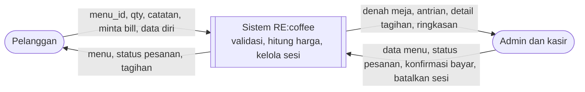
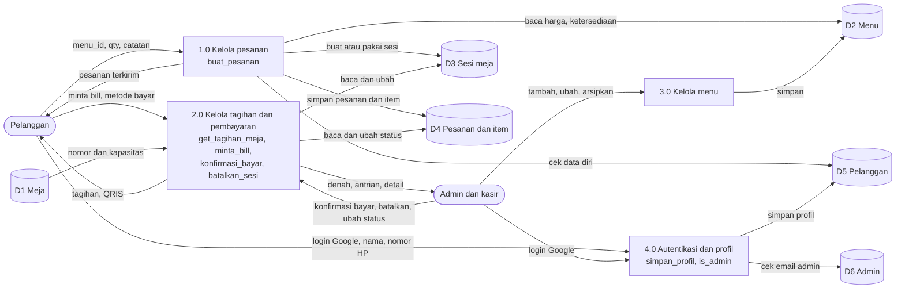

# 03. Kebutuhan dan analisis data

> Dokumen MPPL (M0). Sumber: PRD bagian 6, 7, dan 8, diperbarui dengan hasil implementasi dan pengujian per 22 Nov 2026.
> Kolom "Dibuktikan oleh" mengacu ke nomor kasus uji (TC) di `10-pengujian.md`.

## 1. Kebutuhan fungsional

| ID    | Aktor     | Kebutuhan                                                                                                      | Prioritas | Dibuktikan oleh                         |
| ----- | --------- | -------------------------------------------------------------------------------------------------------------- | --------- | --------------------------------------- |
| FR-01 | Pelanggan | Membuka halaman meja lewat `/meja/:nomor`. Nomor di luar 1 sampai 28 menampilkan pesan meja tidak ditemukan    | Tinggi    | TC-01, TC-02, TC-03                     |
| FR-02 | Pelanggan | Melihat menu dikelompokkan per kategori (Kopi, Non-kopi, Makanan, Camilan)                                     | Tinggi    | TC-01                                   |
| FR-03 | Pelanggan | Menu habis tetap tampil dengan label "Habis" dan tidak bisa ditambahkan                                        | Sedang    | TC-06, TC-07                            |
| FR-04 | Pelanggan | Menambah, mengurangi, dan menghapus item di keranjang. Keranjang tersimpan di perangkat per meja               | Tinggi    | TC-04, TC-05                            |
| FR-05 | Pelanggan | Menambahkan catatan pesanan (maksimal 140 karakter)                                                            | Rendah    | Diperiksa saat pengembangan             |
| FR-06 | Pelanggan | Mengirim pesanan. Sistem membuat atau memakai sesi meja aktif                                                  | Tinggi    | TC-08, TC-09                            |
| FR-07 | Pelanggan | Melihat tagihan meja: semua pesanan dalam sesi, status, subtotal, total                                        | Tinggi    | TC-09, TC-16, TC-31                     |
| FR-08 | Pelanggan | Minta bill dengan memilih QRIS atau bayar di kasir                                                             | Tinggi    | TC-11, TC-12                            |
| FR-09 | Pelanggan | Melihat gambar QRIS dan nominal yang harus dibayar bila memilih QRIS                                           | Tinggi    | TC-11 (gambar QRIS menunggu `qris.png`) |
| FR-10 | Pelanggan | Setelah sesi ditutup kasir, halaman tagihan menampilkan "Terima kasih, pembayaran sudah dikonfirmasi"          | Sedang    | TC-17                                   |
| FR-23 | Pelanggan | Masuk dengan Google sebelum mengirim pesanan. Keranjang tidak hilang setelah kembali dari halaman login        | Tinggi    | TC-26, TC-27                            |
| FR-24 | Pelanggan | Mengisi data diri saat login pertama: nama (2 sampai 50 karakter) dan nomor HP (format Indonesia). Bisa diubah | Tinggi    | TC-27, TC-28, TC-29, TC-32              |
| FR-25 | Pelanggan | Keluar (logout) dari perangkat                                                                                 | Sedang    | Diperiksa saat pengembangan             |
| FR-11 | Admin     | Login dengan Google. Email yang tidak terdaftar sebagai admin ditolak dan otomatis keluar                      | Tinggi    | TC-13, TC-14, TC-15                     |
| FR-12 | Admin     | Melihat denah 28 meja dengan status kosong, terisi, minta bill, dan total berjalan                             | Tinggi    | TC-08, TC-11                            |
| FR-13 | Admin     | Membuka detail meja: pesanan, item, total, metode bayar, serta nama dan nomor HP pemesan tiap pesanan          | Tinggi    | TC-10, TC-17                            |
| FR-14 | Admin     | Konfirmasi bayar (boleh mengganti metode bayar), sesi selesai, meja kosong                                     | Tinggi    | TC-17, TC-18                            |
| FR-15 | Admin     | Batalkan sesi dengan dialog konfirmasi                                                                         | Sedang    | TC-19                                   |
| FR-16 | Admin     | Melihat antrian pesanan berstatus baru dan diproses, urut dari yang terlama                                    | Tinggi    | TC-16                                   |
| FR-17 | Admin     | Memajukan status pesanan satu langkah                                                                          | Tinggi    | TC-16                                   |
| FR-18 | Admin     | Menambah dan mengubah menu (nama, deskripsi, kategori, harga, urutan)                                          | Tinggi    | TC-20, TC-21                            |
| FR-19 | Admin     | Menandai menu habis atau tersedia                                                                              | Tinggi    | TC-06                                   |
| FR-20 | Admin     | Mengarsipkan menu                                                                                              | Sedang    | TC-22, TC-23                            |
| FR-21 | Admin     | Melihat ringkasan dasbor (lihat bagian 3.4 untuk definisi angka)                                               | Rendah    | Diperiksa saat pengembangan             |
| FR-22 | Sistem    | Data denah meja, antrian, dan tagihan diperbarui otomatis (polling)                                            | Tinggi    | TC-16                                   |

FR-05, FR-21, dan FR-25 belum punya kasus uji khusus di tabel black box. Ketiganya berprioritas rendah atau sedang dan
diperiksa langsung di browser saat pengembangan.

## 2. Kebutuhan non-fungsional

| ID     | Kategori        | Kebutuhan                                                                                                             | Status per 22 Nov 2026                                                                       |
| ------ | --------------- | --------------------------------------------------------------------------------------------------------------------- | -------------------------------------------------------------------------------------------- |
| NFR-01 | Performa        | Halaman siap dipakai kurang dari 3 detik di 4G. Bundle JS awal kurang dari 250 KB gzip                                | Bundle awal sekitar 161 KB gzip. Waktu muat 4G belum diukur                                  |
| NFR-02 | Responsif       | Pelanggan optimal di 360 sampai 480 px. Admin optimal di 1024 px ke atas dan tetap bisa dipakai di tablet             | Dicek di 360 dan 480 px serta laptop. HP sungguhan belum                                     |
| NFR-03 | Keamanan        | RLS aktif di semua tabel. Tulis pelanggan hanya lewat database function. Tidak ada secret di frontend                 | Terpenuhi: `rls_check.sql` (9 pemeriksaan) dan 39 pemeriksaan aturan bisnis lulus            |
| NFR-04 | Keamanan        | Admin divalidasi di database (`is_admin()`), bukan hanya di UI                                                        | Terpenuhi (TC-14)                                                                            |
| NFR-05 | Integritas data | Harga integer, total dihitung server, satu sesi aktif per meja dijamin unique index                                   | Terpenuhi (TC-12, TC-23, batas qty dan harga di `10-pengujian.md`)                           |
| NFR-06 | Aksesibilitas   | Kontras WCAG AA, target sentuh 44 px, fokus keyboard terlihat, status tidak hanya dibedakan warna                     | Terpenuhi setelah perbaikan B-02. Audit axe 0 pelanggaran, kontras dihitung dari token warna |
| NFR-07 | Usability       | Alur pesan paling banyak 4 langkah. Semua teks Bahasa Indonesia yang jelas                                            | Terpenuhi                                                                                    |
| NFR-08 | Ketersediaan    | Ter-deploy di Vercel dengan HTTPS                                                                                     | Terpenuhi (TC-24)                                                                            |
| NFR-09 | Maintainability | TypeScript strict, struktur per fitur, migrasi SQL berurutan, dokumentasi progres per milestone                       | Terpenuhi (`docs/PROGRESS.md`)                                                               |
| NFR-10 | Portabilitas    | Berjalan di Chrome, Safari iOS, dan Firefox terbaru                                                                   | Sebagian: diuji di Chrome. Safari iOS dan Firefox belum                                      |
| NFR-11 | Privasi         | Nomor HP hanya terlihat oleh pemiliknya dan admin. Halaman tagihan yang dilihat pelanggan lain hanya menampilkan nama | Terpenuhi (TC-31)                                                                            |

## 3. Analisis data

Bagian ini mengisi poin "data analisis" pada requirement MPPL: data apa yang dibutuhkan sistem, dari mana asalnya, siapa yang
memakainya, bagaimana data mengalir, dan angka apa yang dihasilkan darinya.

> Tafsiran istilah. PRD memakai arti **analisis kebutuhan data** (bagian 3.1 sampai 3.3). Bagian 3.4 menambahkan arti kedua,
> **analitik atas data yang dihasilkan sistem** (ringkasan di dasbor), supaya kedua kemungkinan tercakup. Tafsiran mana yang
> dimaksud dosen belum dikonfirmasi (PRD M0 tugas 7).

### 3.1 Identifikasi data

| Data         | Sumber atau penginput                                 | Pemakai                           | Sifat                    | Contoh                                     |
| ------------ | ----------------------------------------------------- | --------------------------------- | ------------------------ | ------------------------------------------ |
| Meja         | Seed awal (28 baris)                                  | Sistem, admin                     | Master, jarang berubah   | Meja 18, kapasitas 4                       |
| Menu         | Admin                                                 | Pelanggan, admin                  | Master, berubah sesekali | Es Kopi Susu Aren, Rp24.000                |
| Sesi meja    | Sistem (otomatis saat pesanan pertama), ditutup admin | Pelanggan, admin                  | Transaksi                | Sesi meja 18, aktif, dibuka 14.05          |
| Pesanan      | Pelanggan                                             | Admin dan barista                 | Transaksi                | Pesanan meja 18 oleh Rina, status diproses |
| Item pesanan | Pelanggan (menu dan qty), harga diambil sistem        | Admin, perhitungan total          | Transaksi (detail)       | 2 x Es Kopi Susu Aren @ Rp24.000           |
| Pelanggan    | Pelanggan sendiri (sekali, saat login pertama)        | Admin (identitas pemesan), sistem | Master                   | Rina, 081234567890                         |
| Admin        | Seed atau pengelola sistem                            | Sistem (otorisasi)                | Master                   | Email Google kasir                         |
| Akun login   | Google OAuth (dikelola Supabase Auth)                 | Sistem                            | Autentikasi              | Email dan id akun Google                   |

### 3.2 Data turunan

Dihitung saat dibutuhkan, tidak disimpan ganda, supaya tidak ada data yang bisa saling bertentangan.

| Data turunan                 | Rumus                                                                                                   | Alasan tidak disimpan                                |
| ---------------------------- | ------------------------------------------------------------------------------------------------------- | ---------------------------------------------------- |
| Status meja                  | Kosong bila tidak ada sesi `aktif` atau `minta_bill`. Terisi bila `aktif`. Minta bill bila `minta_bill` | Menghindari meja "kosong" padahal ada tagihan        |
| Total berjalan sesi          | Σ (qty x harga_satuan) seluruh item di sesi                                                             | Selalu akurat                                        |
| Jumlah pesanan belum diantar | COUNT pesanan berstatus bukan `diantar`                                                                 | Selalu akurat                                        |
| `total_bayar`                | **Disimpan** saat konfirmasi bayar                                                                      | Snapshot final untuk audit, tidak boleh berubah lagi |

### 3.3 Alur data

**DFD level 0**

**DFD level 1**

### 3.4 Data analitik pada dasbor kasir

Ringkasan hari ini (zona waktu WIB). Hanya dibaca admin, dihitung dari data transaksi, dan tidak disimpan.

| Angka               | Definisi                                                                                |
| ------------------- | --------------------------------------------------------------------------------------- |
| Pendapatan hari ini | Σ `total_bayar` sesi berstatus `selesai` yang ditutup sejak 00.00 WIB                   |
| Transaksi           | Jumlah sesi `selesai` hari ini, dipecah berdasarkan metode (QRIS atau kasir)            |
| Pesanan hari ini    | Jumlah pesanan yang dibuat hari ini, **tidak** menghitung sesi yang dibatalkan          |
| Terlaris hari ini   | Lima menu dengan qty terbanyak hari ini (Σ qty per nama menu, omzet sebagai pembanding) |
| Tagihan berjalan    | Total sesi yang masih terbuka (`aktif` atau `minta_bill`)                               |
| Pesanan menunggu    | Jumlah pesanan berstatus `baru` atau `diproses`                                         |
| Minta bill          | Jumlah sesi berstatus `minta_bill`                                                      |

Aturan penting: sesi `batal` dikeluarkan dari semua hitungan pesanan dan menu terlaris (perbaikan bug B-01 pada M6).

### 3.5 Matriks CRUD

C = create, R = read, U = update, D = delete. Tidak ada kolom yang berisi D karena sesi, pesanan, dan menu tidak pernah
dihapus (BR-08, BR-09).

| Use case                                | MEJA | MENU    | PELANGGAN | SESI_MEJA | PESANAN | ITEM_PESANAN | ADMIN |
| --------------------------------------- | ---- | ------- | --------- | --------- | ------- | ------------ | ----- |
| UC-01 Melihat menu                      | R    | R       |           |           |         |              |       |
| UC-02 Mengelola keranjang               |      |         |           |           |         |              |       |
| UC-03 Mengirim pesanan                  |      | R       | R         | C, R      | C       | C            |       |
| UC-04 Melihat tagihan meja              |      |         | R         | R         | R       | R            |       |
| UC-05 Minta bill dan pilih metode bayar |      |         |           | U         | R       |              |       |
| UC-12 Masuk Google dan data diri        |      |         | C, R, U   |           |         |              |       |
| UC-06 Login dengan Google (admin)       |      |         |           |           |         |              | R     |
| UC-07 Memantau denah meja               | R    |         |           | R         |         | R            |       |
| UC-08 Mengonfirmasi pembayaran          |      |         |           | U         |         |              | R     |
| UC-09 Membatalkan sesi meja             |      |         |           | U         |         |              |       |
| UC-10 Mengelola antrian pesanan         |      |         | R         | R         | R, U    | R            |       |
| UC-11 Mengelola menu                    |      | C, R, U |           |           |         |              |       |

Keranjang (UC-02) tersimpan di `localStorage` perangkat, jadi tidak menyentuh database. Tabel MEJA dan ADMIN diisi lewat seed,
bukan lewat fitur aplikasi.

### 3.6 Volume data (satu kafe)

| Data    | Perkiraan                                               |
| ------- | ------------------------------------------------------- |
| Menu    | 20 sampai 40 baris (saat ini 22 aktif, 12 arsip)        |
| Sesi    | 60 sampai 120 per hari (28 meja x 2 sampai 4 putaran)   |
| Pesanan | Sekitar 1,5 per sesi: 90 sampai 180 per hari            |
| Item    | Sekitar 2 sampai 3 per pesanan: 300 sampai 500 per hari |

Volume ini sangat kecil bagi PostgreSQL. Paket gratis lebih dari cukup untuk demo dan uji coba.

### 3.7 Kualitas dan validasi data

Validasi dua lapis: form di browser (kenyamanan) dan constraint atau function di database (kebenaran).

| Data       | Aturan                                      | Dijaga oleh                           | Diuji pada (batas nilai)             |
| ---------- | ------------------------------------------- | ------------------------------------- | ------------------------------------ |
| Nomor meja | 1 sampai 28                                 | `CHECK` di MEJA, route `/meja/:nomor` | 0, 1, 28, 29                         |
| Qty item   | 1 sampai 20, maksimal 30 baris per pesanan  | `CHECK` dan `buat_pesanan()`          | 0, 1, 20, 21                         |
| Harga menu | 1 sampai 1.000.000, integer                 | `CHECK` di MENU, form menu admin      | 0, 1, 1.000.000, 1.000.001           |
| Nama       | 2 sampai 50 karakter                        | `CHECK`, `simpan_profil()`, form      | 1, 2, 50, 51                         |
| Nomor HP   | Format Indonesia (`08`, `62`, `+62`)        | `simpan_profil()`, form               | Empat format valid, tiga tidak valid |
| Catatan    | Maksimal 140 karakter                       | `CHECK`, form                         | -                                    |
| Status     | Nilai enum, pesanan hanya maju satu langkah | Enum dan trigger `pesanan_transisi`   | TC-16                                |
| Relasi     | Tidak ada baris yatim                       | Foreign key                           | -                                    |
