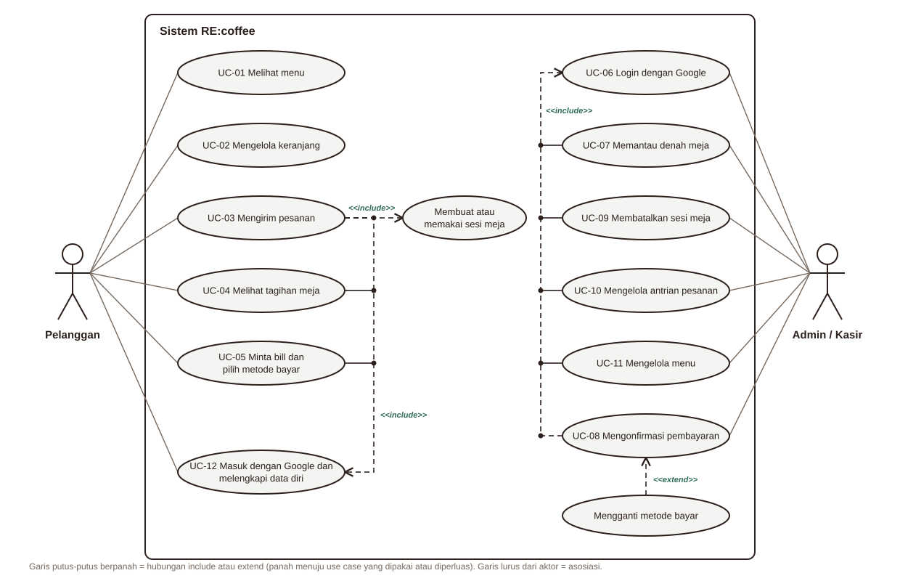

# 04. Use case RE:coffee

> Dokumen MPPL (M0). Sumber: PRD bagian 4 dan 9. Skenario UC-01, 02, 04, 06, 07, 09, 10, dan 11 ditulis dari perilaku
> aplikasi yang sudah berjalan dan diuji (22 Nov 2026).

## 1. Aktor

Sistem punya **dua aktor**, memenuhi syarat minimal dua aktor pada requirement MPPL.

| Aktor             | Autentikasi                                                                 | Boleh                                                                                                                                | Tidak boleh                                                                                                    |
| ----------------- | --------------------------------------------------------------------------- | ------------------------------------------------------------------------------------------------------------------------------------ | -------------------------------------------------------------------------------------------------------------- |
| **Pelanggan**     | Google OAuth dan data diri (nama, nomor HP). Melihat menu tidak perlu login | Melihat menu, mengirim pesanan, melihat tagihan meja aktif, minta bill (hanya bila sudah memesan di sesi itu), mengubah data dirinya | Mengubah harga, mengubah status pesanan, menutup sesi, melihat data diri pelanggan lain, membuka halaman admin |
| **Admin / kasir** | Google OAuth dan email terdaftar di tabel `admin`                           | Semua fitur admin: denah, detail meja, konfirmasi bayar, batalkan sesi, antrian, kelola menu                                         | Menghapus data transaksi. Sesi dan pesanan tidak bisa dihapus, hanya dibatalkan                                |

Barista memakai akun admin yang sama (satu peran). Pelanggan dan admin sama-sama masuk dengan Google. Yang membedakan adalah
email admin terdaftar di tabel `admin`. Akun Google biasa otomatis diperlakukan sebagai pelanggan.

## 2. Daftar use case

| ID    | Use case                                     | Aktor     | Halaman                |
| ----- | -------------------------------------------- | --------- | ---------------------- |
| UC-01 | Melihat menu                                 | Pelanggan | `/meja/:nomor`         |
| UC-02 | Mengelola keranjang                          | Pelanggan | `/meja/:nomor`         |
| UC-03 | Mengirim pesanan                             | Pelanggan | `/meja/:nomor`         |
| UC-04 | Melihat tagihan meja                         | Pelanggan | `/meja/:nomor/tagihan` |
| UC-05 | Minta bill dan memilih metode bayar          | Pelanggan | `/meja/:nomor/tagihan` |
| UC-12 | Masuk dengan Google dan melengkapi data diri | Pelanggan | Dialog di halaman meja |
| UC-06 | Login dengan Google                          | Admin     | `/admin/masuk`         |
| UC-07 | Memantau denah meja                          | Admin     | `/admin`               |
| UC-08 | Mengonfirmasi pembayaran                     | Admin     | `/admin/meja/:nomor`   |
| UC-09 | Membatalkan sesi meja                        | Admin     | `/admin/meja/:nomor`   |
| UC-10 | Mengelola antrian pesanan                    | Admin     | `/admin/antrian`       |
| UC-11 | Mengelola menu                               | Admin     | `/admin/menu`          |

Nomor UC-12 sengaja tetap di urutan pelanggan. Ia ditambahkan setelah pelanggan diwajibkan login (PRD bagian 5).

## 3. Diagram use case

- File sumber yang bisa diedit: [`diagram/use-case.drawio`](diagram/use-case.drawio) (buka di app.diagrams.net).
- Dibuat otomatis dengan `node scripts/generate-use-case.mjs`.

Hubungan antar use case:

| Hubungan      | Dari                              | Ke                               | Arti                                                                           |
| ------------- | --------------------------------- | -------------------------------- | ------------------------------------------------------------------------------ |
| `<<include>>` | UC-03 Mengirim pesanan            | Membuat atau memakai sesi meja   | Setiap pesanan wajib terikat ke satu sesi meja                                 |
| `<<include>>` | UC-03, UC-04, UC-05               | UC-12 Masuk Google dan data diri | Ketiganya hanya bisa dijalankan pelanggan yang sudah login dan punya data diri |
| `<<include>>` | UC-07, UC-08, UC-09, UC-10, UC-11 | UC-06 Login dengan Google        | Semua fitur admin butuh login admin                                            |
| `<<extend>>`  | Mengganti metode bayar            | UC-08 Mengonfirmasi pembayaran   | Opsional: kasir boleh menimpa metode yang dipilih pelanggan saat konfirmasi    |

Aturan yang dipakai: include dipakai untuk langkah yang **selalu** terjadi, extend untuk langkah yang **kadang** terjadi.

## 4. Skenario

Format: prasyarat, alur utama, alur alternatif, dan pascakondisi.

### UC-01 Melihat menu

- Aktor: Pelanggan. Tanpa login.
- Prasyarat: nomor meja valid (1 sampai 28).
- Alur utama:
  1. Pelanggan memindai QR meja atau mengetik nomor meja di beranda. Browser membuka `/meja/:nomor`.
  2. Sistem menampilkan menu yang tidak diarsipkan, dikelompokkan per kategori (Kopi, Non-kopi, Makanan, Camilan).
  3. Pelanggan menggulir atau memilih chip kategori.
- Alur alternatif:
  - 1a. Nomor di luar 1 sampai 28 (misalnya 0 atau 29): tampil "Meja tidak ditemukan. Scan ulang QR di meja kamu."
  - 2a. Menu berstatus habis tetap tampil dengan label "Habis" dan tombol tambah hilang.
- Pascakondisi: menu tampil tanpa perlu login.

### UC-02 Mengelola keranjang

- Aktor: Pelanggan. Tanpa login.
- Prasyarat: halaman meja terbuka dan sesi meja tidak berstatus `minta_bill`.
- Alur utama:
  1. Pelanggan menekan tombol tambah pada menu. Bar "Lihat pesanan" muncul dengan jumlah item dan total.
  2. Pelanggan membuka ringkasan keranjang.
  3. Pelanggan mengubah jumlah (1 sampai 20), menghapus item, atau mengisi catatan opsional (maksimal 140 karakter).
- Alur alternatif:
  - 3a. Jumlah mencapai 20: tombol tambah nonaktif.
  - 3b. Item di keranjang ternyata sudah habis: baris berubah "Habis, hapus dulu" dan tombol Kirim nonaktif.
  - 3c. Pelanggan menekan "Kosongkan pesanan": semua item dihapus.
- Pascakondisi: keranjang tersimpan di penyimpanan browser per meja dan bertahan setelah halaman dimuat ulang.

### UC-03 Mengirim pesanan

- Prasyarat: keranjang berisi minimal satu item, pelanggan sudah login dan punya data diri (UC-12), sesi meja tidak berstatus `minta_bill`.
- Alur utama:
  1. Pelanggan membuka ringkasan keranjang.
  2. Pelanggan menekan **Kirim pesanan**.
  3. Sistem memvalidasi meja, item, qty, dan ketersediaan menu.
  4. Sistem membuat sesi bila belum ada, lalu menyimpan pesanan dan item dengan harga dari database.
  5. Sistem mengosongkan keranjang dan menampilkan "Pesanan terkirim!".
- Alur alternatif:
  - 3a. Menu habis saat dikirim: tampil "Ada menu yang baru saja habis. Hapus dari keranjang lalu kirim lagi."
  - 3b. Sesi `minta_bill`: tampil "Bill sudah diminta. Tambah pesanan lewat kasir."
  - 3c. Jaringan gagal: keranjang tidak dihapus, tampil "Pesanan belum terkirim. Cek koneksi lalu coba lagi."
- Pascakondisi: pesanan berstatus `baru` muncul di antrian admin.

### UC-04 Melihat tagihan meja

- Prasyarat: pelanggan login dan punya data diri (UC-12).
- Alur utama:
  1. Pelanggan menekan "Tagihan meja" di halaman meja.
  2. Sistem memuat semua pesanan di sesi meja itu: tiap pesanan dengan jam, nama pemesan, status, item, dan subtotal.
  3. Sistem menampilkan total tagihan. Halaman diperbarui otomatis setiap 10 detik.
- Alur alternatif:
  - 2a. Meja belum punya sesi aktif: tampil keadaan kosong yang mengajak memilih menu.
  - 2b. Kasir baru saja mengonfirmasi bayar: tampil layar terima kasih (FR-10).
- Pascakondisi: tidak ada perubahan data. Nama pemesan lain tampil, nomor HP tidak.

### UC-05 Minta bill

- Prasyarat: sesi meja `aktif`. Pelanggan login dan sudah punya minimal satu pesanan di sesi ini.
- Alur utama: pelanggan membuka tagihan, menekan **Minta bill**, memilih QRIS atau Bayar di kasir, sistem mengubah sesi
  menjadi `minta_bill`. Bila QRIS, tampil gambar QRIS dan nominal.
- Alur alternatif: pelanggan yang belum memesan di sesi itu ditolak (`BUKAN_PEMESAN_MEJA`).
- Pascakondisi: meja tampil kuning "Minta bill" di denah admin dan pesanan baru diblokir.

### UC-12 Masuk dengan Google dan melengkapi data diri

- Pemicu: pelanggan menekan Kirim pesanan, membuka tagihan, atau Minta bill dalam keadaan belum login.
- Alur utama: sistem menampilkan **Masuk dengan Google**, pelanggan memilih akun Google, kembali ke halaman meja yang sama.
  Bila data diri belum ada, tampil form nama dan nomor HP. Setelah **Simpan**, aksi semula dilanjutkan.
- Alur alternatif: nomor HP tidak valid menampilkan "Nomor HP belum benar. Contoh: 081234567890." Bila pelanggan batal login,
  keranjang tetap ada.
- Pascakondisi: data diri tersimpan, login berikutnya tidak meminta data lagi.

### UC-06 Login dengan Google (admin)

- Aktor: Admin.
- Alur utama:
  1. Admin membuka `/admin/masuk` dan menekan **Masuk dengan Google**.
  2. Admin memilih akun Google, lalu kembali ke `/admin`.
  3. Sistem memeriksa `is_admin()` di database. Hasil true: dasbor tampil.
- Alur alternatif:
  - 3a. Email bukan admin: sistem mengeluarkan akun itu otomatis dan menampilkan "Akun ini bukan admin" dengan penjelasan.
  - 1a. Membuka `/admin` tanpa login: dialihkan ke `/admin/masuk`.
  - 2a. Login Google gagal: tampil alert "Masuk dengan Google gagal".
- Pascakondisi: sesi admin aktif. Pemeriksaan juga dilakukan database, jadi UI yang dibobol tidak memberi akses.

### UC-07 Memantau denah meja

- Prasyarat: admin login.
- Alur utama:
  1. Admin membuka `/admin`.
  2. Sistem menampilkan kartu ringkasan hari ini dan denah 28 meja. Tiap meja berstatus kosong, terisi, atau minta bill,
     dengan teks status dan total berjalan (bukan hanya warna).
  3. Denah diperbarui otomatis setiap 5 detik.
  4. Admin menekan satu meja untuk membuka detailnya.
- Alur alternatif: semua meja kosong menampilkan keadaan kosong bergambar kursi.
- Pascakondisi: tidak ada perubahan data.

### UC-08 Mengonfirmasi pembayaran

- Prasyarat: admin login. Sesi `aktif` atau `minta_bill`.
- Alur utama: admin membuka detail meja, memeriksa total dan metode, boleh mengganti metode, menekan **Konfirmasi bayar**,
  lalu menyetujui dialog. Sistem menyimpan `total_bayar`, `ditutup_at`, `dikonfirmasi_oleh`, dan status `selesai`.
- Pascakondisi: meja kembali kosong dan halaman tagihan pelanggan menampilkan terima kasih.

### UC-09 Membatalkan sesi meja

- Prasyarat: admin login. Sesi `aktif` atau `minta_bill`.
- Alur utama: admin membuka detail meja, menekan **Batalkan sesi**, dan menyetujui dialog konfirmasi. Sistem mengubah status
  sesi menjadi `batal` dan mencatat waktu serta siapa yang membatalkan.
- Alur alternatif: admin menutup dialog tanpa konfirmasi, tidak ada perubahan.
- Pascakondisi: meja kosong. Pesanan di sesi itu tetap tersimpan sebagai riwayat, tetapi tidak muncul di antrian dan tidak
  dihitung di dasbor.

### UC-10 Mengelola antrian pesanan

- Prasyarat: admin login.
- Alur utama:
  1. Admin membuka `/admin/antrian`. Sistem menampilkan pesanan berstatus `baru` dan `diproses`, urut dari yang terlama.
  2. Tiap pesanan menampilkan meja, nama pemesan, item, dan catatan.
  3. Admin menekan tombol langkah berikutnya: `baru` menjadi `diproses`, lalu `diproses` menjadi `diantar`.
  4. Pesanan yang sudah diantar hilang dari antrian. Halaman diperbarui otomatis setiap 5 detik.
- Alur alternatif: status hanya maju satu langkah. Lompatan langsung dari `baru` ke `diantar` ditolak database.
- Pascakondisi: pelanggan melihat status terbaru di halaman tagihannya.

### UC-11 Mengelola menu

- Prasyarat: admin login.
- Alur utama:
  1. Admin membuka `/admin/menu`. Sistem menampilkan daftar menu per kategori.
  2. Admin menambah menu baru atau mengubah menu (nama, deskripsi, kategori, harga, urutan).
  3. Admin menandai menu habis atau tersedia dengan sakelar, atau mengarsipkannya.
  4. Perubahan langsung terlihat di halaman pelanggan.
- Alur alternatif: harga di luar 1 sampai 1.000.000 ditolak di form dengan pesan "Harga harus angka 1 sampai 1.000.000, tanpa titik."
- Pascakondisi: menu yang pernah dipesan tidak bisa dihapus permanen, hanya diarsipkan, sehingga tagihan lama tetap utuh.

## 5. Penelusuran (traceability)

| Use case | Kebutuhan fungsional | Kasus uji black box               |
| -------- | -------------------- | --------------------------------- |
| UC-01    | FR-01, FR-02, FR-03  | TC-01, TC-02, TC-03, TC-06        |
| UC-02    | FR-04, FR-05         | TC-04, TC-05, TC-07               |
| UC-03    | FR-06, FR-22         | TC-08, TC-09, TC-10, TC-25        |
| UC-04    | FR-07, FR-10         | TC-09, TC-16, TC-17, TC-31        |
| UC-05    | FR-08, FR-09         | TC-11, TC-12, TC-30               |
| UC-12    | FR-23, FR-24, FR-25  | TC-26, TC-27, TC-28, TC-29, TC-32 |
| UC-06    | FR-11                | TC-13, TC-14, TC-15               |
| UC-07    | FR-12, FR-21, FR-22  | TC-08, TC-11                      |
| UC-08    | FR-13, FR-14         | TC-17, TC-18                      |
| UC-09    | FR-15                | TC-19                             |
| UC-10    | FR-16, FR-17         | TC-16                             |
| UC-11    | FR-18, FR-19, FR-20  | TC-20, TC-21, TC-22, TC-23        |
