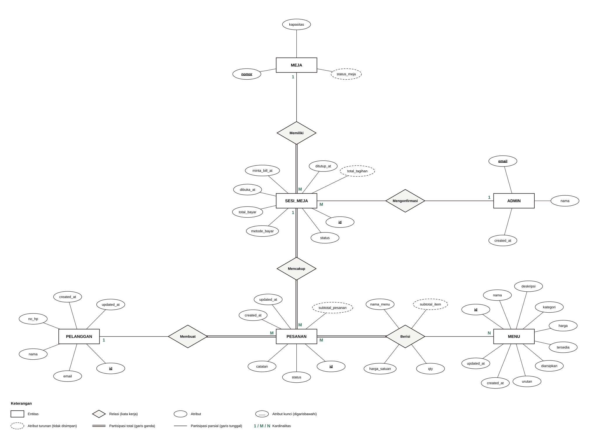
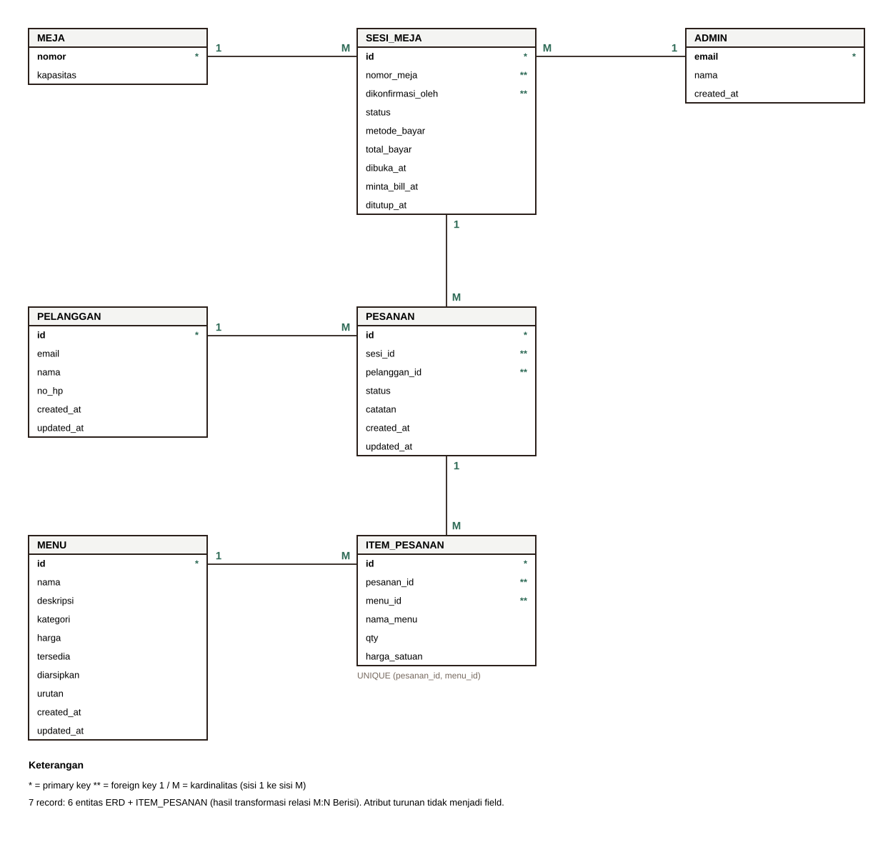

# 05. ERD dan LRS RE:coffee

> Dokumen MPPL (M0). Sumber rancangan: PRD bagian 10. Skema fisiknya ada di `supabase/migrations/0001_schema.sql`.
> Diperbarui 22 Nov 2026 setelah revisi menu dari klien (lihat bagian 1), lalu diperdalam dengan notasi (min, max)
> (5.1), aksi referensial dan indeks (10.1, 10.2), serta normalisasi bertahap dan ketergantungan fungsional (11.1, 11.2).

Urutan perancangan data: **ERD konseptual (notasi Chen) → transformasi → LRS → tabel fisik → kamus data**.
ERD menjawab "apa saja yang ada dan bagaimana hubungannya". LRS menjawab "bagaimana itu disusun menjadi record dan kunci".

## 1. Pengaruh revisi klien terhadap ERD dan LRS

Revisi 22 Nov 2026 mengganti isi menu dari tema warung (kopi tubruk, pisang goreng, kerupuk kaleng) menjadi
menu kafe kekinian untuk Gen Z (es kopi susu aren, latte, matcha, croissant, cookies, dan sebagainya).

- **Struktur tidak berubah.** Entitas, atribut, relasi, kardinalitas, dan kunci sama seperti rancangan awal.
  Yang berubah hanya **isi data** entitas MENU (22 menu baru, 12 menu lama diarsipkan).
- Menu lama **diarsipkan, bukan dihapus** (`menu.diarsipkan = true`) karena `item_pesanan.menu_id` mereferensikannya
  dan tagihan lama harus tetap utuh (BR-09). Ini contoh nyata kenapa MENU tidak punya operasi hapus.
- Kategori tetap empat nilai enum: `kopi`, `non_kopi`, `makanan`, `camilan`. Tidak ada migrasi skema.
- Satu-satunya perubahan di repo adalah migrasi **data** `0005_menu_kafe_gen_z.sql`.

## 2. Simbol notasi Chen

| Simbol              | Bentuk                        | Arti di diagram RE:coffee                                                                      |
| ------------------- | ----------------------------- | ---------------------------------------------------------------------------------------------- |
| Entitas             | Persegi panjang               | PELANGGAN, MEJA, SESI_MEJA, PESANAN, MENU, ADMIN                                               |
| Relasi              | **Belah ketupat**             | Kata kerja: Membuat, Memiliki, Mencakup, Berisi, Mengonfirmasi                                 |
| Atribut             | Oval                          | Properti entitas atau relasi                                                                   |
| Atribut kunci       | Oval, teks digarisbawahi      | `id`, `nomor`, `email`                                                                         |
| Atribut turunan     | Oval garis putus-putus        | `status_meja`, `total_tagihan`, `subtotal_pesanan`, `subtotal_item` (dihitung, tidak disimpan) |
| Kardinalitas        | Angka di garis: `1`, `M`, `N` | 1:M dan M:N                                                                                    |
| Partisipasi total   | Garis ganda                   | Entitas **wajib** ikut relasi                                                                  |
| Partisipasi parsial | Garis tunggal                 | Entitas **boleh tidak** ikut relasi                                                            |

Belah ketupat dipakai untuk relasi. Segitiga hanya untuk generalisasi (EER), dan RE:coffee hanya punya satu jenis admin,
jadi tidak diperlukan.

## 3. Entitas dan alasan keberadaannya

| Entitas   | Mewakili                                                         | Kenapa perlu                                                                                                 |
| --------- | ---------------------------------------------------------------- | ------------------------------------------------------------------------------------------------------------ |
| PELANGGAN | Orang yang memesan (login Google + data diri)                    | Mencegah pesanan iseng; setiap pesanan punya pemesan yang jelas                                              |
| MEJA      | 28 meja fisik di kafe                                            | Titik identitas tagihan; QR dan input nomor meja menunjuk ke meja                                            |
| SESI_MEJA | Satu kunjungan di satu meja, dari pesanan pertama sampai dibayar | Mengikat banyak pesanan menjadi satu tagihan; membedakan kunjungan jam 10.00 dan jam 14.00 di meja yang sama |
| PESANAN   | Satu kali pengiriman keranjang                                   | Pelanggan bisa memesan berkali-kali; barista memproses per pesanan                                           |
| MENU      | Daftar minuman dan makanan                                       | Data master yang dipesan                                                                                     |
| ADMIN     | Kasir yang boleh mengelola sistem                                | Otorisasi dan jejak siapa yang mengonfirmasi pembayaran                                                      |

Dua keputusan yang perlu bisa dijelaskan:

1. **PELANGGAN berelasi ke PESANAN, bukan ke SESI_MEJA.** Tagihan milik meja (open bill) karena satu meja bisa diisi beberapa
   teman yang masing-masing login. Yang dicatat per pelanggan adalah _siapa memesan apa_.
2. **ITEM_PESANAN bukan entitas di ERD.** Hubungan PESANAN dan MENU adalah **M:N** yang punya atribut sendiri
   (`qty`, `harga_satuan`, `nama_menu`), jadi di ERD ia digambar sebagai **relasi "Berisi" beratribut**.
   Baru saat transformasi ke LRS ia menjadi record ITEM_PESANAN.

## 4. Atribut

| Pemilik           | Atribut kunci | Atribut lain                                                                           | Atribut turunan                                               |
| ----------------- | ------------- | -------------------------------------------------------------------------------------- | ------------------------------------------------------------- |
| PELANGGAN         | <u>id</u>     | email, nama, no_hp, created_at, updated_at                                             | –                                                             |
| MEJA              | <u>nomor</u>  | kapasitas                                                                              | status_meja (kosong / terisi / minta bill, dari sesi terbuka) |
| SESI_MEJA         | <u>id</u>     | status, metode_bayar, total_bayar, dibuka_at, minta_bill_at, ditutup_at                | total_tagihan (Σ qty × harga_satuan)                          |
| PESANAN           | <u>id</u>     | status, catatan, created_at, updated_at                                                | subtotal_pesanan                                              |
| MENU              | <u>id</u>     | nama, deskripsi, kategori, harga, tersedia, diarsipkan, urutan, created_at, updated_at | –                                                             |
| ADMIN             | <u>email</u>  | nama, created_at                                                                       | –                                                             |
| Relasi **Berisi** | –             | qty, harga_satuan, nama_menu                                                           | subtotal_item (qty × harga_satuan)                            |

`total_bayar` disimpan (bukan turunan) karena merupakan **snapshot final** saat sesi ditutup dan tidak boleh berubah lagi.

## 5. Relasi, kardinalitas, dan partisipasi

| Relasi            | Entitas             | Kardinalitas | Partisipasi                      | Cara membaca                                                                                                                            |
| ----------------- | ------------------- | ------------ | -------------------------------- | --------------------------------------------------------------------------------------------------------------------------------------- |
| **Membuat**       | PELANGGAN – PESANAN | 1 : M        | PELANGGAN parsial, PESANAN total | Satu pelanggan membuat nol atau banyak pesanan. Setiap pesanan dibuat tepat satu pelanggan.                                             |
| **Memiliki**      | MEJA – SESI_MEJA    | 1 : M        | MEJA parsial, SESI_MEJA total    | Satu meja memiliki nol atau banyak sesi sepanjang waktu. Setiap sesi milik tepat satu meja.                                             |
| **Mencakup**      | SESI_MEJA – PESANAN | 1 : M        | Keduanya total                   | Satu sesi mencakup minimal satu pesanan (sesi baru dibuat bersamaan dengan pesanan pertama, BR-02). Setiap pesanan berada di satu sesi. |
| **Berisi**        | PESANAN – MENU      | M : N        | PESANAN total, MENU parsial      | Satu pesanan berisi satu atau lebih menu. Satu menu bisa ada di nol atau banyak pesanan.                                                |
| **Mengonfirmasi** | ADMIN – SESI_MEJA   | 1 : M        | Keduanya parsial                 | Satu admin mengonfirmasi nol atau banyak sesi. Sesi yang masih berjalan belum dikonfirmasi siapa pun.                                   |

Aturan yang **tidak bisa** digambarkan lewat kardinalitas: _satu meja hanya boleh punya satu sesi terbuka pada satu waktu_.
Di ERD hubungannya tetap 1:M (sepanjang waktu banyak sesi). Batasan waktunya dijaga di level fisik oleh
_partial unique index_ `sesi_meja_satu_terbuka_idx`. ERD menangkap struktur, aturan bisnis tertentu dijaga oleh constraint.

### 5.1 Kardinalitas dalam notasi (min, max)

Notasi (min, max) menyatakan **paling sedikit** dan **paling banyak** kemunculan satu entitas pada relasi. Nilai min 0 sama
dengan partisipasi parsial, min 1 sama dengan partisipasi total.

| Relasi            | Entitas   | (min, max) | Dibaca                                                                    |
| ----------------- | --------- | ---------- | ------------------------------------------------------------------------- |
| **Membuat**       | PELANGGAN | (0, N)     | Seorang pelanggan membuat nol sampai banyak pesanan                       |
|                   | PESANAN   | (1, 1)     | Sebuah pesanan dibuat tepat satu pelanggan                                |
| **Memiliki**      | MEJA      | (0, N)     | Sebuah meja memiliki nol sampai banyak sesi sepanjang waktu               |
|                   | SESI_MEJA | (1, 1)     | Sebuah sesi milik tepat satu meja                                         |
| **Mencakup**      | SESI_MEJA | (1, N)     | Sebuah sesi mencakup satu sampai banyak pesanan                           |
|                   | PESANAN   | (1, 1)     | Sebuah pesanan berada di tepat satu sesi                                  |
| **Berisi**        | PESANAN   | (1, N)     | Sebuah pesanan berisi satu sampai banyak menu                             |
|                   | MENU      | (0, N)     | Sebuah menu ada di nol sampai banyak pesanan                              |
| **Mengonfirmasi** | ADMIN     | (0, N)     | Seorang admin mengonfirmasi nol sampai banyak sesi                        |
|                   | SESI_MEJA | (0, 1)     | Sebuah sesi dikonfirmasi paling banyak satu admin, kosong selama berjalan |

## 6. Diagram ERD (notasi Chen)



- File sumber yang bisa diedit: [`diagram/erd-chen.drawio`](diagram/erd-chen.drawio) (buka di app.diagrams.net).
- Checklist yang terpenuhi: 6 persegi panjang, 5 belah ketupat, tidak ada entitas melayang; nama relasi berupa kata kerja;
  atribut kunci digarisbawahi; atribut turunan putus-putus; atribut `qty`, `harga_satuan`, `nama_menu` menempel ke belah ketupat
  **Berisi**; kardinalitas di kedua ujung; garis ganda untuk partisipasi total; legenda di pojok bawah.

## 7. Transformasi ERD ke LRS

Aturan:

1. Setiap entitas menjadi satu record; atribut kunci menjadi primary key.
2. **Relasi 1:M**: primary key sisi 1 disalin menjadi foreign key di record sisi M.
3. **Relasi M:N**: dibuat record baru berisi primary key kedua entitas (foreign key) ditambah atribut milik relasi.
4. **Atribut turunan tidak dijadikan field** (dihitung saat dibutuhkan).

Penerapan:

| Relasi                               | Aturan | Hasil di LRS                                                                                        |
| ------------------------------------ | ------ | --------------------------------------------------------------------------------------------------- |
| Membuat (1:M)                        | 2      | `pelanggan_id` (FK → PELANGGAN.id) di PESANAN, wajib diisi                                          |
| Memiliki (1:M)                       | 2      | `nomor_meja` (FK → MEJA.nomor) di SESI_MEJA, wajib diisi                                            |
| Mencakup (1:M)                       | 2      | `sesi_id` (FK → SESI_MEJA.id) di PESANAN, wajib diisi                                               |
| Mengonfirmasi (1:M)                  | 2      | `dikonfirmasi_oleh` (FK → ADMIN.email) di SESI_MEJA, **boleh kosong** karena partisipasi parsial    |
| Berisi (M:N)                         | 3      | Record baru **ITEM_PESANAN**: `pesanan_id` (FK), `menu_id` (FK), `qty`, `harga_satuan`, `nama_menu` |
| status_meja, total_tagihan, subtotal | 4      | Tidak menjadi field; dihitung oleh view `v_status_meja` dan query                                   |

Primary key ITEM_PESANAN secara teori adalah gabungan **(pesanan_id, menu_id)**, karena satu menu hanya muncul sekali per
pesanan (yang bertambah adalah `qty`, bukan barisnya). Di implementasi dipakai **surrogate key `id`** agar konsisten dengan
tabel lain (semua UUID), sementara (pesanan_id, menu_id) tetap dijaga sebagai **UNIQUE** (alternate key).

## 8. LRS (Logical Record Structure)



- File sumber yang bisa diedit: [`diagram/lrs.drawio`](diagram/lrs.drawio).
- Konvensi: `*` primary key, `**` foreign key, `1` dan `M` kardinalitas (sisi 1 ke sisi M).

Perubahan dari ERD ke LRS yang terlihat di gambar:

- Relasi M:N **Berisi** hilang dan digantikan record **ITEM_PESANAN** dengan dua relasi 1:M
  (PESANAN 1–M ITEM_PESANAN, MENU 1–M ITEM_PESANAN).
- Setiap garis 1:M punya foreign key yang jelas di sisi M.
- Tidak ada atribut turunan.
- Jumlah record: **7** (6 entitas + 1 hasil transformasi M:N).
- `PELANGGAN.id` sama dengan id akun Supabase Auth (`auth.users.id`), sehingga satu akun Google = satu data pelanggan.

## 9. Kamus data

**PELANGGAN**

| Field                  | Tipe        | Kunci                                  | Keterangan                                   |
| ---------------------- | ----------- | -------------------------------------- | -------------------------------------------- |
| id                     | uuid        | PK (sama dengan id akun Supabase Auth) | Pengenal pelanggan                           |
| email                  | text        | –                                      | Email akun Google, diisi otomatis dari login |
| nama                   | text (2–50) | –                                      | Nama yang diisi pelanggan                    |
| no_hp                  | text        | –                                      | Nomor HP Indonesia (08…, 628…, atau +628…)   |
| created_at, updated_at | timestamptz | –                                      | Waktu daftar dan diubah                      |

**MEJA**

| Field     | Tipe     | Kunci | Keterangan              |
| --------- | -------- | ----- | ----------------------- |
| nomor     | smallint | PK    | Nomor meja 1–28         |
| kapasitas | smallint | –     | Jumlah kursi, default 4 |

**SESI_MEJA**

| Field             | Tipe        | Kunci      | Keterangan                                                 |
| ----------------- | ----------- | ---------- | ---------------------------------------------------------- |
| id                | uuid        | PK         | Pengenal sesi                                              |
| nomor_meja        | smallint    | FK → MEJA  | Meja tempat sesi berlangsung                               |
| dikonfirmasi_oleh | text        | FK → ADMIN | Email admin yang menutup sesi; kosong selama sesi berjalan |
| status            | enum        | –          | aktif, minta_bill, selesai, batal                          |
| metode_bayar      | enum        | –          | qris atau kasir; kosong sebelum minta bill                 |
| total_bayar       | integer     | –          | Snapshot total saat sesi ditutup (Rupiah)                  |
| dibuka_at         | timestamptz | –          | Waktu pesanan pertama                                      |
| minta_bill_at     | timestamptz | –          | Waktu pelanggan meminta bill                               |
| ditutup_at        | timestamptz | –          | Waktu sesi selesai atau batal                              |

**PESANAN**

| Field                  | Tipe        | Kunci          | Keterangan                     |
| ---------------------- | ----------- | -------------- | ------------------------------ |
| id                     | uuid        | PK             | Pengenal pesanan               |
| sesi_id                | uuid        | FK → SESI_MEJA | Sesi pemilik pesanan           |
| pelanggan_id           | uuid        | FK → PELANGGAN | Pelanggan yang membuat pesanan |
| status                 | enum        | –              | baru, diproses, diantar        |
| catatan                | text (≤140) | –              | Catatan pelanggan, opsional    |
| created_at, updated_at | timestamptz | –              | Waktu dibuat dan diubah        |

**ITEM_PESANAN**

| Field        | Tipe     | Kunci                                | Keterangan                           |
| ------------ | -------- | ------------------------------------ | ------------------------------------ |
| id           | uuid     | PK                                   | Pengenal item                        |
| pesanan_id   | uuid     | FK → PESANAN, UNIQUE bersama menu_id | Pesanan pemilik item                 |
| menu_id      | uuid     | FK → MENU                            | Menu yang dipesan                    |
| nama_menu    | text     | –                                    | Snapshot nama menu saat dipesan      |
| qty          | smallint | –                                    | Jumlah 1–20                          |
| harga_satuan | integer  | –                                    | Snapshot harga saat dipesan (Rupiah) |

**MENU**

| Field                  | Tipe        | Kunci | Keterangan                                                |
| ---------------------- | ----------- | ----- | --------------------------------------------------------- |
| id                     | uuid        | PK    | Pengenal menu                                             |
| nama                   | text (2–60) | –     | Nama menu                                                 |
| deskripsi              | text (≤160) | –     | Keterangan singkat                                        |
| kategori               | enum        | –     | kopi, non_kopi, makanan, camilan                          |
| harga                  | integer     | –     | Harga saat ini (Rupiah), 1 sampai 1.000.000               |
| tersedia               | boolean     | –     | false = habis                                             |
| diarsipkan             | boolean     | –     | true = disembunyikan permanen (menu tidak pernah dihapus) |
| urutan                 | smallint    | –     | Urutan tampil dalam kategori                              |
| created_at, updated_at | timestamptz | –     | Waktu dibuat dan diubah                                   |

**ADMIN**

| Field      | Tipe        | Kunci | Keterangan                       |
| ---------- | ----------- | ----- | -------------------------------- |
| email      | text        | PK    | Email Google admin (huruf kecil) |
| nama       | text        | –     | Nama tampilan                    |
| created_at | timestamptz | –     | Waktu didaftarkan                |

## 10. Aturan yang dijaga constraint database

| Aturan                                                             | Penjaga                                                                           |
| ------------------------------------------------------------------ | --------------------------------------------------------------------------------- |
| Satu meja hanya punya satu sesi terbuka                            | Partial unique index `sesi_meja_satu_terbuka_idx` (status `aktif` / `minta_bill`) |
| Satu menu hanya sekali per pesanan                                 | `UNIQUE (pesanan_id, menu_id)` di ITEM_PESANAN                                    |
| Sesi tertutup wajib punya `ditutup_at`, sesi terbuka tidak boleh   | Check `sesi_tutup_konsisten`                                                      |
| Nomor meja 1–28, qty 1–20, harga 1–1.000.000                       | Check constraint di MEJA, ITEM_PESANAN, MENU                                      |
| Nama pelanggan 2–50 huruf, nomor HP valid                          | Check constraint + validasi di `simpan_profil()`                                  |
| Status pesanan hanya maju satu langkah (baru → diproses → diantar) | Trigger `pesanan_transisi`                                                        |
| Pelanggan hanya membaca data sendiri, admin membaca semua          | Row Level Security (migrasi `0002`)                                               |
| Harga tidak bisa dimanipulasi dari browser                         | `buat_pesanan()` mengambil harga dari tabel MENU di server                        |

### 10.1 Aksi referensial (foreign key)

Semua foreign key memakai **RESTRICT** atau **NO ACTION** pada penghapusan, tidak ada `ON DELETE CASCADE`. Itu sengaja:
sesi, pesanan, dan menu tidak pernah dihapus (BR-08, BR-09), jadi riwayat transaksi tidak boleh hilang karena induknya dihapus.

| Foreign key                   | Mengacu ke      | Saat induk dihapus | Saat kunci induk berubah | Boleh kosong | Alasan                                                            |
| ----------------------------- | --------------- | ------------------ | ------------------------ | ------------ | ----------------------------------------------------------------- |
| `sesi_meja.nomor_meja`        | `meja.nomor`    | NO ACTION          | NO ACTION                | Tidak        | Meja fisik tidak dihapus                                          |
| `sesi_meja.dikonfirmasi_oleh` | `admin.email`   | NO ACTION          | **CASCADE**              | Ya           | Kosong selama sesi berjalan. Bila email admin diganti, jejak ikut |
| `pelanggan.id`                | `auth.users.id` | RESTRICT           | NO ACTION                | Tidak        | Satu akun Google sama dengan satu data pelanggan                  |
| `pesanan.sesi_id`             | `sesi_meja.id`  | RESTRICT           | NO ACTION                | Tidak        | Pesanan selalu terikat ke sesi (BR-02)                            |
| `pesanan.pelanggan_id`        | `pelanggan.id`  | RESTRICT           | NO ACTION                | Tidak        | Setiap pesanan punya pemesan (BR-12)                              |
| `item_pesanan.pesanan_id`     | `pesanan.id`    | RESTRICT           | NO ACTION                | Tidak        | Item tidak berdiri sendiri                                        |
| `item_pesanan.menu_id`        | `menu.id`       | RESTRICT           | NO ACTION                | Tidak        | Menu yang pernah dipesan hanya diarsipkan (BR-09)                 |

### 10.2 Indeks

| Indeks                       | Tabel dan kolom                                         | Jenis          | Fungsi                                                      |
| ---------------------------- | ------------------------------------------------------- | -------------- | ----------------------------------------------------------- |
| `sesi_meja_satu_terbuka_idx` | `sesi_meja (nomor_meja)` untuk `aktif` dan `minta_bill` | Unique parsial | Menjaga aturan satu sesi terbuka per meja (BR-01)           |
| `sesi_meja_status_idx`       | `sesi_meja (status)`                                    | Biasa          | Denah dan dasbor memfilter sesi menurut status              |
| `menu_kategori_urutan_idx`   | `menu (kategori, urutan)` untuk menu tidak diarsipkan   | Parsial        | Daftar menu per kategori di halaman pelanggan               |
| `pesanan_sesi_idx`           | `pesanan (sesi_id)`                                     | Biasa          | Mengambil pesanan satu sesi untuk tagihan                   |
| `pesanan_pelanggan_idx`      | `pesanan (pelanggan_id)`                                | Biasa          | Mengecek apakah pelanggan sudah memesan (syarat minta bill) |
| `pesanan_antrian_idx`        | `pesanan (created_at)` untuk `baru` dan `diproses`      | Parsial        | Antrian barista urut dari yang terlama                      |
| `item_pesanan_menu_idx`      | `item_pesanan (menu_id)`                                | Biasa          | Menu terlaris dan pemeriksaan menu yang pernah dipesan      |

## 11. Catatan normalisasi

- Semua record memenuhi **3NF**: setiap field non-kunci hanya bergantung pada primary key record-nya.
- `item_pesanan.nama_menu` dan `item_pesanan.harga_satuan` adalah **denormalisasi yang disengaja (snapshot)**: tagihan dan
  riwayat harus mencerminkan nama dan harga saat transaksi, bukan saat ini. Tanpa snapshot, mengubah harga menu akan mengubah
  tagihan yang sudah dibayar. Revisi menu 22 Nov 2026 membuktikannya: tagihan hari itu yang berisi "Kopi Tubruk" tetap tertulis
  "Kopi Tubruk" walau menu itu sudah diarsipkan.
- `sesi_meja.total_bayar` juga snapshot final saat sesi ditutup.
- Status meja **tidak disimpan** karena atribut turunan dari sesi terbuka; menyimpannya membuka peluang data tidak sinkron
  (meja "kosong" padahal ada tagihan). Ia dihitung oleh view `v_status_meja`.

### 11.1 Normalisasi bertahap

Bahan awalnya satu **tagihan meja** seperti yang dilihat kasir: satu lembar yang memuat meja, sesi, daftar pesanan, pemesan, dan
daftar menu yang dipesan. Dari lembar itu ditunjukkan bagaimana tujuh record LRS terbentuk.

**Bentuk tidak normal (UNF).** Ada kelompok yang berulang, yaitu pesanan dalam satu tagihan dan item dalam satu pesanan.

```
TAGIHAN (nomor_meja, kapasitas, status_sesi, metode_bayar, total_bayar, dibuka_at, minta_bill_at, ditutup_at,
         dikonfirmasi_oleh, nama_admin,
         { pesanan_id, status_pesanan, catatan, created_at,
           pelanggan_id, email, nama, no_hp,
           { menu_id, nama_menu, kategori, harga, tersedia, qty, harga_satuan } } )
```

**1NF.** Kelompok berulang dipecah sehingga setiap sel berisi satu nilai dan setiap baris mewakili satu menu dalam satu pesanan.
Kunci utama menjadi **(pesanan_id, menu_id)**.

```
R1 (pesanan_id*, menu_id*, sesi_id, nomor_meja, kapasitas, status_sesi, metode_bayar, total_bayar, dibuka_at,
    minta_bill_at, ditutup_at, dikonfirmasi_oleh, nama_admin, status_pesanan, catatan, created_at,
    pelanggan_id, email, nama, no_hp, nama_menu_master, kategori, harga, tersedia,
    qty, harga_satuan, nama_menu)
```

Masalah yang masih ada (anomali): mengganti nomor HP pelanggan berarti mengubah banyak baris (anomali ubah), menu baru tidak bisa
disimpan sebelum ada yang memesannya (anomali tambah), dan menghapus pesanan terakhir yang berisi suatu menu ikut menghapus
data menu itu (anomali hapus).

**2NF.** Atribut yang hanya bergantung pada **sebagian** kunci dipisahkan.

| Ketergantungan                                                    | Hasil record                                                                                |
| ----------------------------------------------------------------- | ------------------------------------------------------------------------------------------- |
| `menu_id` menentukan nama, kategori, harga, tersedia              | **MENU** (menu_id\*, nama, deskripsi, kategori, harga, tersedia, ...)                       |
| `pesanan_id` menentukan sesi, status, catatan, pemesan            | **PESANAN** (pesanan_id\*, sesi_id, nomor_meja, ..., pelanggan_id, email, nama, no_hp, ...) |
| (`pesanan_id`, `menu_id`) menentukan qty, harga_satuan, nama_menu | **ITEM_PESANAN** (pesanan_id\*, menu_id\*, qty, harga_satuan, nama_menu)                    |

**3NF.** Ketergantungan **transitif** (non-kunci menentukan non-kunci) dipisahkan.

| Ketergantungan transitif                                                                  | Hasil record                                                                                                                         |
| ----------------------------------------------------------------------------------------- | ------------------------------------------------------------------------------------------------------------------------------------ |
| `pesanan_id` menentukan `sesi_id`, lalu `sesi_id` menentukan status, metode, waktu, total | **SESI_MEJA** (id\*, nomor_meja\*\*, status, metode_bayar, total_bayar, dibuka_at, minta_bill_at, ditutup_at, dikonfirmasi_oleh\*\*) |
| `nomor_meja` menentukan `kapasitas`                                                       | **MEJA** (nomor\*, kapasitas)                                                                                                        |
| `pesanan_id` menentukan `pelanggan_id`, lalu `pelanggan_id` menentukan email, nama, no_hp | **PELANGGAN** (id\*, email, nama, no_hp, ...)                                                                                        |
| `dikonfirmasi_oleh` menentukan `nama_admin`                                               | **ADMIN** (email\*, nama, created_at)                                                                                                |

Hasil akhir: **MEJA, SESI_MEJA, PELANGGAN, PESANAN, MENU, ITEM_PESANAN, ADMIN**, sama dengan LRS di bagian 8.

**Snapshot `nama_menu` dan `harga_satuan` di ITEM_PESANAN bukan pelanggaran 3NF.** Keduanya bergantung pada kunci penuh
(pesanan_id, menu_id) karena merupakan sifat **baris pesanan itu** (nama dan harga pada saat transaksi), bukan sifat menu
sekarang. Jadi tidak ada ketergantungan transitif lewat `menu_id`. Ini yang membuat tagihan lama tidak berubah ketika harga
atau nama menu diubah.

### 11.2 Ketergantungan fungsional dan kunci kandidat

| Record       | Primary key      | Kunci kandidat atau alternatif                                                       | Ketergantungan fungsional utama                                       | Bentuk normal |
| ------------ | ---------------- | ------------------------------------------------------------------------------------ | --------------------------------------------------------------------- | ------------- |
| MEJA         | `nomor`          | -                                                                                    | `nomor` menentukan `kapasitas`                                        | BCNF          |
| MENU         | `id`             | -                                                                                    | `id` menentukan semua atribut lain                                    | BCNF          |
| PELANGGAN    | `id`             | `email` (unik karena berasal dari akun Google, tidak dijaga constraint di tabel ini) | `id` menentukan email, nama, no_hp, waktu                             | BCNF          |
| SESI_MEJA    | `id`             | -                                                                                    | `id` menentukan semua atribut lain                                    | BCNF          |
| PESANAN      | `id`             | -                                                                                    | `id` menentukan sesi, pemesan, status, catatan, waktu                 | BCNF          |
| ITEM_PESANAN | `id` (surrogate) | (`pesanan_id`, `menu_id`) dijaga `UNIQUE`                                            | (`pesanan_id`, `menu_id`) menentukan id, nama_menu, qty, harga_satuan | BCNF          |
| ADMIN        | `email`          | -                                                                                    | `email` menentukan nama dan created_at                                | BCNF          |

Setiap determinan pada tabel di atas adalah kunci (utama atau kandidat), jadi seluruh record memenuhi BCNF dan otomatis 3NF.

Aturan bisnis yang **bukan** ketergantungan fungsional dan dijaga di tempat lain: satu sesi terbuka per meja (partial unique
index), status pesanan hanya maju satu langkah (trigger), dan harga tidak dikirim dari browser (function `buat_pesanan()`).

## 12. Bukti konsistensi ERD, LRS, dan database

Pemeriksaan 22 Nov 2026: nama field di LRS dibandingkan dengan `information_schema.columns` project Supabase `recoffee`.

| Record       | Jumlah field | Hasil       |
| ------------ | ------------ | ----------- |
| MEJA         | 2            | Sama persis |
| SESI_MEJA    | 9            | Sama persis |
| ADMIN        | 3            | Sama persis |
| PELANGGAN    | 6            | Sama persis |
| PESANAN      | 7            | Sama persis |
| MENU         | 10           | Sama persis |
| ITEM_PESANAN | 6            | Sama persis |

Diagram dibuat otomatis dari satu sumber data, jadi ERD dan LRS tidak bisa saling berbeda. Untuk membuat ulang setelah
skema berubah:

```bash
node scripts/generate-diagrams.mjs
```

Perintah itu menulis ulang empat file di `docs/mppl/diagram/` (`erd-chen.drawio`, `erd-chen.svg`, `lrs.drawio`, `lrs.svg`).
Bila dosen meminta PNG, buka file `.drawio` di app.diagrams.net lalu **File → Export as → PNG**.

## 13. Pertanyaan yang mungkin muncul saat presentasi

| Pertanyaan                                                         | Inti jawaban                                                                                                                                               |
| ------------------------------------------------------------------ | ---------------------------------------------------------------------------------------------------------------------------------------------------------- |
| Kenapa PELANGGAN terhubung ke PESANAN, bukan ke SESI_MEJA?         | Satu meja bisa diisi beberapa orang yang masing-masing login. Tagihan milik meja (open bill), pelanggan dicatat per pesanan untuk akuntabilitas.           |
| Kenapa pelanggan wajib login dan isi data diri?                    | Mencegah pesanan iseng; setiap pesanan bisa ditelusuri ke orang yang jelas.                                                                                |
| Kenapa ITEM_PESANAN ada di LRS tapi tidak di ERD?                  | Di ERD ia relasi M:N "Berisi" yang punya atribut; aturan transformasi M:N mengubahnya menjadi record sendiri di LRS.                                       |
| Kenapa perlu SESI_MEJA, tidak langsung MEJA ke PESANAN?            | Satu meja dipakai banyak pengunjung bergantian. Tanpa sesi, pesanan jam 10 dan jam 14 tercampur dalam satu tagihan.                                        |
| Kalau satu meja hanya boleh satu sesi aktif, kenapa relasinya 1:M? | Kardinalitas menggambarkan sepanjang waktu (banyak sesi). Batasan "satu yang aktif" dijaga partial unique index.                                           |
| Kenapa harga disimpan dua kali (MENU dan ITEM_PESANAN)?            | Di MENU harga sekarang, di ITEM_PESANAN harga saat transaksi. Snapshot disengaja.                                                                          |
| Kenapa ADMIN dihubungkan ke SESI_MEJA?                             | Jejak audit: siapa yang mengonfirmasi pembayaran atau membatalkan sesi.                                                                                    |
| Menu diganti, apakah ERD ikut berubah?                             | Tidak. Menu hanya data di entitas MENU. Menu lama diarsipkan, bukan dihapus, supaya tagihan lama tetap utuh.                                               |
| Tunjukkan bahwa skema sudah 3NF, bukan hanya mengaku               | Bagian 11.1: dari tagihan tidak normal ke 1NF, 2NF, lalu 3NF. Setiap pemisahan punya ketergantungan yang jelas. Bagian 11.2 menunjukkan semua record BCNF. |
| Apakah snapshot harga di ITEM_PESANAN melanggar normalisasi?       | Tidak. Harga dan nama itu bergantung pada kunci penuh (pesanan_id, menu_id) sebagai sifat baris pesanan, bukan lewat `menu_id`.                            |
| Kenapa foreign key memakai RESTRICT, bukan CASCADE?                | Riwayat transaksi tidak boleh hilang. Sesi, pesanan, dan menu tidak pernah dihapus (BR-08, BR-09). Lihat bagian 10.1.                                      |
