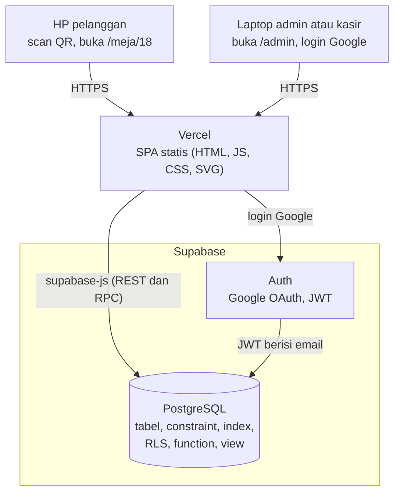
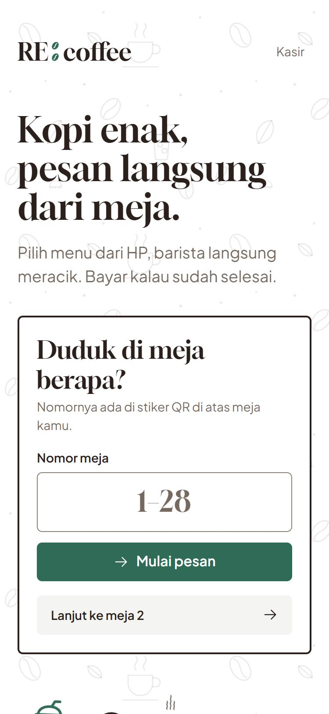
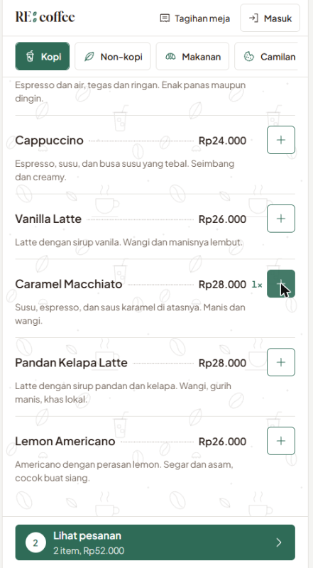
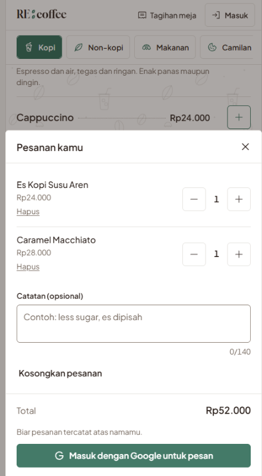
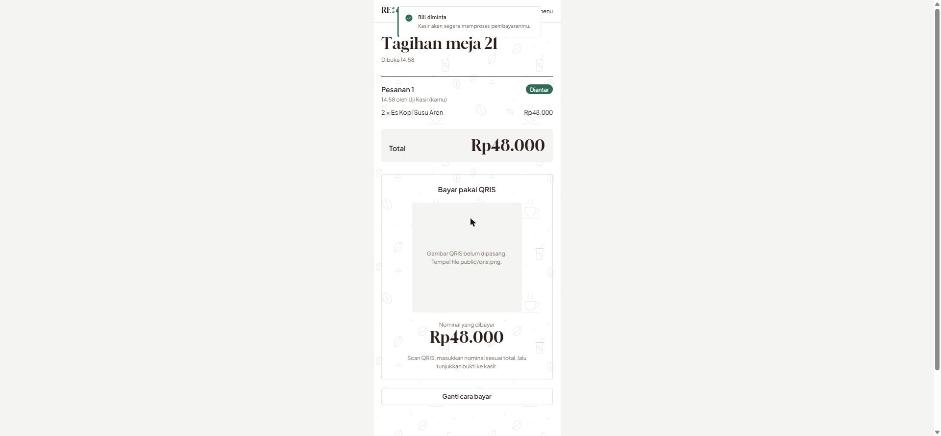
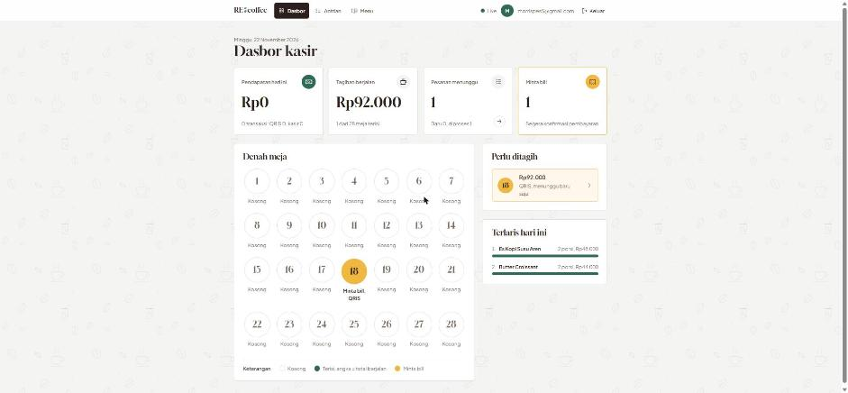
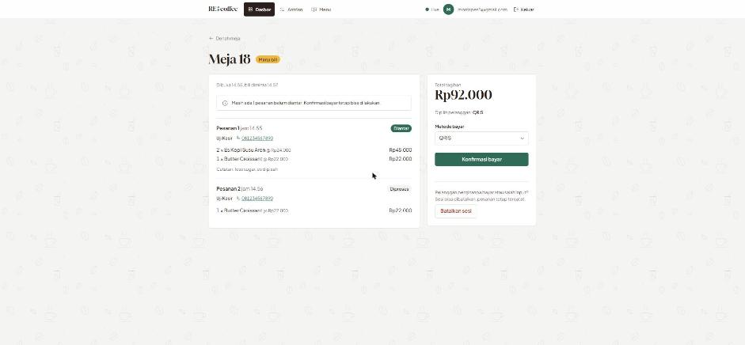

# 06. Desain sistem dan antarmuka

> Dokumen MPPL (M0). Sumber: PRD bagian 11, 12, 15, dan 16, serta `docs/design-system.md`, diperbarui dengan keadaan
> aplikasi per 22 Nov 2026. Gambar tampilan diambil dari aplikasi produksi.

## 1. Arsitektur sistem

- Frontend adalah satu aplikasi web statis. Tidak ada server aplikasi terpisah.
- Logika yang kritis (membuat pesanan, minta bill, konfirmasi bayar) ada di **database function**, bukan di browser.
- Karena browser berbicara langsung ke database, keamanan bertumpu pada **Row Level Security (RLS)** dan function. Itu sebabnya
  skema database (`supabase/migrations/`) ditulis rinci dan diuji terpisah (`aturan_bisnis.sql`, `rls_check.sql`).

### Pola akses data

| Operasi                          | Siapa                                    | Cara                                        |
| -------------------------------- | ---------------------------------------- | ------------------------------------------- |
| Baca meja dan menu               | Publik                                   | `select` langsung (RLS mengizinkan baca)    |
| Simpan atau ubah data diri       | Pelanggan login                          | RPC `simpan_profil`                         |
| Baca data diri sendiri           | Pelanggan login                          | `select` tabel `pelanggan` (hanya barisnya) |
| Kirim pesanan                    | Pelanggan login dengan data diri         | RPC `buat_pesanan`                          |
| Baca tagihan meja                | Pelanggan login                          | RPC `get_tagihan_meja`                      |
| Minta bill                       | Pelanggan yang sudah memesan di sesi itu | RPC `minta_bill`                            |
| Denah meja                       | Admin                                    | `select` view `v_status_meja`               |
| Detail meja dan antrian          | Admin                                    | `select` dengan relasi (RLS admin)          |
| Ubah status pesanan, kelola menu | Admin                                    | `update` atau `insert` langsung (RLS admin) |
| Konfirmasi bayar, batalkan sesi  | Admin                                    | RPC `konfirmasi_bayar`, `batalkan_sesi`     |

Prinsip: **pelanggan tidak punya akses tulis langsung ke tabel mana pun**. Semua tulis pelanggan lewat function yang memvalidasi
input dan memakai identitas dari token login (`auth.uid()`), bukan dari data yang dikirim browser. Frontend hanya mengirim
`menu_id` dan `qty`. Harga selalu diambil database.

### Pembaruan data

Memakai polling (TanStack Query `refetchInterval`), bukan websocket.

| Halaman           | Interval |
| ----------------- | -------- |
| Denah meja admin  | 5 detik  |
| Antrian pesanan   | 5 detik  |
| Detail meja admin | 5 detik  |
| Tagihan pelanggan | 10 detik |

Polling berhenti saat tab tidak aktif dan memuat ulang saat tab kembali difokuskan.

### Autentikasi

Pelanggan dan admin sama-sama memakai Google OAuth lewat Supabase Auth. Bedanya hanya di otorisasi.

- **Pelanggan:** menu tampil tanpa login. Saat menekan Kirim pesanan, membuka tagihan, atau Minta bill dalam keadaan belum login,
  tampil tombol Masuk dengan Google. Keranjang aman karena tersimpan di `localStorage`. Setelah kembali dari Google, bila data
  diri belum ada, tampil form nama dan nomor HP, lalu aksi semula dilanjutkan.
- **Admin:** di `/admin/masuk`, setelah login frontend memanggil `is_admin()`. Bila bukan admin, akun dikeluarkan dan tampil
  alert "Akun ini bukan admin". Pemeriksaan yang sama dilakukan database, jadi UI yang dibobol tidak memberi akses.

## 2. Teknologi

| Lapisan                           | Pilihan                                                 | Alasan                                                                          |
| --------------------------------- | ------------------------------------------------------- | ------------------------------------------------------------------------------- |
| Bahasa                            | TypeScript (strict)                                     | Tipe data jelas dan kesalahan ketahuan sebelum jalan                            |
| Build dan UI                      | Vite dan React                                          | Dev server cepat, ekosistem luas, tanpa server framework                        |
| Routing                           | React Router (mode SPA)                                 | Cukup untuk 9 halaman                                                           |
| Data                              | TanStack Query                                          | Cache, status loading dan error, polling                                        |
| Gaya                              | Tailwind CSS v4 dengan token di `@theme`                | Konsisten dengan design token, tanpa UI kit                                     |
| Validasi                          | Zod (form menu admin dan env)                           | Validasi deklaratif yang ringan                                                 |
| Backend                           | Supabase: PostgreSQL dan Auth Google                    | Database relasional, auth tanpa menulis OAuth, function SQL untuk logika kritis |
| QR code                           | `qrcode` (script Node)                                  | Membuat 28 file SVG QR sekali jalan                                             |
| Pengujian                         | Vitest, React Testing Library, axe-core                 | Unit test, komponen, dan audit aksesibilitas                                    |
| Hosting                           | Vercel (Hobby) dengan deploy otomatis dari GitHub       | HTTPS otomatis, deploy statis gratis                                            |
| Ditambahkan atas permintaan klien | `motion` (animasi), `sonner` (toast), `canvas-confetti` | Interaksi lebih hidup. Semuanya mati saat `prefers-reduced-motion`              |

Kenapa bukan Next.js atau backend terpisah: aplikasi ini tidak butuh SSR atau SEO, dan semua logika server cukup di database
function. Tanpa server terpisah, permukaan serangan dan biaya pemeliharaan lebih kecil, dan deploy hanya file statis.

## 3. Design system

Rincian lengkap: [`../design-system.md`](../design-system.md). Implementasi token: `src/styles/index.css`. Katalog komponen:
`npm run dev` lalu buka `/dev/ui`.

**Konsep.** Nama RE:coffee dibaca sebagai _re-_ (kembali). Semula tema "warung kopi, diseduh ulang", lalu atas permintaan
klien (22 Nov 2026) menjadi **kafe kekinian untuk Gen Z** dengan nama, palet, dan font yang sama. Modern datang dari disiplin:
latar putih, ruang kosong, grid tenang, tipografi tegas.

| Aspek        | Keputusan                                                                                                                                                                          |
| ------------ | ---------------------------------------------------------------------------------------------------------------------------------------------------------------------------------- |
| Warna        | Sembilan token: `putih`, `tegel`, `garis`, `batas`, `tubruk` (teks), `ampas` (teks sekunder), `blirik` (aksen hijau), `lampu` (kuning, status minta bill), `kaleng` (merah, error) |
| Aturan warna | Satu aksen per layar selain status. Tanpa gradien dan shadow. Kuning `lampu` hanya sebagai latar, tidak pernah sebagai warna teks                                                  |
| Tipografi    | Gloock (judul, nomor meja) dan Plus Jakarta Sans (teks dan harga, `tabular-nums`). Sentence case, tidak ada label huruf kapital semua                                              |
| Bentuk       | Radius 6 px, lingkaran hanya untuk meja dan badge. Target sentuh minimal 44 px. Kolom pelanggan maksimal 480 px, admin maksimal 1120 px                                            |
| Elemen khas  | Menu tampil sebagai **daftar harga ala papan menu** dengan titik penghubung nama dan harga, bukan grid kartu berfoto                                                               |
| Ikon         | Ikon UI umum dari Phosphor (MIT). Ikon kategori dan latar pola kopi berupa **SVG tulis tangan**. Tidak ada gambar hasil generator AI, foto, atau emoji                             |
| Gerak        | Pegas halus untuk keranjang, daftar, dan denah. Konfeti dan cangkir beruap saat pesanan terkirim. Semua mati lewat `prefers-reduced-motion`                                        |
| Tulisan      | Bahasa Indonesia santai dan sopan, tombol menyebut aksinya, pesan error menjelaskan apa yang terjadi dan apa yang harus dilakukan                                                  |

Komponen dasar (`src/components/ui/`): `Button` (primary, secondary, ghost, danger), `IconButton`, `Badge` (selalu berisi
teks), `Dialog` (elemen `<dialog>` native), `Sheet` (panel keranjang dari bawah), `TextField`, `TextArea`, `Select`, `Switch`,
`InlineMessage`, `Spinner`, dan `Skeleton`.

### Aksesibilitas

| Hal                      | Keputusan dan bukti                                                                                  |
| ------------------------ | ---------------------------------------------------------------------------------------------------- |
| Kontras teks             | Semua pasangan teks lulus WCAG AA (4,5:1), dihitung dari token warna (`10-pengujian.md` bagian 8)    |
| Kontras komponen         | Batas kolom form dinaikkan ke token `batas` (3,7:1) setelah temuan B-02                              |
| Status tidak hanya warna | Tiap meja punya teks status di bawah lingkaran dan `aria-label` ("Meja 12, terisi, total Rp106.000") |
| Keyboard                 | Dialog bisa ditutup Esc, fokus kembali ke pemicu, fokus terlihat dengan outline 2 px                 |
| Audit otomatis           | axe-core pada form beranda, komponen form, dialog data diri, dan form menu: 0 pelanggaran            |

## 4. Peta halaman

| Route                  | Halaman                        | Akses                                                  |
| ---------------------- | ------------------------------ | ------------------------------------------------------ |
| `/`                    | Beranda dan input nomor meja   | Publik                                                 |
| `/meja/:nomor`         | Menu dan keranjang             | Publik untuk melihat, login untuk mengirim             |
| `/meja/:nomor/tagihan` | Tagihan meja, minta bill, QRIS | Perlu login (data tagihan hanya untuk pelanggan login) |
| `/admin/masuk`         | Login Google admin             | Publik                                                 |
| `/admin`               | Dasbor kasir dan denah meja    | Admin                                                  |
| `/admin/meja/:nomor`   | Detail tagihan meja            | Admin                                                  |
| `/admin/antrian`       | Antrian pesanan                | Admin                                                  |
| `/admin/menu`          | Kelola menu                    | Admin                                                  |
| `*`                    | Halaman tidak ditemukan        | Publik                                                 |

Catatan: PRD awal menandai halaman tagihan sebagai publik. Pada implementasi, data tagihan diambil lewat RPC yang menolak
pengguna tanpa login, jadi halaman itu meminta login.

### Spesifikasi singkat per halaman

| Halaman      | Tujuan                            | Isi utama                                                                                                                                    | Keadaan khusus                                                                          |
| ------------ | --------------------------------- | -------------------------------------------------------------------------------------------------------------------------------------------- | --------------------------------------------------------------------------------------- |
| Beranda      | Mengantar pelanggan ke mejanya    | Judul, kotak "Duduk di meja berapa?" (angka 1 sampai 28), tombol Mulai pesan, cuplikan menu, cara pesan                                      | Nomor salah menampilkan alert "Meja 50 tidak ada"                                       |
| Menu         | Memilih menu dan memesan          | Nomor meja besar, tiga langkah, chip kategori, daftar harga per kategori, bar "Lihat pesanan", sheet keranjang                               | Menu habis, sesi minta bill (tombol tambah nonaktif), meja tidak ditemukan              |
| Tagihan      | Melihat tagihan dan membayar      | Pesanan per jam dan nama pemesan, status, total, tombol Minta bill, panel QRIS                                                               | Belum ada pesanan, bill sudah diminta, layar terima kasih setelah dibayar               |
| Login admin  | Masuk sebagai kasir               | Tombol Masuk dengan Google                                                                                                                   | Akun bukan admin: alert penolakan. Login gagal: alert dengan tombol coba lagi           |
| Dasbor kasir | Gambaran hari ini dan status meja | Empat kartu (pendapatan hari ini, tagihan berjalan, pesanan menunggu, minta bill), denah 28 meja, panel "Perlu ditagih", "Terlaris hari ini" | Semua meja kosong menampilkan keadaan kosong bergambar kursi                            |
| Detail meja  | Menagih satu meja                 | Pesanan dengan nama dan nomor HP pemesan, total, pilihan metode, Konfirmasi bayar, Batalkan sesi                                             | Peringatan bila masih ada pesanan belum diantar. Dialog konfirmasi untuk dua aksi utama |
| Antrian      | Barista memproses pesanan         | Kartu pesanan urut terlama dengan tombol langkah berikutnya                                                                                  | Antrian kosong                                                                          |
| Kelola menu  | Mengubah menu                     | Daftar per kategori, form tambah dan ubah, sakelar habis, arsipkan                                                                           | Validasi harga dan nama di form                                                         |

## 5. Tampilan aplikasi

Pelanggan (HP, aplikasi produksi):

| Beranda                           | Menu                                     | Keranjang                             |
| --------------------------------- | ---------------------------------------- | ------------------------------------- |
|  |  |  |

Pelanggan, tagihan dengan QRIS (gambar QRIS masih penanda sampai `public/qris.png` dipasang):

Kasir (laptop):

## 6. Keputusan desain dan alasannya

| Keputusan                                                     | Alasan                                                                                                             |
| ------------------------------------------------------------- | ------------------------------------------------------------------------------------------------------------------ |
| Daftar harga ala papan menu, bukan grid kartu                 | Menyatukan identitas visual tanpa foto, hemat data, dan harga mudah dibandingkan                                   |
| Input nomor meja berupa kolom angka, bukan dropdown           | Di HP keypad angka langsung muncul, nomor tertulis di meja, dan 28 pilihan dropdown lebih lambat digulir           |
| Pelanggan wajib login Google dan mengisi data diri            | Mencegah pesanan iseng. Setiap pesanan bisa ditelusuri ke orang yang jelas                                         |
| Tagihan milik meja (open bill), pelanggan dicatat per pesanan | Satu meja bisa diisi beberapa teman yang masing-masing login. Tagihan satu, tetapi akuntabilitas per pemesan       |
| Harga disalin ke item saat pesanan dibuat                     | Mengubah harga menu tidak mengubah tagihan yang sudah ada (BR-03)                                                  |
| Polling, bukan websocket                                      | Cukup untuk satu kafe, lebih sederhana, dan tidak butuh layanan realtime berbayar                                  |
| QRIS statis dengan konfirmasi kasir                           | Payment gateway dinamis butuh akun merchant dan biaya. Tujuan proyek adalah memvalidasi alur                       |
| Status meja dihitung, tidak disimpan                          | Menghindari data tidak sinkron antara status meja dan tagihan                                                      |
| Alert modal untuk kabar penting, toast untuk kabar kecil      | Pengguna harus menyadari hasil yang penting (gagal, berhasil kirim), sedangkan kabar kecil tidak boleh menghalangi |
