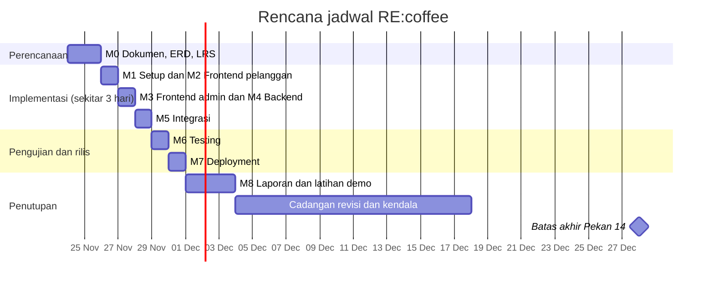

# 07. Estimasi pengerjaan dan jadwal

> Dokumen MPPL (M0). Sumber: PRD bagian 18 dan 21. Bagian 4 dan 5 membandingkan rencana dengan kenyataan per 22 Nov 2026.

## 1. Metode estimasi

- **Expert judgment berbasis WBS (bottom-up).** Tiap paket kerja di `02-ruang-lingkup-wbs.md` diperkirakan jamnya, lalu dijumlahkan
  per milestone.
- Proyek dikerjakan **individu** dengan bantuan AI coding assistant (Claude Code). Estimasi memperhitungkan hal itu: fase
  implementasi dipadatkan karena scope kecil, desain dan skema database sudah ditentukan sebelum coding, dan pekerjaan
  dibagi per milestone. Tanpa alat tersebut, fase implementasi diperkirakan 2 sampai 3 kali lebih lama.
- **Buffer 20%** untuk risiko, ditambahkan di atas total jam.

## 2. Estimasi jam

| Milestone | Aktivitas                                               | Estimasi (jam) | Peran yang dijalankan |
| --------- | ------------------------------------------------------- | -------------- | --------------------- |
| M0        | Dokumen perencanaan, use case, ERD, LRS                 | 6              | PM dan QA/Dokumentasi |
| M1        | Setup project dan design system                         | 2              | Developer             |
| M2        | Frontend pelanggan (termasuk login dan data diri, mock) | 4              | Developer             |
| M3        | Frontend admin                                          | 3              | Developer             |
| M4        | Backend Supabase                                        | 2              | Developer             |
| M5        | Integrasi (termasuk auth pelanggan)                     | 4              | Developer             |
| M6        | Testing (unit, RLS, black box, UAT)                     | 4              | QA/Dokumentasi        |
| M7        | Deployment dan QR meja                                  | 1              | Developer             |
| M8        | Laporan dan latihan demo                                | 8              | PM dan QA/Dokumentasi |
|           | **Total**                                               | **34**         |                       |
|           | **Dengan buffer 20%**                                   | **sekitar 41** |                       |

Pembagian per peran: Project Manager 8 jam, Developer 16 jam (M1 sampai M5 dan M7), QA dan Dokumentasi 10 jam. Angka ini
dipakai di `08-biaya.md`.

## 3. Jadwal rencana (Gantt)

Tanggal rencana awal. Batas akhir mengikuti kalender kampus (Pekan 14).

Strategi: selesaikan inti lebih awal dan sisakan waktu panjang untuk revisi dosen dan kendala tak terduga.

## 4. Realisasi

Jam kerja aktual tidak dicatat per milestone, jadi perbandingan memakai tanggal dari `docs/PROGRESS.md` dan riwayat commit.

| Milestone                                   | Rencana            | Realisasi                                                             | Catatan                                                      |
| ------------------------------------------- | ------------------ | --------------------------------------------------------------------- | ------------------------------------------------------------ |
| M1 Setup dan design system                  | 1 hari bersama M2  | 21 Nov 2026                                                           | Tugas deploy dipindah ke M7                                  |
| M2 Frontend pelanggan (mock)                | Lanjutan hari 1    | 21 Nov 2026                                                           |                                                              |
| M3 Frontend admin (mock)                    | Hari 2             | 21 Nov 2026                                                           |                                                              |
| Revisi tampilan (klien)                     | Tidak direncanakan | 21 Nov 2026                                                           | Pekerjaan tambahan                                           |
| M4 Backend Supabase                         | Hari 2             | 21 sampai 22 Nov 2026                                                 | Login Google admin berhasil 22 Nov                           |
| M5 Integrasi                                | Hari 3             | 21 sampai 22 Nov 2026                                                 | Uji dua akun lewat UI sebagian                               |
| Dasbor, animasi, landing, menu kafe (klien) | Tidak direncanakan | 22 Nov 2026                                                           | Pekerjaan tambahan, lihat `02-ruang-lingkup-wbs.md` bagian 5 |
| M6 Testing                                  | Hari 4             | 22 Nov 2026                                                           | UAT belum dijalankan                                         |
| M7 Deployment                               | Hari 5             | 22 Nov 2026                                                           | Cetak QR dan `qris.png` menunggu                             |
| M0 Dokumen MPPL                             | 24 sampai 25 Nov   | 22 Nov 2026 (ERD dan LRS lebih dulu, dokumen lain disusun setelah M7) | Urutan menyimpang dari rencana                               |
| M8 Laporan dan latihan demo                 | 3 hari             | Belum                                                                 |                                                              |

### Analisis deviasi

- **Implementasi lebih cepat dari rencana.** Rencana sekitar 3 hari kalender untuk M1 sampai M5, realisasi 21 sampai 22 Nov
  (2 hari kalender), termasuk pekerjaan tambahan dari klien. Penyebabnya: skema database dan spesifikasi halaman sudah ditulis
  di PRD sebelum coding, dan scope kecil.
- **Urutan menyimpang.** Rencana awal menyusun dokumen M0 sebelum coding. Realisasinya implementasi lebih dulu, dokumen
  menyusul. Dampaknya bagian 5 di `02-ruang-lingkup-wbs.md` bisa mencatat perubahan scope yang sebenarnya terjadi. Risikonya
  dokumen bisa terkesan ditulis belakangan, jadi setiap dokumen mencantumkan tanggal penyusunan.
- **Pekerjaan tambahan tidak diestimasi ulang.** Revisi klien (tampilan, landing, dasbor, menu kafe, animasi) tidak ada di
  estimasi awal. Dampaknya diserap oleh buffer 20% dan cadangan waktu 14 hari.
- **Pengujian menemukan 3 bug** (B-01, B-02, B-04) yang diperbaiki di hari yang sama, sehingga tidak menggeser M7.

## 5. Sisa pekerjaan

| Pekerjaan                                                              | Perkiraan | Bergantung pada                              |
| ---------------------------------------------------------------------- | --------- | -------------------------------------------- |
| Pasang `public/qris.png` dan cetak QR meja 1, 18, 27, lalu pindai satu | 1 jam     | Pelaksana menyiapkan gambar QRIS dan printer |
| Sesi UAT dengan 3 sampai 5 teman dan isi hasil di `11-uat.md`          | 2 jam     | Teman terdaftar sebagai Test user Google     |
| TC-10 dan TC-30 lewat UI (opsional, sudah lulus lewat SQL)             | 0,5 jam   | Dua atau tiga akun Google                    |
| M8 laporan akhir, skenario demo, latihan minimal sekali                | 8 jam     | Dokumen 01 sampai 11 (sudah ada)             |

Cadangan waktu dari akhir November sampai akhir Desember lebih dari empat minggu, jadi sisa pekerjaan tidak mengancam batas akhir.
